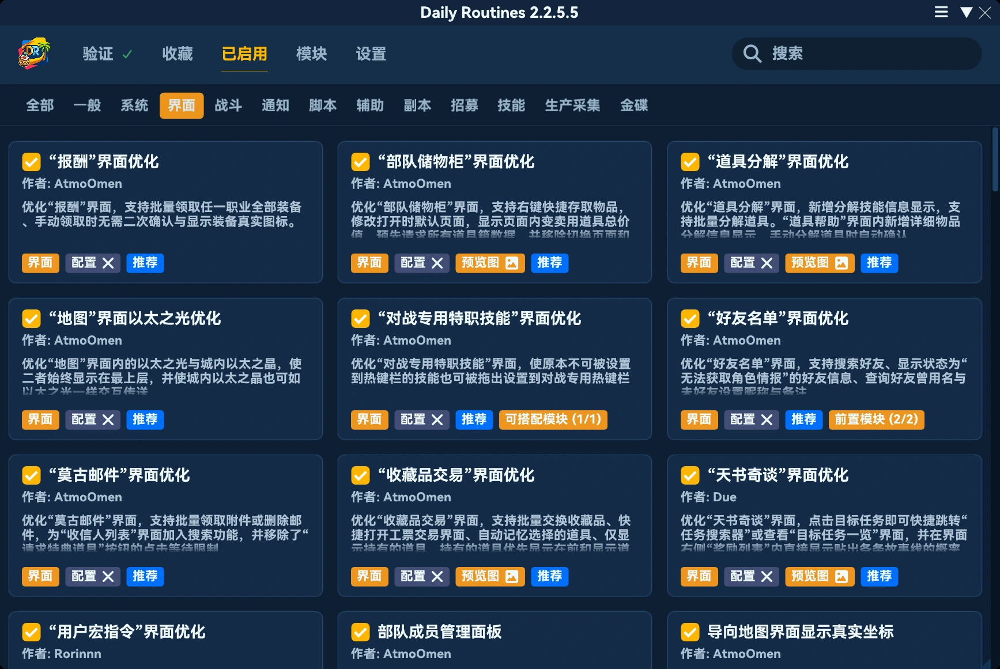
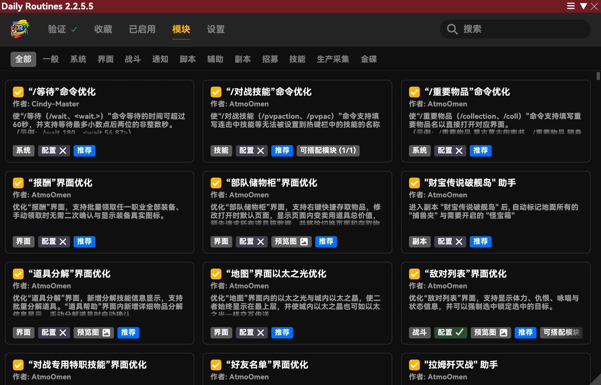
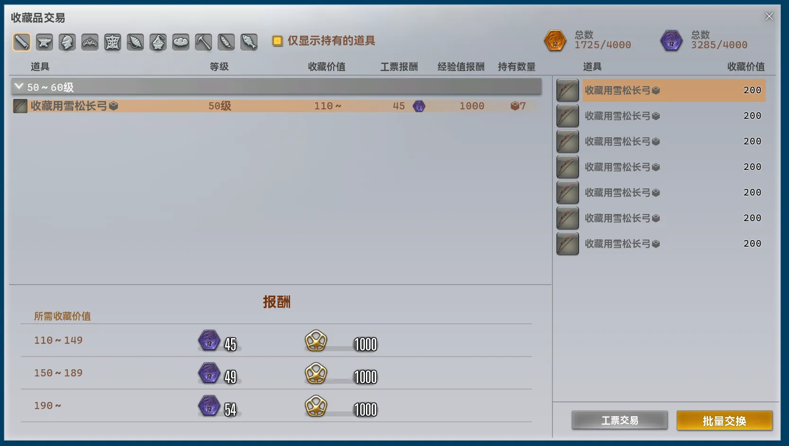
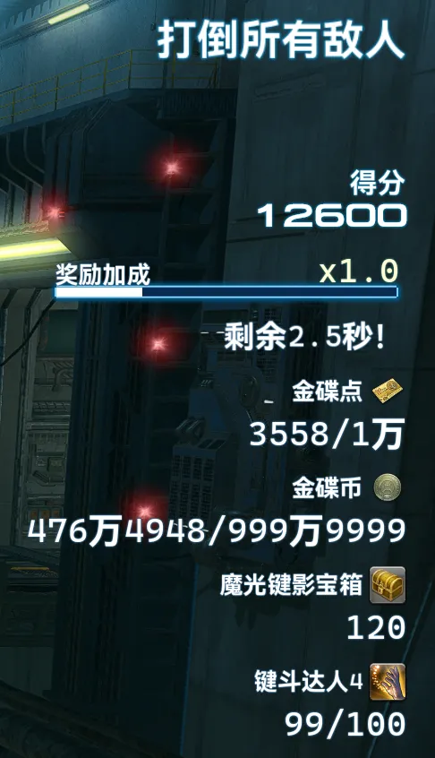

## Core Changes

- Fixed excessive IPC error messages when the plugin loaded before vnavmesh.
- Reduced the Universalis request concurrency limit from 30 to 10 to prevent bursts of simultaneous requests.
- Fixed various failures in associated services caused by Dalamud automatically canceling cancellation tokens.
- Added handling for AFK detection in Keybound Brawler to “Never AFK”.
- Significantly lowered the loading priority to improve compatibility.
- Completely redesigned the main window layout and styling, improving performance, information density, and focus. The layout now adapts automatically between one, two, and three columns.

- Fixed incorrect generation of encrypted authentication tokens for self-service verification when the local system clock was inaccurate.
- Completely reworked and greatly simplified the Tray Widget implementation. Its position must be adjusted again.
- Improved automatic navigation to the changelog when opening the main window after an update, preventing the main window and Tray Widget from briefly flashing onscreen.
- Opening the main window with `/pdr` no longer clears the search text.
- Moved “Tray Widget” from “General” to “Interface” in settings.
- Added “Dalamud Style” to the “Style” settings under “Interface”. Selecting it disables the plugin's built-in styling.
    ※ The plugin interface is developed and tested exclusively with its built-in styling. Some elements may look unusual or display incorrectly when using Dalamud styling. This is expected behavior; feedback and fix requests concerning these issues will not be accepted.

- Removed “MID”.
- Adjusted the appearance of the built-in `Tropical Sanctuary` style to improve readability.
- Fixed module reloading being interrupted, leaving all modules unable to load, if an online verification request was sent after the old module instances had been cleared but before the new instances had been created from their files.
- Added convenient travel routes.
    - Gold Saucer ↔ Keybound Square
    - Chocobo Square → Keybound Square
    - Gold Saucer ↔ Chocobo Square
- Fixed the shared cross-zone travel logic failing to use Aethernet shards in Gold Saucer areas.
- Completely rebuilt module search around a layered retrieval algorithm. This resolves minor typos preventing correct results, precise queries returning excessive results, and correct matches receiving a lower ranking, while greatly improving performance.
    - Contiguous phrases take priority, followed by compact phrase combinations in titles. Search no longer matches arbitrary words scattered across a long concatenation of module information.
    - Multiple keywords can match across titles, descriptions, and additional information. All keywords must match for a module to appear.
    - Links and information about associated modules are no longer indexed, reducing irrelevant results.
    - Pinyin search automatically splits input into reasonable Chinese syllables. A starting-character bitmap rejects input whose first character cannot start any candidate, while a consumable-stream subsequence check rejects impossible character orders, preventing confusion between pinyin and English searches.
    - Pinyin matches must now begin at a syllable boundary to reduce false matches.
    - Pinyin search now supports full pinyin, initials, combinations of full pinyin and initials, and combinations of full pinyin and Chinese characters.
    - Pinyin search supports tone marks and full-width letters.
    - Initial matching in pinyin searches now applies only to module titles, preventing excessive potentially irrelevant results.
    - Ranking considers the match quality of each word, whether the entire phrase matches, and the original text length. Original text and pinyin take priority over abbreviations, while short fragments split from internal module names receive significantly lower priority.
    - Added a lock-free snapshot cache holding 16 entries. Cache hits return the sorted result array directly for better performance.
    - Implemented multiple layers of lossless pruning. Each field has a 64-bit consumable-character bitmap, allowing candidates to be checked with a single union operation for better performance.
    - Implemented pruning based on upper bounds of ranking scores to improve performance.
    - Made pinyin dynamic programming sparse. A 64-bit active-state mask records reachable states so subsequent processing visits only reachable positions, and row cleanup touches only slots written in the previous round, improving performance.
    - Precomputed sort keys so sorting compares byte sequences directly, improving performance.
    - Switched match-result buffers to ArrayPool and sorting to a structured comparer with Span sorting, reducing allocations and improving performance.

## Removed Modules

### Auto Collectables Exchange [Addon]

Removed because all functionality has been integrated into the new `Better Collectables Exchange` module.

### Better Company Credits Exchange [Addon]

Removed because all functionality has been integrated into the new `Higher Purchase Cap At NPC Vendors` module.

## New Modules

### Higher Purchase Cap At NPC Vendors [Addon]

*Recommended module*

Raises the per-purchase item limit at various shops to 999 or 255.

### Better Collectables Exchange [Addon]

*Recommended module*

Enhances Collectables Exchange with batch turn-ins, quick access to Scrip Exchange, automatic retention of the selected item, an option to show only owned items, prioritization of owned items, and actual item icons.

### Auto Keybound Brawler [Gold Saucer]

Automatically types prompts to attack the nearest enemy upon entering Keybound Brawler, prioritizes strengthening barriers and interrupting casts, and pauses input when typing is prohibited.

### Party Scoreboard In Keybound Brawler [Gold Saucer]

*Recommended module*

Automatically reveals other players' hidden scores on the Keybound Brawler results screen.

### Auto Register For Keybound Brawler [Gold Saucer]

Once started, repeatedly registers for Keybound Brawler and automatically leaves after each run.

### Chat Log In Keybound Brawler [Gold Saucer]

Automatically displays the deliberately hidden Messages window in Keybound Brawler so you can review messages.

### Better Keybound Brawler Interface [Gold Saucer]

*Recommended module*

Enhances the Keybound Brawler information display with the exact remaining reward bonus duration, your MGC and MGP balances, the number of Keybound coffers you own, and progress toward related achievements.

## Module Changes

### Auto Max In Number Input [Addon]

- Updated the name and description.
- Removed the online verification requirement.
- Now a recommended module.
- Removed “Modify the store's single purchase limit”. This functionality has moved to the new `Higher Purchase Cap At NPC Vendors` module.
- Added `Higher Purchase Cap At NPC Vendors` as a complementary module.
- No longer supports the interrupt hotkey.
- Completely rebuilt the implementation at a lower level. Instead of forcing a fixed value every frame, the module now sets the maximum when the value is initialized or refreshed, providing a maximum default while still allowing manual changes.

### Actual Item Icon At Vendors [Addon]

- Removed handling for Collectables Exchange. Use `Better Collectables Exchange` for this functionality.
- Removed handling for the Reward window. Use `Better Reward Claim` for this functionality.
- Added `Better Collectables Exchange` and `Better Reward Claim` as complementary modules.

※ If a dedicated interface enhancement module is released for another window handled by this module, the corresponding functionality will also move to that module. This module will be removed once all supported windows are covered by dedicated modules.

### Better Reward Claim [Addon]

- Updated the description.
- Now supports actual equipment icons.

### Auto FATE [Script]

- Changed the rules for skipping FATEs based on level.
    - For FATEs at level 30 or below, skip when your level is at least 6 levels below the FATE's level.
    - For FATEs at levels 31–50, skip when your level is at least 3 levels below the FATE's level.
    - Otherwise, skip when your level is at least 8 levels below the FATE's level.

### Better Wait Command [System]

- Updated the title and description because the previous wording was ambiguous, unclear, and difficult to understand.

### Destination Above Dotted Line [General]

- Fixed destination labels not respecting the game's UI scaling settings.

### Faster In-Zone Loading [System]

- Completely rebuilt the implementation at a lower level, further reducing loading times.

### Status Manual Removal Notification [Combat]

- Updated the description.
- Updated notification text.
- Removed “Send Chat Message”, since chat messages are the only way to view recorded events. Messages are now always sent.
- Removed “Track Specified Status Only”. The module now always monitors only selected statuses.
- Optimized configuration UI rendering.

### Unrestricted Macro Icon [Addon]

- Completely rebuilt the implementation at a lower level.
- Fixed icons assigned with `/pdr micon` sometimes failing to appear immediately when opening User Macros.
- Assigning an icon with `/pdr micon` in a macro now takes effect immediately.

### Better World Visit [Addon]

- Improved UI performance.
- Fixed duplicate requests for World status.
- (Chinese servers only) Enabling or disabling DCTravelerX now updates the interface dynamically, without requiring the window to be reopened.
- Adjusted World buttons. Removed the red/green colors, which varied greatly between game color themes. Available Worlds now use normal text buttons, while unavailable Worlds appear disabled.
- Clicking an unavailable World now blocks the request and displays an error without closing the window.

### Ninja Flip For Everyone [General]

- Fixed the animation incorrectly applying to other players.
- Fixed the animation not being restored promptly when disabling the module.
- Fixed rendering issues affecting Lalafell.

### Better Aetheryte On Map [Addon]

- Traveling to an Aethernet shard now also closes the map, matching aetheryte teleport behavior.
- Completely rebuilt the implementation. Instead of adding extra icons, the module now intercepts map icon generation directly to produce fully controllable icons that match native behavior without overlapping.
- The module now also handles interactions with aetherytes on the map and displays the actual gil cost of the route generated by the plugin's shared cross-zone travel logic in real time.

### Better Market Board [Addon]

- Updated the description.
- Extensively revised interface text.
- Universalis queries triggered by Item Help now wait 400 milliseconds before being sent, preventing bursts of requests when quickly hovering over different items.
- Fixed requests still being sent to Universalis when a valid local cache was available.
- Item Help now explicitly displays failures when a Universalis request fails, instead of continuing to show a loading message.
- Unified Universalis market queries from the module interface and Item Help so they can share data and avoid duplicate requests.
- Continuing to hover over an item whose request failed now automatically retries after the backoff period.
- Cross-World prices, listing counts, sales history, and market trends now clearly distinguish between loading, failure, and no-data states.
- Fixed an initial failure to retrieve Worlds preventing World information from being obtained for the remainder of the current lifecycle.
- Opening the interface through the “Search In Market” context-menu entry now automatically selects the normal-quality or high-quality view according to the item's quality.

### Notorious Monster Seeker [Script]

- Fixed an extremely rare case where a disposed scanner could be reused.
- Scanning now temporarily sets “Character Display Range” to “Maximum” and restores the previous setting afterward.
- With automatic display-range adjustment in place, increased the scan range from 100 to 300 to cover locations faster.

### Better Friend List [Addon]

- Fixed an incorrect character-limit indicator in the friend search field.
- Widened the friend search field.

### Auto Adventurer In Need Notification [Recruitment]

- Updated the description.
- Completely rewrote notification content because the previous messages were unclear.
- Removed “Send Chat Message”, “Send Notification”, and “Send TTS”.
- Completely rebuilt the implementation using a lower-level, more comprehensive approach that remains stable across versions, also fixing numerous subtle and unusual logic issues.

### Auto Leave Duty [Duty]

- Added support for Keybound Brawler.

### Duty Leaving Command [Assistance]

- Added support for Keybound Brawler.

### Auto Duty Commence [Duty]

- Completely rebuilt the implementation at a lower level.
- Now skips secondary confirmation dialogs that do not affect duty entry.
- Now automatically retries confirmation when relevant conditions affecting duty entry change, rather than confirming only once.

### Better Party Finder Filter [Recruitment]

- Fixed some interface elements unexpectedly becoming right-aligned after interaction.

### Better Phantom Job Repertoire [Duty]

- Updated the description.
- Improved performance.
- Fixed action and trait names frequently overflowing the interface on non-Chinese clients.
- Automatically hides the game's native new-job notification node, preventing an undismissable notification when the original interface cannot be interacted with.

### Better Enmity List [Combat]

- Updated the description.
- Adjusted configuration UI rendering.
- Simplified resource cleanup.
- Added “Swap HP And Status”. Displays statuses on the left, expanding leftward, and HP on the right, expanding rightward. Disabled by default.
- Completely rebuilt status display nodes with a lower-level, maintainable implementation attached directly to the Enmity List, replacing the module's complex size and position transformation system.
- Status tooltips now use the game's native text-generation functions instead of manually assembled text, improving compatibility with other plugins and modules that modify these tooltips and reducing maintenance across versions.

### Unified Glamour Manager [Addon]

- Updated the description.
- Reworked glamour dresser and armoire inventory reading to use the current character's native game cache. Glamour dresser items and outfit component unlock information are restored automatically from game records after logging in again or restarting the game. The module no longer maintains its own saved cache.
- Equipment lists now refresh automatically when enabling the module, logging in, or opening or refreshing the glamour dresser or armoire, synchronizing loaded caches through native game logic.
- Fixed missing equipment and misaligned caches caused by mixing the armoire's two sets of loading states and incorrectly indexing the expanded inventory bitmap.
- Improved reading and preservation of glamour dresser dye information. Applying glamours now reads the latest dye information and updates the cache accordingly.
- Improved outfit component unlock checks. Restoring the glamour dresser cache now also reads saved component unlock information, and component availability is checked again before applying glamours.
- Improved refreshing by combining requests made close together and avoiding a shared queue for refresh tasks and template application. Existing lists are retained if reading fails or data is temporarily unavailable.
- Improved character switching and delayed operations to prevent reusing another character's data or applying delayed glamours to a different slot after the selected slot changes.
- Optimized equipment merging, selection matching, and outfit parsing to reduce repeated reads and temporary allocations.

### Better Teleportation [Addon]

- Updated the description.
- All convenient travel routes are now automatically registered as teleport destinations for easier access. This adds approximately 70 destinations in this version, including:
    - The Waking Sands
    - The Rising Stones
    - Keybound Square
    - Lower Jeuno
    - North Horn
    - South Horn
- Teleport costs now reflect the actual route generated by the plugin's shared cross-zone travel logic.
    ※ Example: A direct teleport costs 1,300 gil, but the actual route uses zone boundaries and NPCs throughout and costs only 150 gil. Previously, the displayed cost was 1,300 gil; it is now 150 gil.
- Completely rebuilt the underlying teleport cost algorithm, replacing grid enumeration with unidirectional Dijkstra, combining calculations for all destinations into a single pass, and moving the task off the game's main thread to greatly improve performance.

### Fast Object Interaction [Addon]

- Fixed Aethernet shards not displaying correctly in Gold Saucer areas.

### Custom Map Mark [Addon]

- Updated the description.
- Fixed incorrect center alignment in the interface.
