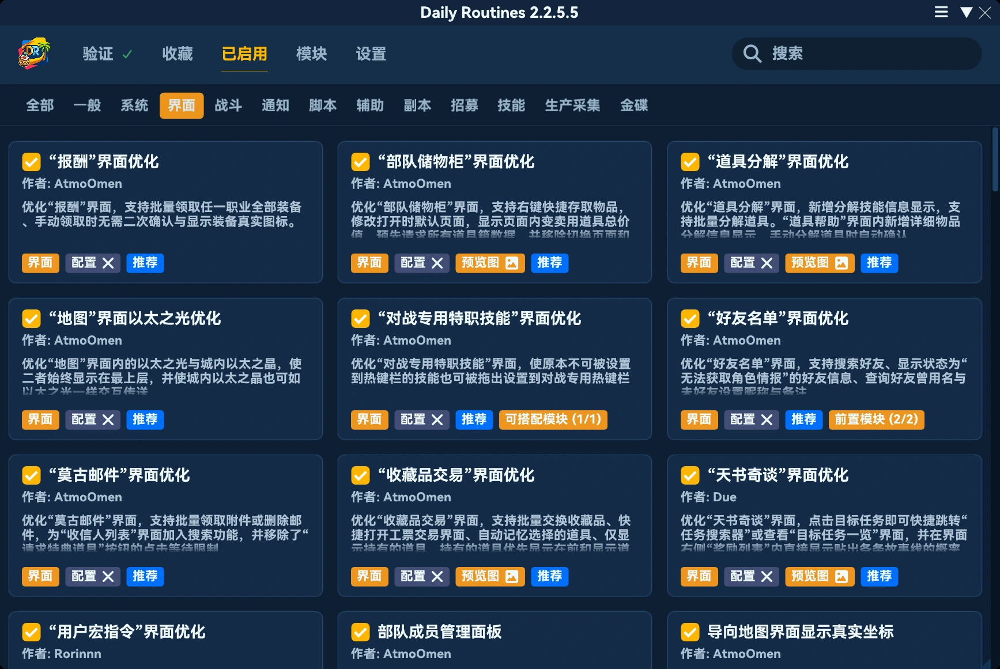
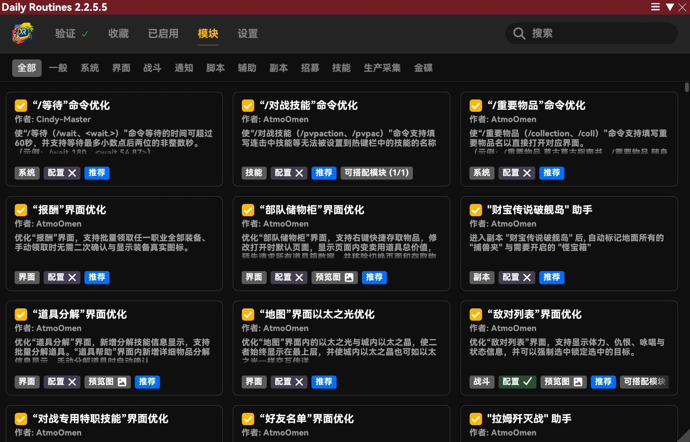
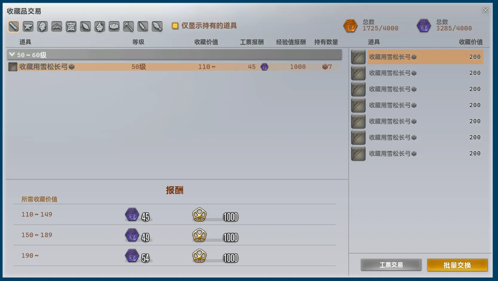
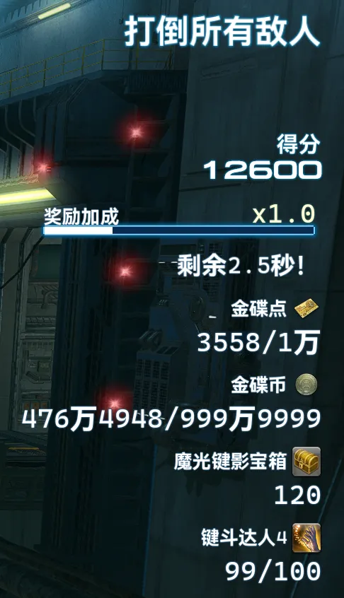

## 本体の変更

- プラグインが vnavmesh より先に読み込まれた場合、大量の IPC 呼び出しエラーが出力される問題を修正しました。
- 短時間に大量のリクエストが集中することを防ぐため、Universalis の同時リクエスト数の上限を 30 から 10 に変更しました。
- Dalamud がキャンセルトークンを自動的にキャンセルすると、関連サービスでさまざまな不具合が発生する問題を修正しました。
- 設定項目「離席状態防止」に、キーバウンド・ブロウラー内での離席判定への対応を追加しました。
- 互換性を向上させるため、読み込み優先度を大幅に下げました。
- メイン画面のレイアウトとスタイルを全面的に刷新しました。パフォーマンスと情報密度を向上させ、内容をより見やすく整理しました。1 列・2 列・3 列のレイアウトに自動で切り替わります。

- PC の時刻設定が正確でない場合、セルフサービス認証用の暗号化認証トークンが正しく生成されない問題を修正しました。
- トレーオーバレイの実装を全面的に刷新し、大幅に簡素化しました。トレーオーバレイの位置を再調整する必要があります。
- バージョン更新後にメイン画面を開くと更新履歴へ自動で移動する処理を改善し、メイン画面やトレーオーバレイが一瞬表示される現象を解消しました。
- `/pdr` コマンドでメイン画面を開いても、検索内容が消去されなくなりました。
- 設定項目「トレーオーバレイ」を「全般」から「インターフェイス」へ移動しました。
- 「インターフェイス」の「スタイル」に「* Dalamud スタイルを使用」を追加しました。選択すると、プラグイン内蔵のスタイルを使用しなくなります。
    ※ プラグインの UI は内蔵スタイルのみを前提に開発・テストしています。Dalamud スタイルを選択すると、一部の要素が不自然に表示されたり、表示が崩れたりする場合があります。これは想定された動作であり、これに関する報告や修正依頼は受け付けません。

- 「マシン認証情報」を削除しました。
- 内蔵スタイル `Tropical Sanctuary` の外観を調整し、読みやすさを向上させました。
- 古いモジュールのインスタンスを破棄してから、新しいインスタンスをファイルから生成するまでの間にオンライン認証リクエストが送信されると、モジュールの再読み込みが中断され、すべてのモジュールを読み込めなくなる問題を修正しました。
- 便利な移動経路を追加しました。
    - ゴールドソーサー ↔ キーバウンドスクウェア
    - チョコボスクウェア → キーバウンドスクウェア
    - ゴールドソーサー ↔ チョコボスクウェア
- 共通のエリア間移動処理が、ゴールドソーサー関連エリアで都市内エーテライトを使用しない問題を修正しました。
- モジュール検索を全面的に刷新し、階層型の検索アルゴリズムを中心とする仕組みに変更しました。わずかな誤入力で正しい結果が見つからない、正確に入力しても大量の結果が返る、正しい結果の表示順位が低くなるといった問題を解消し、パフォーマンスも大幅に向上させました。
    - 連続した語句の一致を優先し、次にタイトル内のまとまった語句の組み合わせを評価します。モジュール情報を連結した長文中の任意の文字や単語に、無差別に一致しなくなりました。
    - 複数のキーワードをタイトル・説明・追加情報に分けて照合できるようになりました。すべてのキーワードに一致する必要があります。
    - 無関係な結果を減らすため、各種リンクや関連モジュールの情報を検索インデックスから除外しました。
    - ピンイン検索では、入力を適切な漢字の音節に自動分割します。先頭文字のビットマップで候補の開始文字になり得ない入力を除外し、消費可能な文字ストリームの部分列判定で文字順が成立しない入力を除外することで、ピンイン検索と英語検索の混同を防ぎます。
    - 誤一致を減らすため、ピンイン検索は音節の先頭から一致する必要があります。
    - ピンイン検索で、完全な綴り、頭文字、完全な綴りと頭文字の組み合わせ、完全な綴りと漢字の組み合わせに対応しました。
    - ピンイン検索で、声調記号付きの入力と全角英字の入力に対応しました。
    - ピンイン検索の頭文字照合はモジュールタイトルのみに限定し、無関係な結果が大量に表示されることを防ぎます。
    - 各単語の一致精度、語句全体の一致、元のテキストの長さを総合的に評価して並べ替えます。原文とピンインを略称より優先し、モジュール内部名から分割された短い語句の優先度を大幅に下げました。
    - 16 件を保持するロックフリーのスナップショットキャッシュを導入しました。キャッシュに一致すると、並べ替え済みの結果配列を直接返して処理を高速化します。
    - 検索結果を損なわない多段階の枝刈りを実装しました。各フィールドに消費可能文字の 64 ビットマップを構築し、1 回の和集合演算で検索候補を判定して処理を高速化します。
    - 並べ替えスコアの上限を用いた枝刈りを実装し、パフォーマンスを向上させました。
    - ピンインの動的計画法を疎な状態管理に変更しました。到達可能な状態を 64 ビットのアクティブマスクで記録し、その後は到達可能な位置のみを処理します。各行の初期化も前回書き込んだスロットだけに限定し、処理を高速化しました。
    - ソートキーを事前計算し、並べ替え時はバイト列を直接比較することで処理を高速化しました。
    - 一致結果のバッファを ArrayPool に変更し、構造体の比較器と Span によるソートを採用することで、メモリ割り当てとパフォーマンスを改善しました。

## 削除されたモジュール

### 収集品納品自動化 [インターフェイス]

すべての機能を新モジュール `「収集品取引」UIの最適化` に統合したため、削除しました。

### 軍票交換数の上限突破 [インターフェイス]

すべての機能を新モジュール `ショップの1回あたりの購入上限引き上げ` に統合したため、削除しました。

## 新規モジュール

### ショップの1回あたりの購入上限引き上げ [インターフェイス]

*推奨モジュール*

各種ショップでのアイテムの 1 回あたりの購入上限を 999 または 255 に引き上げます。

### 「収集品取引」UIの最適化 [インターフェイス]

*推奨モジュール*

収集品取引画面を改善します。収集品の一括納品、スクリップの取引画面へのクイックアクセス、選択アイテムの自動記憶、所持アイテムのみの表示、所持アイテムの優先表示、実際のアイテムアイコンの表示に対応します。

### 「キーバウンドブロウラー」自動周回 [ゴールドソーサー]

キーバウンド・ブロウラーに入場すると、最も近い敵を攻撃するためにお題を自動入力します。バリア強化と詠唱中断を優先し、入力禁止の判定中は入力を停止します。

### 「キーバウンドブロウラー」スコアの表示 [ゴールドソーサー]

*推奨モジュール*

キーバウンド・ブロウラーのリザルトで、通常は隠されている他のプレイヤーのスコアを自動表示します。

### 「キーバウンドブロウラー」への自動参加申請 [ゴールドソーサー]

開始するとキーバウンド・ブロウラーへの参加申請を自動で繰り返し、終了時に自動退出します。

### * キーバウンド・ブロウラーでメッセージ画面を自動表示 [ゴールドソーサー]

キーバウンド・ブロウラーで意図的に非表示にされているメッセージ画面を自動表示し、各種メッセージを確認できるようにします。

### * キーバウンド・ブロウラー情報画面の改善 [ゴールドソーサー]

*推奨モジュール*

キーバウンド・ブロウラーの情報画面を改善します。報酬ボーナスの正確な残り時間、マンダヴィル・ゴールドソーサークレジットと MGP の所持数、キーバウンド・ブロウラーの宝箱の所持数、関連アチーブメントの進捗を表示します。

## モジュールの変更

### 自動で数字入力フィールドを最大値に設定する [インターフェイス]

- 名前と説明を調整しました。
- オンライン認証を不要にしました。
- 推奨モジュールになりました。
- 設定項目「ショップの一括購入数上限を変更する」を削除しました。機能は新モジュール `ショップの1回あたりの購入上限引き上げ` へ移動しました。
- 併用可能なモジュールとして `ショップの1回あたりの購入上限引き上げ` を追加しました。
- 中断ホットキーへの対応を終了しました。
- 実装を全面的に刷新し、より低レベルの処理に変更しました。毎フレーム固定値へ強制変更する方式を廃止し、値の初期化時や更新時に最大値を設定します。初期値を最大にしつつ、手動での数値変更も可能になりました。

### ショップでアイテムアイコンを表示 [インターフェイス]

- 収集品取引画面への処理を削除しました。必要な場合は `「収集品取引」UIの最適化` を使用してください。
- 報酬画面への処理を削除しました。必要な場合は `「報酬」UIの改善` を使用してください。
- 併用可能なモジュールとして `「収集品取引」UIの最適化` と `「報酬」UIの改善` を追加しました。

※ 今後、本モジュールが対応する画面に専用の UI 改善モジュールが追加された場合、その画面の処理も該当モジュールへ移動します。すべての画面が専用モジュールで対応されるようになった時点で、本モジュールを削除します。

### 「報酬」UIの改善 [インターフェイス]

- 説明を調整しました。
- 装備の実際のアイコンを表示できるようになりました。

### 自動F.A.T.E. [スクリプト]

- レベルによる F.A.T.E. の除外条件を変更しました。
    - レベル 30 以下の F.A.T.E. は、自分のレベルが対象より 6 レベル以上低い場合に除外します。
    - レベル 31～50 の F.A.T.E. は、自分のレベルが対象より 3 レベル以上低い場合に除外します。
    - それ以外は、自分のレベルが対象より 8 レベル以上低い場合に除外します。

### 「/wait」コマンドの最適化 [システム]

- 以前のタイトルと説明は意味や対象が曖昧でわかりにくかったため、変更しました。

### エリア境界線に移動先を表示する [全般]

- 移動先の表示がゲームの UI スケール設定に従わない問題を修正しました。

### エリア内のマップ遷移ロードを高速化する [システム]

- 実装を全面的に刷新し、より低レベルの処理を採用することで、読み込みをさらに高速化しました。

### 状態効果の終了を自動で記録 [戦闘]

- 説明を調整しました。
- 通知内容を調整しました。
- 記録内容を確認する手段がチャットメッセージのみであるため、設定項目「チャットメッセージを送信」を削除しました。常に送信するようになりました。
- 設定項目「指定した状態効果のみを監視」を削除しました。常に選択した状態効果のみを監視します。
- 設定画面の描画処理を最適化しました。

### マクロアイコンの自由指定 [インターフェイス]

- 実装を全面的に刷新し、より低レベルの処理に変更しました。
- マクロ画面を開いた際、`/pdr micon` で指定したアイコンがすぐに表示されない場合がある問題を修正しました。
- マクロ内で `/pdr micon` を使用してアイコンを指定すると、即座に反映されるようになりました。

### クイック・ワールド間テレポ [インターフェイス]

- UI のパフォーマンスを最適化しました。
- ワールドの状態を重複して取得する問題を修正しました。
- 中国サーバーのみ：DCTravelerX の有効・無効を切り替えると、UI が即座に更新されるようになりました。更新のために画面を開き直す必要がなくなりました。
- ワールドボタンの外観を調整しました。ゲームのカラーテーマによって見え方が大きく変わる赤・緑の配色を廃止し、移動可能なワールドは通常のテキストボタン、移動できないワールドは無効状態で表示します。
- 移動できないワールドをクリックした場合、リクエストを遮断してエラーメッセージを表示し、画面を閉じなくなりました。

### 全ジョブ忍者のジャンプモーション [全般]

- 他のプレイヤーに誤って適用される問題を修正しました。
- モジュールを無効にした際、モーションが速やかに元へ戻らない問題を修正しました。
- ララフェルの描画異常を修正しました。

### 「マップ」ウィンドウのエーテライト表示拡張 [インターフェイス]

- 都市内エーテライトへの移動開始時もマップ画面を閉じるようにし、エーテライトへのテレポと同じ動作に統一しました。
- 実装を全面的に刷新しました。アイコンを追加する方式から、マップアイコンの生成処理を直接制御する方式に変更しました。標準と同じ動作を保ちつつ、完全に制御可能で重複しないアイコンを生成します。
- マップ上のエーテライトへの操作もモジュールが処理するようになりました。共通のエリア間移動処理が生成した実際の経路に必要なギルを、リアルタイムで表示します。

### どこでもマーケットボード [インターフェイス]

- 説明を調整しました。
- UI のテキストを大幅に調整しました。
- アイテム詳細からの Universalis 検索に 400 ミリ秒の遅延を設けました。短時間にカーソルを別のアイテムへ移動した際、大量のリクエストが送信されることを防ぎます。
- 有効なローカルキャッシュがある場合も Universalis へリクエストする問題を修正しました。
- Universalis へのリクエスト失敗時、アイテム詳細に失敗内容を明示するようになりました。取得中の表示が続くことはなくなりました。
- モジュール画面とアイテム詳細からの Universalis 検索を統合しました。データを相互に再利用し、重複したリクエストを防ぎます。
- リクエストに失敗したアイテムにカーソルを合わせ続けると、バックオフ時間の経過後に自動で再試行します。
- ワールド間価格、出品数、取引履歴、価格推移で、読み込み中・失敗・データなしを明確に区別するようになりました。
- ワールド情報の初回取得に失敗すると、以後そのライフサイクル中は取得できなくなる問題を修正しました。
- コンテキストメニューの「相場を確認する」から画面を開くと、対象アイテムの品質に応じて NQ・HQ 表示を自動で切り替えるようになりました。

### リスキーモブを自動スキャン [スクリプト]

- ごくまれに破棄済みのスキャナーを再利用する可能性がある問題を修正しました。
- スキャン中はゲーム設定「キャラクターの表示範囲」を「最大」に固定し、終了後に元へ戻すようになりました。
- 表示範囲の自動調整に伴い、スキャン範囲を 100 から 300 に拡大し、各地点をより速く巡回できるようになりました。

### 「フレンドリスト」UIの改善 [インターフェイス]

- フレンド検索欄に誤った文字数制限が表示される問題を修正しました。
- フレンド検索欄を広げました。

### コンテンツルーレットの不足ロールボーナスを自動通知 [募集]

- 説明を調整しました。
- 以前の通知内容がわかりにくかったため、全面的に刷新しました。
- 設定項目「チャットメッセージを送信」「通知を送信」「TTSを送信」を削除しました。
- より低レベルで、バージョン変更に強く、幅広く対応できる実装へ全面的に刷新しました。あわせて、多数の潜在的で不自然な動作を引き起こす問題を修正しました。

### コンテンツから自動退出する [コンテンツ]

- キーバウンド・ブロウラーに対応しました。

### コンテンツ退出コマンド [拡張コマンド]

- キーバウンド・ブロウラーに対応しました。

### 自動シャキ確認 [コンテンツ]

- 実装を全面的に刷新し、より低レベルの処理に変更しました。
- コンテンツへの入場に影響しない各種の追加確認画面をスキップするようになりました。
- 入場可否に関わる状態が変化した際、自動で参加確認を再試行するようになりました。初回のみ確認する動作を変更しました。

### パーティ募集フィルター画面の改善 [募集]

- 操作後、一部の UI 要素が意図せず右揃えになる問題を修正しました。

### サポートジョブリストの改善 [コンテンツ]

- 説明を調整しました。
- パフォーマンスを最適化しました。
- 中国語以外のクライアントで、アクション名や特性名が画面からはみ出しやすい問題を修正しました。
- ゲーム標準の新ジョブ通知ノードを自動で非表示にします。元の UI を操作できず、通知を消せなくなることを防ぎます。

### 「敵対リスト」UIの改善 [戦闘]

- 説明を調整しました。
- 設定画面の描画処理を調整しました。
- リソースの解放処理を簡素化しました。
- 設定項目「* HP と状態効果の表示位置を入れ替える」を追加しました。状態効果を左側に表示して左へ展開し、HP を右側に表示して右へ展開します。初期設定では無効です。
- 状態効果の表示ノードを全面的に刷新しました。敵対リストに直接付属する、より低レベルで保守しやすい実装に変更し、複雑なサイズ・位置変換システムを独自に管理する必要をなくしました。
- 状態効果のツールチップは、テキストを独自に組み立てず、ゲーム標準のテキスト生成関数を直接使用するようになりました。この部分を変更する他のプラグインやモジュールとの互換性を高め、バージョン変更に伴う保守負担を軽減しました。

### ミラプリ一括管理 [インターフェイス]

- 説明を調整しました。
- ミラージュドレッサーと愛蔵品キャビネットの所持品取得処理を刷新し、現在のキャラクターのゲーム標準キャッシュを使用するようにしました。再ログインやゲーム再起動後も、ドレッサー内のアイテムとセット装備の各部位の解放情報をゲームの記録から自動復元します。モジュール独自の保存キャッシュは使用しなくなりました。
- モジュールの有効化、ログイン、ドレッサーやキャビネット画面の表示・更新時に装備一覧を自動更新し、ゲーム標準の処理を通じて読み込み済みのキャッシュを同期するようになりました。
- キャビネットの 2 組の読み込み状態の混用と、拡張所持品ビットマップの誤ったインデックス参照によって、装備の欠落やキャッシュのずれが発生する問題を修正しました。
- ドレッサー内の染色情報の取得・保持処理を改善しました。投影時に最新の染色情報を取得し、キャッシュにも反映します。
- セット装備の各部位の解放判定を改善しました。ドレッサーのキャッシュ復元時に保存済みの解放情報も取得し、投影前に各部位が利用可能か再確認します。
- 更新処理を最適化しました。短時間の重複リクエストをまとめ、更新タスクとテンプレート適用でキューを共有しないようにしました。取得失敗時や一時的に取得できない場合は、既存の一覧を保持します。
- キャラクター切り替えと遅延操作への対応を改善しました。別キャラクターのデータを引き継ぐことや、遅延実行する投影が切り替え後の別部位へ適用されることを防ぎます。
- 装備の統合、選択項目の照合、セット装備の解析を最適化し、重複読み込みと一時的なメモリ割り当てを削減しました。

### テレポUI最適化 [インターフェイス]

- 説明を調整しました。
- 各種操作で利用しやすいように、便利な移動経路をすべてテレポ可能な目的地として自動登録するようになりました。今回のバージョンでは約 70 か所を追加しました。主な目的地は以下のとおりです。
    - 砂の家
    - 石の家
    - キーバウンドスクウェア
    - ジュノ下層
    - 三日月島北部
    - 三日月島南部
- テレポ料金を、共通のエリア間移動処理が生成した実際の経路に基づいて計算するようになりました。
    ※ 例：直接テレポすると 1,300 ギルかかる目的地でも、実際の経路がエリア境界や NPC を経由し、150 ギルで移動できる場合、以前は 1,300 ギルと表示していましたが、更新後は 150 ギルと表示します。
- テレポ料金の基礎アルゴリズムを全面的に刷新しました。グリッド列挙から単方向の Dijkstra 法に変更し、すべての目的地の計算を 1 回にまとめ、ゲームのメインスレッド外で実行することで、計算時のパフォーマンスを大幅に向上させました。

### 周囲のオブジェクトを素早く調べる [インターフェイス]

- ゴールドソーサー関連エリアで都市内エーテライトが正しく表示されない問題を修正しました。

### カスタムマップマーカー [インターフェイス]

- 説明を調整しました。
- UI の中央揃えが正しく表示されない問題を修正しました。
