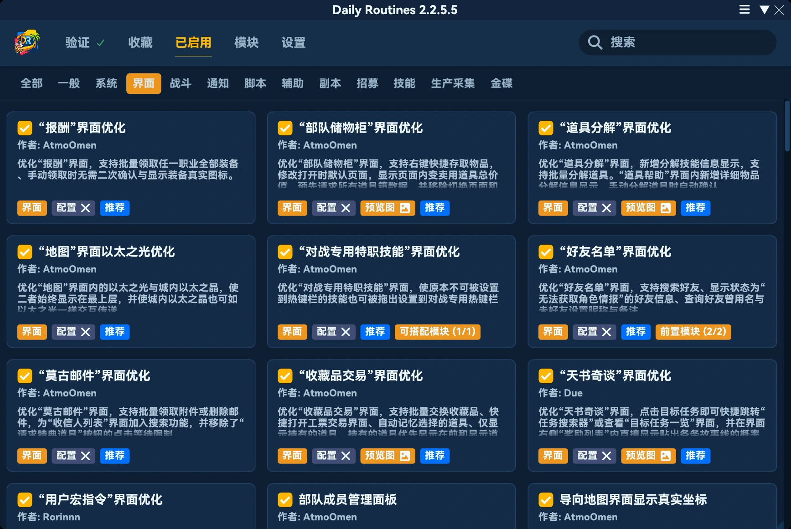
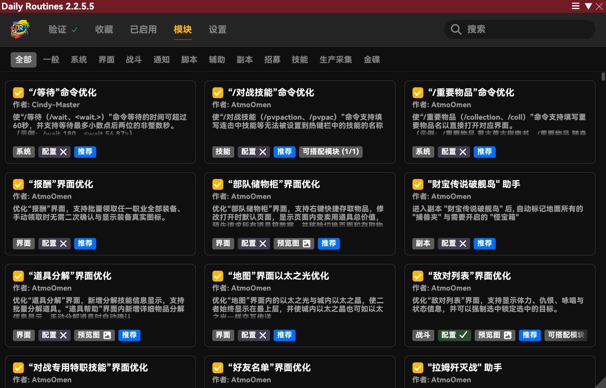
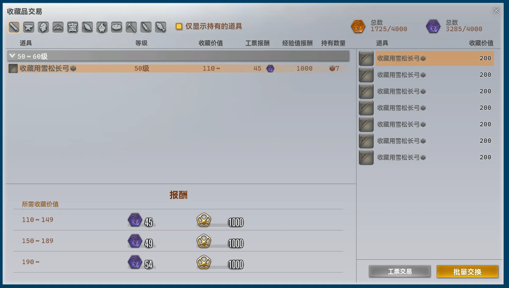
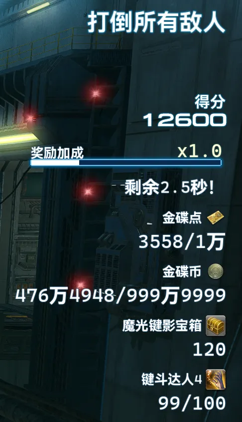

## 본체 변경 사항

- 플러그인이 vnavmesh보다 먼저 로드되면 IPC 호출 오류가 대량으로 출력되는 문제를 수정했습니다.
- 짧은 시간에 요청이 집중되는 것을 방지하기 위해 Universalis 동시 요청 한도를 30에서 10으로 조정했습니다.
- Dalamud가 취소 토큰을 자동으로 취소하면서 연결된 서비스에 여러 가지 오류가 발생하는 문제를 수정했습니다.
- '자리 비움 상태 방지' 설정에 마법자판 난타전의 자리 비움 판정 처리를 추가했습니다.
- 호환성을 높이기 위해 로드 우선순위를 크게 낮췄습니다.
- 메인 창의 배치와 스타일을 전면 개편했습니다. 성능과 정보 밀도를 높이고 내용을 더 집중해서 볼 수 있도록 개선했으며, 창 크기에 따라 1열·2열·3열 배치로 자동 전환됩니다.

- PC의 시간 설정이 정확하지 않으면 셀프서비스 인증에 사용하는 암호화 인증 토큰이 잘못 생성되는 문제를 수정했습니다.
- 트레이 오버레이의 구현을 전면 개편하고 크게 단순화했습니다. 트레이 오버레이의 위치를 다시 조정해야 합니다.
- 버전 업데이트 후 메인 창을 열면 업데이트 내역으로 자동 이동하는 처리를 개선하여, 메인 창과 트레이 오버레이가 잠깐 나타났다 사라지는 현상을 해결했습니다.
- 이제 `/pdr` 명령어로 메인 창을 열어도 검색 내용이 지워지지 않습니다.
- '트레이 오버레이' 설정을 '일반'에서 '인터페이스'로 이동했습니다.
- '인터페이스'의 '스타일'에 '* Dalamud 스타일 사용'을 추가했습니다. 선택하면 플러그인 내장 스타일을 사용하지 않습니다.
    ※ 플러그인 UI의 개발과 테스트는 전적으로 내장 스타일을 기준으로 진행합니다. Dalamud 스타일을 사용하면 일부 요소가 어색하거나 비정상적으로 표시될 수 있습니다. 이는 예상된 동작이며, 관련 제보나 수정 요청은 받지 않습니다.

- 'PC 식별 인증서'를 삭제했습니다.
- 내장 스타일 `Tropical Sanctuary`의 외형을 조정하여 가독성을 높였습니다.
- 기존 모듈 인스턴스를 정리한 뒤 새 인스턴스를 파일에서 생성하기 전에 온라인 인증 요청이 전송되면, 모듈 다시 불러오기가 중단되어 모든 모듈을 불러올 수 없게 되는 문제를 수정했습니다.
- 편리한 이동 경로를 추가했습니다.
    - 골드 소서 ↔ 마법자판 광장
    - 초코보 광장 → 마법자판 광장
    - 골드 소서 ↔ 초코보 광장
- 공통 지역 간 이동 처리가 골드 소서 관련 지역에서 도시 내 에테라이트를 사용하지 않는 문제를 수정했습니다.
- 모듈 검색을 계층형 검색 알고리즘 중심으로 전면 개편했습니다. 사소한 오타 때문에 올바른 결과가 나오지 않거나, 정확히 입력해도 결과가 너무 많이 나오거나, 올바른 결과가 뒤로 밀리는 문제를 해결하고 성능을 크게 높였습니다.
    - 연속된 구절의 일치를 우선하고, 다음으로 제목에 밀집된 구절 조합을 평가합니다. 모듈 정보를 길게 이어 붙인 텍스트에서 임의의 글자나 단어를 무분별하게 일치시키지 않습니다.
    - 여러 검색어가 제목, 설명, 추가 정보에 나뉘어 있어도 검색할 수 있습니다. 모든 검색어가 일치해야 합니다.
    - 관련 없는 결과를 줄이기 위해 각종 링크와 연관 모듈 정보를 검색 색인에서 제외했습니다.
    - 병음 검색은 입력을 적절한 한자 음절로 자동 분리합니다. 시작 문자 비트맵으로 첫 문자가 어떤 후보의 시작점도 될 수 없는 입력을 제외하고, 소비 가능한 문자 스트림의 부분 수열 검사로 문자 순서가 성립할 수 없는 입력을 제외하여 병음 검색과 영어 검색의 혼동을 방지합니다.
    - 잘못된 일치를 줄이기 위해 병음 검색은 이제 음절의 시작점부터 일치해야 합니다.
    - 병음 전체 표기, 첫 글자, 전체 표기와 첫 글자의 조합, 전체 표기와 한자의 조합을 지원합니다.
    - 성조 기호가 있는 병음과 전각 영문자 입력을 지원합니다.
    - 병음 검색의 첫 글자 일치는 모듈 제목에만 적용하여 관련 없을 수 있는 결과가 과도하게 늘어나는 것을 방지합니다.
    - 각 단어의 일치 품질, 구절 전체의 일치 여부, 원문 길이를 종합하여 정렬합니다. 원문과 병음을 약어보다 우선하고, 모듈 내부 이름에서 분리된 짧은 구절의 우선순위를 크게 낮췄습니다.
    - 16개 항목을 보관하는 잠금 없는 스냅샷 캐시를 도입했습니다. 캐시가 적중하면 정렬된 결과 배열을 바로 반환하여 성능을 높입니다.
    - 검색 결과를 누락하지 않는 다단계 가지치기를 구현했습니다. 각 필드에 소비 가능한 문자의 64비트 비트맵을 구성하고, 한 번의 합집합 연산으로 검색 후보를 검사하여 성능을 높입니다.
    - 정렬 점수의 상한을 이용한 가지치기를 구현하여 성능을 높였습니다.
    - 병음 동적 계획법을 희소 상태 처리 방식으로 변경했습니다. 64비트 활성 마스크로 도달 가능한 상태를 기록하고 이후에는 도달 가능한 위치만 순회합니다. 행 정리도 이전 단계에서 기록한 슬롯만 처리하여 성능을 높였습니다.
    - 정렬 키를 미리 계산하고 정렬 시 바이트열을 직접 비교하여 성능을 높였습니다.
    - 검색 결과 버퍼를 ArrayPool로 변경하고 구조체 비교자와 Span 정렬을 사용하여 메모리 할당과 성능을 개선했습니다.

## 삭제된 모듈

### 소장품 자동 납품 [인터페이스]

모든 기능이 새 모듈 `"소장품 거래" UI 최적화`에 통합되어 삭제했습니다.

### 더 높은 군표 교환 제한 상한 [인터페이스]

모든 기능이 새 모듈 `1회 구매 한도 자동 상향`에 통합되어 삭제했습니다.

## 신규 모듈

### 1회 구매 한도 자동 상향 [인터페이스]

*추천 모듈*

각종 상점에서 아이템의 1회 구매 한도를 999 또는 255로 높입니다.

### "소장품 거래" UI 최적화 [인터페이스]

*추천 모듈*

소장품 거래 창을 개선합니다. 소장품 일괄 납품, 화폐 거래 창 빠르게 열기, 선택한 아이템 자동 기억, 보유 아이템만 표시, 보유 아이템 우선 표시, 실제 아이템 아이콘 표시를 지원합니다.

### 마법자판 난타전 자동 플레이 [골드 소서]

마법자판 난타전에 입장하면 제시어를 자동으로 입력하여 가장 가까운 적을 공격합니다. 방어막 강화와 시전 중단을 우선하고, 입력 금지 판정 중에는 입력을 멈춥니다.

### 마법자판 난타전 점수 표시 [골드 소서]

*추천 모듈*

마법자판 난타전 결과 화면에서 가려져 있던 다른 플레이어의 점수를 자동으로 표시합니다.

### 마법자판 난타전 자동 신청  [골드 소서]

시작하면 마법자판 난타전 참가 신청을 자동으로 반복하고, 완료 시 자동으로 퇴장합니다.

### * 마법자판 난타전 메시지 창 자동 표시 [골드 소서]

마법자판 난타전에서 의도적으로 숨겨진 메시지 창을 자동으로 표시하여 각종 메시지를 확인할 수 있게 합니다.

### * 마법자판 난타전 정보 UI 개선 [골드 소서]

*추천 모듈*

마법자판 난타전 정보 창을 개선합니다. 보상 보너스의 정확한 남은 시간, 맨더빌 골드 소서 화폐와 MGP 보유량, 마법자판 난타전 보물상자 보유 수, 관련 업적 진행도를 표시합니다.

## 모듈 변경 사항

### 자동 숫자 입력 최대값 설정 [인터페이스]

- 이름과 설명을 조정했습니다.
- 온라인 인증 요구 사항을 삭제했습니다.
- 추천 모듈로 지정했습니다.
- '상점 일괄 구매 수량 상한 변경' 설정을 삭제했습니다. 해당 기능은 새 모듈 `1회 구매 한도 자동 상향`으로 이동했습니다.
- 함께 사용할 수 있는 모듈로 `1회 구매 한도 자동 상향`을 추가했습니다.
- 중단 단축키 지원을 종료했습니다.
- 구현을 전면 개편하여 더 낮은 수준의 처리를 사용합니다. 매 프레임 고정값으로 강제 변경하는 대신, 값이 초기화되거나 갱신될 때 최대값을 설정합니다. 기본값은 최대값으로 유지하면서 수동으로 값을 변경할 수도 있습니다.

### 상점에서 아이템 아이콘 표시 [인터페이스]

- 소장품 거래 창 처리를 삭제했습니다. 필요한 경우 `"소장품 거래" UI 최적화` 모듈을 사용하세요.
- 보상 창 처리를 삭제했습니다. 필요한 경우 `"보상" UI 최적화` 모듈을 사용하세요.
- 함께 사용할 수 있는 모듈로 `"소장품 거래" UI 최적화`와 `"보상" UI 최적화`를 추가했습니다.

※ 앞으로 이 모듈이 지원하는 창에 전용 UI 개선 모듈이 추가되면 해당 창의 처리도 전용 모듈로 이동합니다. 모든 창이 전용 모듈로 지원되면 이 모듈은 삭제합니다.

### "보상" UI 최적화 [인터페이스]

- 설명을 조정했습니다.
- 장비의 실제 아이콘 표시를 지원합니다.

### 자동 돌발 임무 [스크립트]

- 레벨에 따라 돌발 임무를 제외하는 규칙을 변경했습니다.
    - 30레벨 이하 돌발 임무는 자신의 레벨이 해당 임무보다 6레벨 이상 낮으면 제외합니다.
    - 31~50레벨 돌발 임무는 자신의 레벨이 해당 임무보다 3레벨 이상 낮으면 제외합니다.
    - 그 밖의 경우에는 자신의 레벨이 해당 임무보다 8레벨 이상 낮으면 제외합니다.

### “/wait”명령어 개선 [시스템]

- 기존 제목과 설명의 의미와 대상이 모호하여 이해하기 어려웠으므로 제목과 설명을 변경했습니다.

### 에리어 경계선에 이동할 위치 표시 [일반]

- 목적지 표시가 게임의 UI 배율 설정을 따르지 않는 문제를 수정했습니다.

### 지역 내 맵 전환 로딩 가속 [시스템]

- 구현을 전면 개편하고 더 낮은 수준의 처리를 사용하여 로딩을 더욱 빠르게 했습니다.

### 상태 해제 내역 자동 기록 [전투]

- 설명을 조정했습니다.
- 알림 내용을 조정했습니다.
- 기록 내용을 확인할 수 있는 수단이 채팅 메시지뿐이므로 '채팅 메세지 송신' 설정을 삭제했습니다. 이제 항상 전송합니다.
- '선택한 상태 이상만 추적' 설정을 삭제했습니다. 이제 항상 선택한 상태만 추적합니다.
- 설정 창 그리기 처리를 최적화했습니다.

### 제한 없는 매크로 아이콘 [인터페이스]

- 구현을 전면 개편하여 더 낮은 수준의 처리를 사용합니다.
- 매크로 창을 열었을 때 `/pdr micon`으로 지정한 아이콘이 즉시 표시되지 않는 경우가 있는 문제를 수정했습니다.
- 매크로에서 `/pdr micon`으로 아이콘을 지정하면 즉시 반영됩니다.

### 빠른 서버 텔레포트 명령어 [인터페이스]

- UI 성능을 최적화했습니다.
- 서버 상태를 중복 요청하는 문제를 수정했습니다.
- 중국 서버 전용: DCTravelerX를 활성화하거나 비활성화하면 UI가 즉시 갱신됩니다. 갱신을 위해 창을 다시 열 필요가 없습니다.
- 서버 버튼의 외형을 조정했습니다. 게임 색상 테마에 따라 표시 차이가 컸던 빨강·초록 배색을 삭제했습니다. 이동 가능한 서버는 일반 텍스트 버튼으로, 이동할 수 없는 서버는 비활성 상태로 표시합니다.
- 이동할 수 없는 서버를 클릭하면 요청을 차단하고 오류 메시지를 표시하며, 창은 닫지 않습니다.

### 모든 잡 닌자 점프 [일반]

- 다른 플레이어에게 잘못 적용되는 문제를 수정했습니다.
- 모듈을 끌 때 동작이 즉시 원래대로 복구되지 않는 문제를 수정했습니다.
- 라라펠의 렌더링 오류를 수정했습니다.

### "지도" 창의 에테라이트 표시 확장 [인터페이스]

- 도시 내 에테라이트로 이동을 시작할 때도 지도 창을 닫도록 하여 에테라이트 텔레포와 동작을 통일했습니다.
- 구현을 전면 개편했습니다. 아이콘을 추가하던 방식에서 지도 아이콘 생성 처리를 직접 제어하는 방식으로 변경하여, 기본 동작과 일치하면서 겹치지 않고 완전히 제어 가능한 아이콘을 생성합니다.
- 지도 위 에테라이트와의 상호작용도 모듈에서 처리합니다. 공통 지역 간 이동 처리가 생성한 실제 경로에 필요한 길을 실시간으로 표시합니다.

### 어디서든 장터 게시판 [인터페이스]

- 설명을 조정했습니다.
- UI 문구를 대폭 조정했습니다.
- 아이템 상세 정보에서 시작하는 Universalis 조회는 400밀리초 후 전송합니다. 짧은 시간에 마우스를 여러 아이템으로 옮겨 요청이 대량으로 전송되는 것을 방지합니다.
- 유효한 로컬 캐시가 있어도 Universalis에 요청을 보내던 문제를 수정했습니다.
- Universalis 요청에 실패하면 아이템 상세 정보에 실패 내용을 명확하게 표시합니다. 요청 중이라는 표시가 계속 남지 않습니다.
- 모듈 창과 아이템 상세 정보에서 수행하는 Universalis 조회를 통합했습니다. 서로 데이터를 재사용하여 중복 요청을 방지합니다.
- 요청에 실패한 아이템에 마우스를 계속 올려 두면 백오프 시간이 지난 후 자동으로 다시 요청합니다.
- 서버 간 가격, 판매 수량, 거래 내역, 거래 추세에서 로딩 중·실패·데이터 없음 상태를 명확히 구분합니다.
- 최초 서버 정보 조회에 실패하면 현재 수명 주기 동안 계속 서버 정보를 가져오지 못하는 문제를 수정했습니다.
- 우클릭 메뉴의 '장터 게시판에서 검색'으로 창을 열면 해당 아이템의 고품질 여부에 따라 일반 품질 또는 고품질 보기로 자동 전환합니다.

### 자동 마물 스캐너 [스크립트]

- 매우 드문 상황에서 해제된 스캐너를 재사용할 수 있는 문제를 수정했습니다.
- 스캔 중에는 게임 설정 '캐릭터 표시 범위'를 '최대'로 고정하고, 완료 후 원래 설정으로 복구합니다.
- 표시 범위 자동 조정에 맞춰 스캔 범위를 100에서 300으로 늘려 각 지점을 더 빠르게 탐색할 수 있게 했습니다.

### "친구 목록" UI 최적화 [인터페이스]

- 친구 검색 입력란에 잘못된 글자 수 제한이 표시되는 문제를 수정했습니다.
- 친구 검색 입력란을 넓혔습니다.

### 무작위 임무 역할 부족 보너스 자동 알림 [파티 모집]

- 설명을 조정했습니다.
- 기존 알림 내용이 이해하기 어려워 전면 개편했습니다.
- '채팅 메세지 송신', '알림 송신', 'TTS 송신' 설정을 삭제했습니다.
- 더 낮은 수준에서 작동하며 버전 변경에 안정적이고 포괄적인 구현으로 전면 개편했습니다. 이와 함께 드러나기 어렵거나 특이한 동작을 일으키던 여러 로직 문제를 수정했습니다.

### 컨텐츠 자동 퇴장 [콘텐츠]

- 마법자판 난타전을 지원합니다.

### 임무 종료 명령어 [도우미]

- 마법자판 난타전을 지원합니다.

### 자동 매칭 입장 [콘텐츠]

- 구현을 전면 개편하여 더 낮은 수준의 처리를 사용합니다.
- 임무 입장에 영향을 주지 않는 각종 추가 확인 창을 건너뜁니다.
- 입장 가능 여부에 영향을 주는 상태가 변경되면 자동으로 입장 확인을 다시 시도합니다. 최초 한 번만 확인하던 동작을 변경했습니다.

### 개선된 파티 찾기 필터 UI [파티 모집]

- 조작 후 일부 UI 요소가 의도치 않게 오른쪽 정렬되는 문제를 수정했습니다.

### 개선된 서포트 직업 목록 [콘텐츠]

- 설명을 조정했습니다.
- 성능을 최적화했습니다.
- 중국어 이외의 클라이언트에서 기술이나 특성 이름이 창을 벗어나기 쉬운 문제를 수정했습니다.
- 게임 기본 신규 직업 알림 노드를 자동으로 숨깁니다. 원래 UI를 조작할 수 없어 알림을 지우지 못하는 상황을 방지합니다.

### "적대 목록" UI 개선 [전투]

- 설명을 조정했습니다.
- 설정 창 그리기 처리를 조정했습니다.
- 리소스 정리 처리를 단순화했습니다.
- '* HP와 상태 표시 위치 교환' 설정을 추가했습니다. 상태는 왼쪽에 표시하여 왼쪽으로 펼치고, HP는 오른쪽에 표시하여 오른쪽으로 펼칩니다. 기본적으로 비활성화되어 있습니다.
- 상태 표시 노드의 구현을 전면 개편했습니다. 적대 목록에 직접 부착되는 더 낮은 수준의 유지보수하기 쉬운 방식으로 변경하여, 복잡한 크기 및 위치 변환 체계를 별도로 관리하지 않습니다.
- 상태 툴팁은 텍스트를 직접 조합하는 대신 게임 기본 텍스트 생성 함수를 사용합니다. 해당 부분을 수정하는 다른 플러그인이나 모듈과의 호환성을 높이고 버전 변경에 따른 유지보수 부담을 줄였습니다.

### 통합 투영 관리 [인터페이스]

- 설명을 조정했습니다.
- 환상의 옷장과 추억의 보관함의 아이템 읽기 처리를 개편하여 현재 캐릭터의 게임 기본 캐시를 사용합니다. 재접속하거나 게임을 다시 실행하면 환상의 옷장 아이템과 세트 구성품 해금 정보를 게임 기록에서 자동으로 복원합니다. 모듈 자체의 저장 캐시는 더 이상 사용하지 않습니다.
- 모듈 활성화, 캐릭터 접속, 환상의 옷장이나 추억의 보관함 창 열기·새로고침 시 장비 목록을 자동 갱신하고, 게임 기본 처리를 통해 이미 불러온 캐시를 동기화합니다.
- 추억의 보관함의 두 가지 로딩 상태를 혼용하고 확장 아이템 비트맵의 인덱스를 잘못 참조하여 장비가 누락되거나 캐시가 어긋나는 문제를 수정했습니다.
- 환상의 옷장 염색 정보의 읽기 및 보존 처리를 개선했습니다. 투영 적용 시 최신 염색 정보를 읽고 캐시도 갱신합니다.
- 세트 구성품 해금 판정을 개선했습니다. 환상의 옷장 캐시 복원 시 저장된 구성품 해금 정보도 읽고, 투영을 적용하기 전에 구성품 사용 가능 여부를 다시 확인합니다.
- 갱신 과정을 최적화했습니다. 짧은 시간에 발생한 중복 요청을 합치고 갱신 작업과 템플릿 적용이 큐를 공유하지 않도록 했습니다. 읽기에 실패하거나 일시적으로 읽을 수 없으면 기존 목록을 유지합니다.
- 캐릭터 전환과 지연 작업 처리를 개선했습니다. 다른 캐릭터의 데이터를 재사용하거나, 지연된 투영이 선택 변경 후 다른 부위에 잘못 적용되는 것을 방지합니다.
- 장비 병합, 선택 항목 일치 확인, 세트 분석을 최적화하여 중복 읽기와 임시 메모리 할당을 줄였습니다.

### 텔레포 UI 최적화 [인터페이스]

- 설명을 조정했습니다.
- 각종 작업에서 편리하게 사용할 수 있도록 모든 편리한 이동 경로를 텔레포 가능한 목적지로 자동 등록합니다. 이번 버전에서 약 70개의 목적지가 추가되었으며, 주요 목적지는 다음과 같습니다.
    - 모래의 집
    - 돌의 집
    - 마법자판 광장
    - 쥬노 하층
    - 초승달 섬 북부
    - 초승달 섬 남부
- 공통 지역 간 이동 처리가 생성한 실제 경로에 따라 텔레포 비용을 계산합니다.
    ※ 예: 직접 텔레포하면 1,300길이 들지만 실제 경로는 지역 경계와 NPC만 이용하여 150길이 드는 경우, 이전에는 1,300길로 표시했으나 이제는 150길로 표시합니다.
- 텔레포 비용 계산의 기반 알고리즘을 전면 개편했습니다. 격자 열거 대신 단방향 Dijkstra 알고리즘을 사용하고, 모든 목적지 계산을 한 번에 처리하며, 게임 메인 스레드 밖에서 작업하도록 변경하여 계산 성능을 크게 높였습니다.

### 주변 오브젝트 빠른 조사 [인터페이스]

- 골드 소서 관련 지역에서 도시 내 에테라이트가 올바르게 표시되지 않는 문제를 수정했습니다.

### 사용자 지정 지도 표식 [인터페이스]

- 설명을 조정했습니다.
- UI의 가운데 정렬 표시 오류를 수정했습니다.
