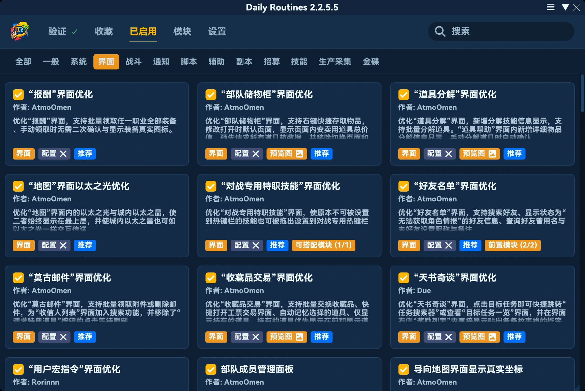
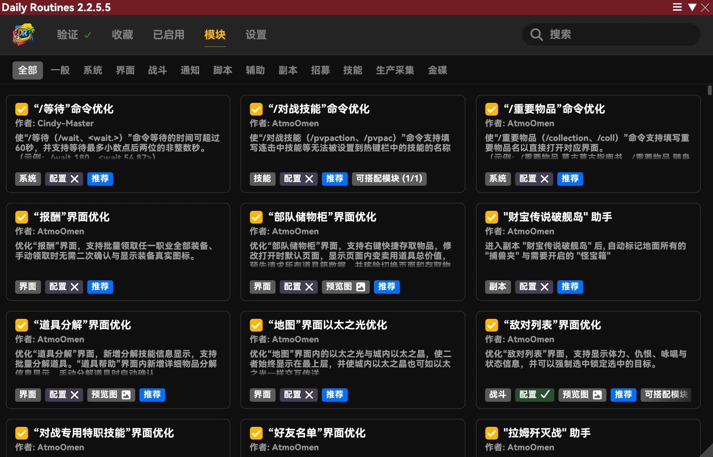
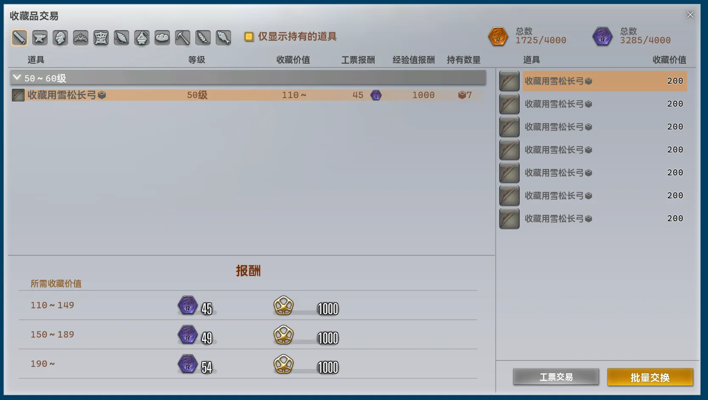
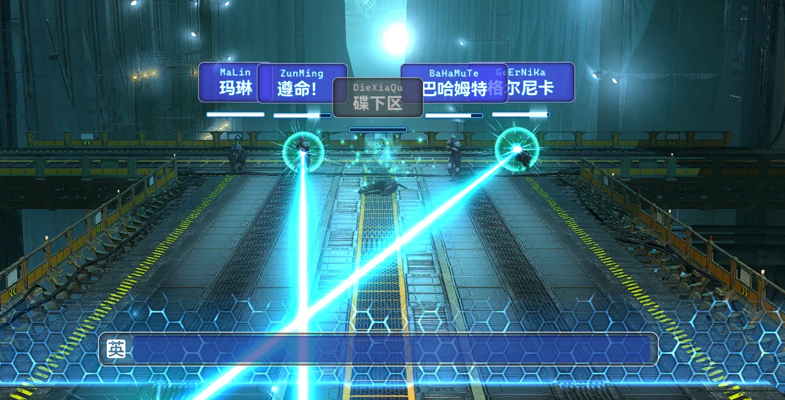
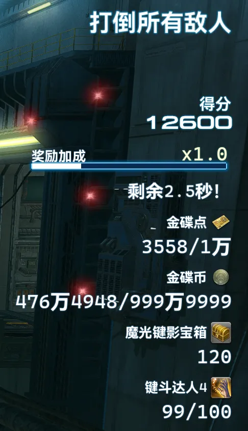

## 本体修改

- 修复了因插件早于 vnavmesh 导致打印大量 IPC 调用报错的问题。
- 将 Universalis 请求并发限制由 30 调整为 10，避免短时间内大量请求并发。
- 修复了因 Dalamud 自动取消取消令牌导致关联的服务均出现不同程度的异常的问题。
- 配置项“防止暂离状态”新增对“魔光键影”玩法内暂离状态判断的处理。
- 大幅降低了加载优先级，以提高兼容性。
- 完全重构了主界面布局与样式。性能表现更佳，信息密度更高，内容更加聚焦，且支持在单列、双列与三列布局间自适应切换。

- 修复了本机时间设置不准确会导致自助验证用加密验证令牌生成错误的问题。
- 完全重构并大幅简化了托盘悬浮窗的实现逻辑。需要重新调整托盘悬浮窗的位置。
- 完善在版本更新后打开主界面自动跳转至更新日志界面的逻辑，现在不再会导致主界面与托盘悬浮窗闪现。
- 现在通过 `/pdr` 指令打开主界面不再会清除搜索内容。
- 将配置项“托盘悬浮窗”的分类由“一般”调整为“界面”。
- “界面”分类下配置项“样式”新增选项“使用 Dalamud 样式”，选择后将不再使用插件内置的样式。
    ※ 由于插件界面的开发与测试完全基于内置样式，故在选用 Dalamud 样式后，可能会有部分元素显示奇怪或异常。这是预期行为，不接受此类的反馈或修复请求。

- 移除了“机器认证凭证”。
- 调整了内置样式 `Tropical Sanctuary` 的外观表现，提高了可读性。
- 修复了若在线验证请求恰好在旧模块实例已清空但新模块实例尚未从文件中实例化时发送的话，会直接打断模块重载，导致所有模块均不可加载的问题。
- 新增了便捷传送路径。
    - 金碟游乐场 ↔ 键斗广场
    - 陆行鸟广场 → 键斗广场
    - 金碟游乐场 ↔ 陆行鸟广场
- 修复了共享跨区域移动逻辑不会在金碟游乐场相关区域使用城内以太之晶的问题。
- 完全重构了模块搜索逻辑，现在围绕分层检索算法构建了完整的系统。从而解决了旧版本微弱笔误就会导致无法返回正确结果、精准输入仍然返回大量搜索结果与正确搜索结果反而排序优先级更低的问题，并极大提升了性能表现。
    - 优先识别匹配连续词语，标题中的紧凑词组组合次之。不再任意命中模块信息拼成的长文本中的任意字词。
    - 多个关键词现在可以分别命中标题、说明或额外信息中包含的关键词，且必须要全部满足，以跨字段搜索模块。
    - 模块信息中的各类链接与各种关联模块的信息退出搜索索引，以减少无关结果。
    - 拼音搜索会自动将输入拆分为较为合理的汉字音节，并以起始字符位图排除首字符无法作为任何候选起点的情形，并以可消费流子序列排除字符顺序不可能成立的情形，以避免混淆拼音检索和英文检索。
    - 拼音搜索现在必须要求从音节起点匹配，以减少错误匹配。
    - 拼音搜索现在支持全拼、首字母、全拼与首字母组合和全拼与中文组合的形式。
    - 拼音搜索支持带声调输入与全角字母输入。
    - 拼音搜索下，非模块标题信息不再参与首字母匹配，避免扩散出大量可能无关的结果。
    - 排序会综合考虑每个独立词的匹配质量、是否整句命中以及原文长度。原文与拼音优先于缩写，并大幅降低了模块内部名称可能被拆出来的短词组优先级。
    - 内部维护容量为 16 的无锁快照缓存，命中时将直接返回有序结果数组，优化了性能。
    - 实现了多层无损剪枝。为每独立字段构建了 64 位可消费字符位图，单次并集检查待检索项，优化了性能。
    - 实现了排序评分上界剪枝，优化了性能。
    - 实现了拼音动态规划稀疏化。以 64 位活跃位掩码记录可达状态，并在后续只遍历可达位置，逐行清理也仅针对上轮写入槽位，优化了性能。
    - 预计算了排序键，排序阶段直接比较字节序列，优化了性能。
    - 匹配结果缓冲改为使用 ArrayPool 组件，排序改为使用结构化比较器与 Span 排序，优化了分配与性能。

## 删除模块

### 自动交易收藏品 [界面]

相关功能完全融入新模块 `“收藏品交易”界面优化`，故删除。

### 更高的部队战绩交易上限 [界面]

相关功能完全融入新模块 `自动提高商店单次购买上限`，故删除。

## 新增模块

### 自动提高商店单次购买上限 [界面]

*推荐模块*

将各类商店内道具的单次购买上限提高至999或255。

### “收藏品交易”界面优化 [界面]

*推荐模块*

优化“收藏品交易”界面，支持批量交换收藏品、快捷打开工票交易界面、自动记忆选择的道具、仅显示持有的道具、持有的道具优先显示在前和显示道具真实图标。

### 自动游玩魔光键影 [金碟]

进入“魔光键影”副本后，自动输入词条攻击最近的敌人，优先强化屏障和打断咏唱，并在禁止打字判定期间暂停输入。

### 自动显示魔光键影分数 [金碟]

*推荐模块*

“魔光键影”副本结算时，自动显示本被遮蔽的其他玩家的分数。

### 自动申请参加魔光键影 [金碟]

开始后，自动反复申请副本“魔光键影”，并在其完成时自动退出。

### 自动魔光键影内显示“消息”界面 [金碟]

在副本“魔光键影”中，自动显示被刻意隐藏的“消息”界面，以便核对各种消息。

### 自动支持魔光键影拼音输入 [金碟]

*推荐模块*
*仅国服*

在副本“魔光键影”中，使输入判定支持拼音，且自动在词条上方显示对应的拼音。

### 魔光键影信息界面优化 [金碟]

*推荐模块*

优化副本“魔光键影”中的信息显示界面，支持显示奖励加成剩余的具体时间，显示持有的金碟点、金碟币与魔光键影宝箱数量，并显示相关成就的进度。

## 模块修改

### 自动数字输入框最大值 [界面]

- 调整了名称与描述。
- 移除了在线验证要求。
- 现在为推荐模块。
- 移除了配置项“修改商店单次购买上限”，相关功能移动至新模块 `自动提高商店单次购买上限`。
- 新增可搭配模块 `自动提高商店单次购买上限`。
- 不再支持打断热键。
- 完全重构了实现逻辑，采取了更加底层的实现方式。现在不再每帧强行修改为固定的数值，而是在数值初始化或每次刷新自动修改为最大值，同时满足了每次默认最大值与手动修改数值的场景场景。

### 商店显示物品真实图标 [界面]

- 移除了对“收藏品交易”界面的处理，如有需要请直接使用 `“收藏品交易”界面优化` 模块。
- 移除了对“报酬”界面的处理，如有需要请直接使用 `“报酬”界面优化` 模块。
- 新增可搭配模块 `“收藏品交易”界面优化` 和 `“报酬”界面优化`。

※ 若后续本模块涉及到的相关界面推出了专门的“-界面优化”类模块，则也会一并将本模块中对相关界面的处理逻辑移动到对应模块中。若所有界面都已分散支持，则届时会删除本模块。

### “报酬”界面优化 [界面]

- 调整了描述。
- 现在支持显示装备的真实图标。

### 自动临危受命 [脚本]

- 修改了根据等级忽略危命任务的规则。
    - 若危命任务在 30 级及以下，则当自身等级小于等于其 6 级时，忽略该危命任务。
    - 若危命任务在 31 级到 50 级时，则当自身等级小于等于其 3 级时，忽略该危命任务。
    - 其他情况下，当自身等级小于等于其 8 级时，忽略该危命任务。

### “/等待”命令优化 [系统]

- 因原本的标题与描述带有歧义且指代模糊不清，理解困难，修改了标题与描述。

### 自动显示过图线目的地 [一般]

- 修复了目的地显示未遵循游戏缩放设置的问题。

### 更快的区域内过图加载 [系统]

- 完全重构了实现方式，采取了更加底层的实现逻辑，并进一步加快了加载速度。

### 自动记录状态消失情况 [战斗]

- 调整了描述。
- 调整了通知消息内容。
- 因本身就只有“聊天消息”这一种形式能够得知记录情况，故移除了配置项“发送聊天消息”，现在始终发送。
- 移除了配置项“仅监控选定的状态”，现在始终仅监控选定的状态。
- 优化了配置界面绘制逻辑。

### 无限制宏图标指定 [界面]

- 完全重构了实现方式，采取了更加底层的实现逻辑。
- 修复了有时候打开“用户宏指令”界面没有立刻显示出使用 `/pdr micon` 指定的图标的问题。
- 现在在宏中使用 `/pdr micon` 指定图标会立刻反映出来。

### 快捷跨界传送 [界面]

- 优化了界面性能表现。
- 修复了重复请求服务器状态的问题。
- （仅国服）在启用或禁用插件 DCTravelerX 时会直接动态更新界面，不再需要手动开关界面以刷新。
- 调整了界面内各服务器按钮的外观，移除了原本在不同游戏颜色主题下表现差异巨大的红绿配色，现在可以正常前往的服务器对应的按钮就显示为普通的文本按钮，不可前往的服务器显示为禁用态。
- 现在在界面内点击不可前往的服务器时，会直接拦截相关请求并显示报错消息，不再会关闭界面。

### 全职业忍者跳跃动作 [一般]

- 修复了会错误应用至其他玩家的问题。
- 修复了模块关闭时未及时还原动作的问题。
- 修复了拉拉菲尔族渲染异常的问题。

### “地图”界面以太之光优化 [界面]

- 现在发起到城内以太之晶的传送时，会一并关闭地图界面，与以太之光传送行为保持一致。
- 完全重构了实现逻辑，原本采取新增图标的做法，现在采取直接拦截生成地图图标的逻辑，用以生成完全可控、与原生表现一致且无重叠的图标。
- 现在与界面上以太之光的交互也会由模块处理，并能实时反映通过插件内共享跨区域移动逻辑所产出的实际路径移动时所要耗费的金币数量。

### 更好的市场布告板 [界面]

- 调整了描述。
- 大幅调整了界面文本。
- 现在由“道具帮助”界面触发的 Universalis 查询会延时 400 毫秒再发送，避免短时间内频繁切换悬停物品导致发送出大量请求。
- 修复了在本地存在有效缓存时仍然对 Universalis 发出请求的问题。
- 现在在请求 Universalis 失败时，会在“道具帮助”界面内明确显示相关失败文本，而非一直显示请求中相关问题。
- 聚合了界面内的 Universalis 市场数据查询与“道具帮助”界面触发的 Universalis 查询，现在可以互相复用数据，避免重复发送请求。
- 现在持续悬停某一请求失败的物品时，会自动在退避时间后重新发出请求。
- 界面内的跨服价格、在售数量、成交历史与交易趋势信息现在都会明确区分加载、失败与无数据状态。
- 修复了首次获取服务器失败会导致本生命周期内始终无法获取服务器信息的问题。
- 现在在通过右键菜单项“查看市场行情”时打开界面时，会自动根据右键的物品是否为高品质而切换普通品质或高品质视图。

### 自动扫描恶名精英 [脚本]

- 修复了极罕见情况下可能复用到已释放的扫描器的问题。
- 现在扫描期间会固定将游戏设置“角色显示范围”调整为“最大”，扫描完成后自动还原。
- 因应加入了自动调整显示范围相关逻辑，故扫描范围由 100 提高至 300，能够更快地遍历各个点位。

### “好友名单”界面优化 [界面]

- 修复了好友搜索输入框会错误显示不正确的字数限制信息的问题。
- 加长了好友搜索输入框。

### 自动通知随机任务少数职能奖励 [招募]

- 调整了描述。
- 因原本的通知内容过于不知所云，故完全重构了通知内容。
- 移除了配置项“发送聊天消息”、“发送通知消息”和“发送语音消息”。
- 完全重构了实现逻辑，使用了更加底层、跨版本稳定且全面的实现方式，连带着修复了大量隐蔽诡异的逻辑问题。

### 自动退出副本 [副本]

- 支持副本“魔光键影”。

### 退出副本指令 [辅助]

- 支持副本“魔光键影”。

### 自动任务出发确认 [副本]

- 完全重构了实现逻辑，采取了更加底层的实现方式。
- 现在会直接跳过各类不影响进入副本的二次确认界面。
- 现在会在影响是否可以进入副本的相关状态变更时自动尝试再次确认副本，而非原本只确认首次。

### 更好的招募过滤界面 [招募]

- 修复了界面内部分元素在交互后意外变成右对齐的问题。

### 更好的辅助职业列表 [副本]

- 调整了描述。
- 优化了性能表现。
- 修复了在非中文客户端语言下，技能或特性名称显示很有可能溢出界面的问题。
- 现在会自动隐藏游戏原生的新职业提醒节点，避免因无法交互原本的界面而无法消除该提醒。

### “敌对列表”界面优化 [战斗]

- 调整了描述。
- 调整了配置界面绘制逻辑。
- 简化了资源清理逻辑。
- 新增配置项“交换体力与状态显示位置”。使状态显示在左侧，向左展开；体力显示在右侧，向右展开。默认禁用。
- 完全重构了“状态”显示节点的实现逻辑，现在采取完全附着于“敌对列表”界面的更加底层且可维护的逻辑，不再自行维护一整套复杂的尺寸与位置变换系统。
- “状态”显示节点的悬浮文本现在直接采取游戏原生生成相关文本信息的函数，而不是自行拼接文本，故现在可以兼容其他各种修改此处的插件或模块，且降低了跨版本维护成本。

### 统一投影管理器 [界面]

- 调整了描述。
- 重构了投影台与收藏柜的库存读取逻辑，改为使用当前角色的游戏原生缓存；投影台物品及套装部件解锁信息可自动在重新登录或重启游戏后自动读取游戏记录数据恢复，不再使用任何模块自身保存的缓存。
- 现在启用模块、登录角色及打开或刷新投影台、收藏柜界面时，均会自动刷新装备列表，并通过游戏原生逻辑同步已经加载缓存。
- 修复了混用收藏柜两组加载状态及错误索引扩展库存位图导致装备遗漏、缓存错位的问题。
- 完善了投影台染色信息的读取与保留逻辑，现在应用投影时会读取最新染色信息并同步更新缓存。
- 完善了套装部件的解锁判定，恢复投影台缓存时会一并读取保存的部件解锁信息，并在应用投影前再次检查部件是否可用。
- 优化了刷新流程，合并短时间内的重复刷新请求，避免刷新任务与模板应用共用队列；读取失败或暂不可读时保留原有列表。
- 完善了角色切换与延迟操作的处理，避免沿用其他角色的数据，以及延迟补发投影时错误应用到已切换的部位。
- 优化了装备合并、选中项匹配及套装解析逻辑，减少重复读取与临时内存分配。

### 更好的传送界面 [界面]

- 调整了描述。
- 现在会自动将所有便捷传送路径自动注册为可传送的目的地，以方便各种操作。得益于此，当前版本新增了约 70 个可传送的目的地，涵盖的常见目的地包括：
    - 沙之家
    - 石之家
    - 键斗广场
    - 朱诺下层
    - 新月岛北部
    - 新月岛南部
- 现在计算传送费用会自动根据所使用的插件内共享跨区域移动逻辑所产出的实际路径计算。
    ※ 示例：从当前区域直接传送至某地需要花费 1300 金币，但实际路径全程通过过图线和非玩家对象前往，只需要花费 150 金币。在旧版中，会显示传送花费为 1300 金币；在新版中，则会显示传送花费为 150 金币。
- 完全重构了传送费用计算的底层算法，由网格枚举改为单向 Dijkstra 算法，且将所有传送目的地的计算合并为单一一次完成，并将任务从游戏主线程上移走，从而大幅优化了传送费用计算时的性能表现。

### 快速目标交互 [界面]

- 修复了在金碟游乐场相关区域无法正确显示其中的城内以太之晶的问题。

### 自定义地图标记 [界面]

- 调整了描述。
- 修复了界面居中对齐显示错误的问题。