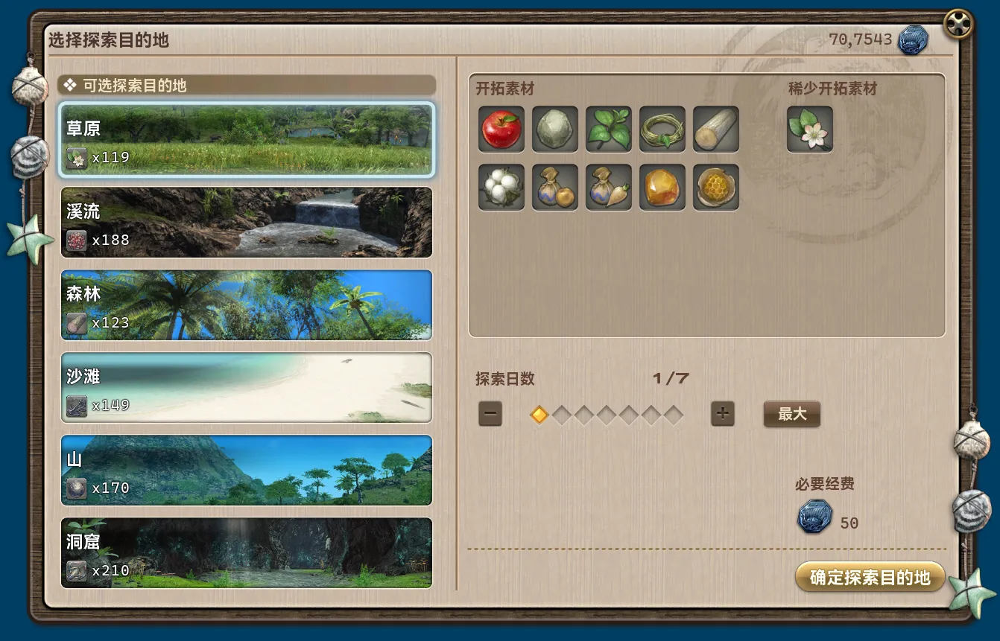
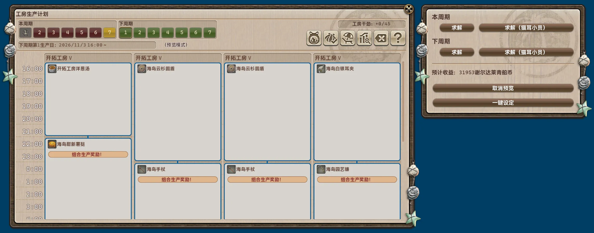
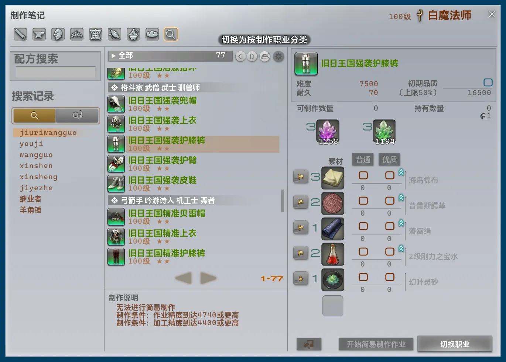

## Core Changes

- Added convenient travel routes.
    - Kholusia ↔ The Puppets' Bunker
    - Kholusia ↔ Excavation Tunnels
    - Excavation Tunnels ↔ The Copied Factory
    - The Ruby Sea ↔ Reisen Temple
    - Unnamed Island → Lower La Noscea
    - Labyrinthos ↔ Old Sharlayan
    - The Parrock ↔ Leofard's Chambers
- Selecting “Module” in the main window's primary navigation bar now expands additional tabs to the right, including the previously separate “Enabled” tab and the new “Recommended” tab.
    - “Recommended” lists all modules marked as recommended.
- Removed the separate font and font size settings. The plugin now follows Dalamud's font and font size settings.
- Fixed a longstanding error in UI scaling calculations. Font size was incorrectly counted twice and combined with Dalamud's global scaling, making the actual scale excessively large.
- Reduced the default Tray Widget size from 48 to 30 to account for the corrected UI scaling. Adjust it again after updating to suit your preferred appearance.
- Updated many UI rendering routines to accommodate the corrected scaling calculations. The appearance remains as close as possible to the previous version, although some styling and design changes are expected.
- Fixed incorrect calculations of remaining space in the command completion interface caused by ignoring UI scaling.
- Restored switching between “Compact View” and “Full View”, which was omitted during the previous UI redesign.
- All FontAwesome icons now render at a fixed width for a more consistent appearance.
- Fixed scrolling through the module list sometimes being interrupted when a module card's description or badge area captured the scroll input.
- Fixed the module details page incorrectly including the secondary navigation bar in its scrollable area.
- Fixed “Copy module internal name” failing to send a notification when clicked.
- Fixed the shared cross-zone travel logic not prioritizing teleportation to the selected aetheryte.
- Fixed tasks that must run on the main thread progressing too slowly at low frame rates.
- Searching in the main window now clears the displayed selection state of the primary navigation bar.
- Fixed being able to interact with disabled module cards to open their configuration interfaces.
- Greatly simplified and optimized route calculations in the shared cross-zone travel logic.
    - Fully supports checking unlock requirements for travel points provided by NPCs.
    - Travel points are now automatically excluded when you have insufficient gil or have not unlocked them.

## Removed Modules

### Auto Island Workshop Agenda Import [Addon]

Removed because it only supported importing existing external agendas in a format popular on Chinese servers. The new `Better Isleworks Agenda` module fully replaces it.

### Better Workshop Schedule [System]

Removed because all functionality has been integrated into the new `Better Isleworks Agenda` module.

## New Modules

### Better Granaries [Addon]

*Recommended module*

Enhances Granaries in Island Sanctuary. Collect gathered materials with one click, and dispatch expeditions with one click based on the rare material you currently own the least of. Expedition Area also shows each destination's rare material and your current stock directly alongside the destination.

### Better Isleworks Agenda [Addon]

*Recommended module*

Enhances Isleworks Agenda in Island Sanctuary. Automatically calculates and schedules production agendas according to your requirements, with more flexible rest day settings.

## Module Changes

### Auto Gather In Island Sanctuary [Script]

- Updated the description.
- Updated configuration UI rendering.
- Removed frequent Dalamud notifications during gathering point data collection.
- Renamed “When reach caps, stop gathering and send notification” to “Send Notification When All Materials Reach Cap”.
- “Send Notification When All Materials Reach Cap” now checks inventory quantities directly instead of monitoring error notifications about exceeding item limits.
- “Send Notification When All Materials Reach Cap” now stops only when all selected items reach their limits, rather than stopping when any one item reaches its limit.
- Completely rebuilt the implementation at a lower level.
    - Select the materials you want directly instead of selecting gathering point types. The module automatically chooses the corresponding gathering points.
    - Added a preview of selected materials and their gathering points to the configuration interface, with a live display of the material currently being gathered.
    - Rebuilt and greatly simplified gathering point data collection. Reduced the number of locations from 96 to 24 to substantially shorten collection time. The module now waits for nearby objects to actually update before moving to the next location, replacing fixed delays to accommodate different network conditions and avoid missed locations or excessive waits.
    - Rebuilt the gathering process. It now waits for nearby objects to actually update before moving to the next location, replacing fixed delays to accommodate different network conditions and avoid missed locations or excessive waits. Added comprehensive environment checks. If gathering times out at a location, the module automatically uses Isle Return and attempts to resume gathering.
- Added extensive status information and error messages.
- “Dive Correction” must now be enabled in the plugin settings before gathering can start.
- Updated many notification types and messages.
- Added IPC.
    - `DailyRoutines.Modules.AutoMJIGather.IsBusy`
        - Purpose: Indicates whether the module is working.
        - Return type: `bool`.
    - `DailyRoutines.Modules.AutoMJIGather.SetItems`
        - Purpose: Temporarily sets the items for the next gathering session.
        - Signature: `Task<bool> SetItems(Dictionary<uint, int>? items)`.
            - Returns whether the items were set successfully.
            - Keys in `items` are Item IDs; values are the desired total quantities to hold. Pass an empty dictionary to return to the module's configuration.
    - `DailyRoutines.Modules.AutoMJIGather.Start`
        - Purpose: Starts gathering.
        - Signature: `Task<bool> Start()`.
            - Returns whether gathering started.
    - `DailyRoutines.Modules.AutoMJIGather.Stop`
        - Purpose: Stops gathering.
        - Signature: `Task<bool> Stop()`.
            - Returns whether gathering stopped.

### Disable Background Rendering [System]

- Updated the description.
- Completely rebuilt the implementation. Instead of preventing render frames from being submitted, it now disables the game's 3D rendering. Since frame submission continues, compatibility is better with plugins that hook directly into game rendering events. The previous implementation could reduce GPU usage to almost zero while active; the new implementation uses slightly more GPU resources because the UI still renders and frames continue to advance.
- Replaced per-frame background checks with direct hooks into Windows window events, improving responsiveness and reducing overhead.

### Better Aetheryte On Map [Addon]

- Updated the description.
- Added “No Interface Modification When In Party”, enabled by default. While in a party, the module does not override aetheryte teleportation, enable teleportation through Aethernet shards, or add extra destinations, preventing unintended party teleport invitations.
- The module also no longer modifies the interface while in a duty.
- All convenient travel routes are now automatically added to the map as extra destinations.
- Added “Skip Confirmation”, disabled by default. Teleport directly without the additional confirmation dialog.

### Better Teleportation [Addon]

- Updated the description.
- Changed teleportation notifications from floating text to chat messages.
- Updated teleportation notification text.
- Fixed the interface not closing after clicking “Teleport Here”.
- Search now uses the same system as module search, improving performance and accuracy and supporting its various search features.

### Real-time Network Metrics [System]

- Moved from “Addon” to “System”.
- Updated the description.
- Completely rebuilt the implementation. Instead of attempting to ping the game server through the actual outbound connection, it now reads TCP round-trip times recorded by the game itself, improving accuracy and compatibility with different network environments and settings.
- Custom display text formats are no longer supported.
- Removed the packet loss metric due to the implementation change. Added the “PL” retransmission rate metric.
- Fixed clicking the server information bar entry failing to close the popup because its click-to-open behavior conflicted with automatic closing on focus loss.

### Custom Map Marker [Addon]

- Fixed “Custom Marker List” not automatically hiding its scrollbar.

### Special Rendering Modes [System]

- Updated the description.
- Renamed multiple options.
- Redesigned the configuration interface layout.
- Added “* Hide Version Information and Controls on the Title Screen”.
- Changed the default color for “* Cover the Screen with a Solid Color, Keeping Only the Game UI (Excluding Nameplates)”.

### Better Frame Rate Cap [System]

- Fixed clicking the server information bar entry failing to close the popup because its click-to-open behavior conflicted with automatic closing on focus loss.

### Better Crafting Log [Craft & Gather]

- Updated the description.
- Updated configuration UI rendering so option help text is now shown directly.
- Revised many interface strings for clarity and to accommodate the characteristics of each language.
- Remembers the last selected recipe and automatically selects it the next time you open the Crafting Log.
    - Recipes selected by crafting classes are remembered separately for each class.
    - Gathering and combat classes share the same remembered recipe.
- Recipe search history now persists across game restarts.
- Replaced the underlying recipe search logic with the same system used for module search, greatly increasing search speed and adding features such as fuzzy and pinyin searches.
- Fixed the clear button on the right of the recipe search field not immediately clearing the input text.
- Added search view switching. Results can now be grouped “By Crafter” (the game's original behavior) or “By Applicable Job”.
    - For example, all “of Fending” equipment for tanks is naturally grouped together.
    - Note: In “By Applicable Job”, main-hand and off-hand weapons and tools have their own “Tool” category. Items other than equippable gear remain grouped by their original crafting class.

- Removed “Notify After Synthesis Is Complete”. Completion notifications are now always sent, with updated notification types and text.
- Removed “Higher Quick Synthesis Cap”. This feature is now always active.
- Removed “Same Recipe Under Other Jobs”. This feature is now always active.
- Removed “Material Source Tracing”. This feature is now always active.
- Removed “Search Clearing Button”. This feature is now always active.
- Removed “Job Switching Button”. This feature is now always active.

*Reminder: Feedback requesting compatibility or repositioning because another plugin adds elements in the same location will not be accepted for this module. Choose which one to use.*

### Auto Spam Key [System]

- Fixed combinations involving the controller's left trigger not being handled.
