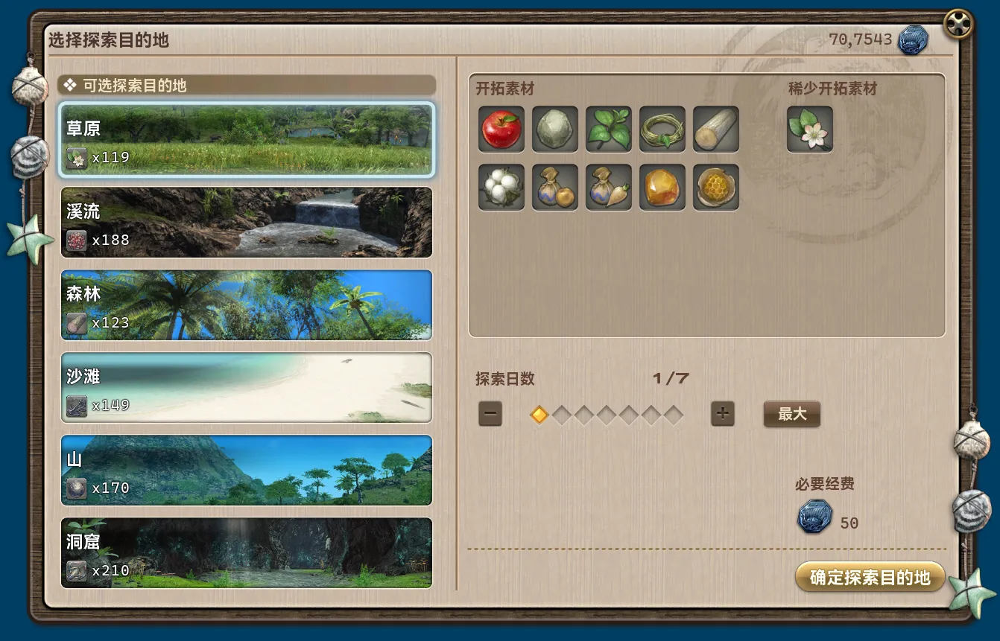
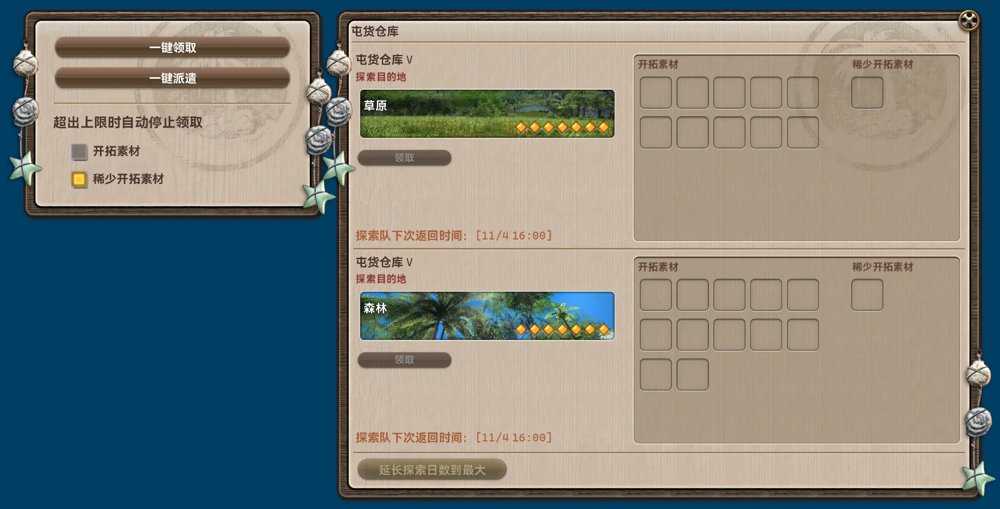
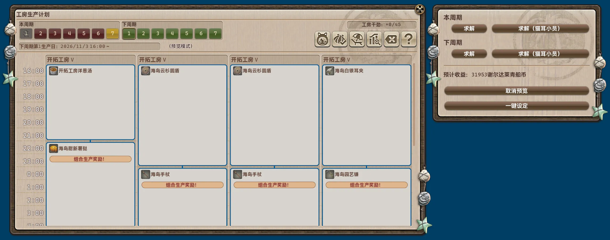
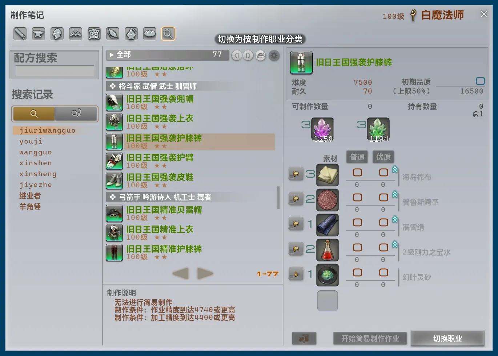

## 本体の変更

- 便利な移動経路を追加しました。
    - コルシア島 ↔ 人形タチノ軍事基地
    - コルシア島 ↔ 機械遺跡の坑道
    - 機械遺跡の坑道 ↔ 複製サレタ工場廃墟
    - 紅玉海 ↔ 醴泉神社境内
    - 名もなき島 → 低地ラノシア
    - ラヴィリンソス ↔ オールド・シャーレアン
    - パロック繋留基地 ↔ レオファードの私室
- メインウィンドウの上段ナビゲーションで「モジュール」を選択すると、右側にほかの項目が展開されるようになりました。従来は独立して並んでいた「有効機能一覧」と、新設の「推奨」が含まれます。
    - 「推奨」には、推奨モジュールとして指定されたすべてのモジュールが表示されます。
- 独自のフォントとフォントサイズの設定を完全に削除しました。今後は Dalamud の設定に従います。
- 以前から誤っていた UI スケーリングの計算式を修正しました。フォントサイズを二重に計算し、さらに Dalamud のグローバルスケールを混在させていたため、実際の倍率が過度に大きくなっていました。
- UI スケーリングの計算式修正に伴い、トレイウィジェットの既定サイズを 48 から 30 に変更しました。更新後、見た目に合わせて再調整することをお勧めします。
- UI スケーリングの計算式修正に合わせて、多くの UI 描画処理を変更しました。従来の外観をできるだけ維持していますが、一部のスタイルやデザインは変更されています。
- コマンド補完画面で UI スケーリングを考慮しておらず、残りの表示可能領域を誤って計算する問題を修正しました。
- 前回の UI 改修時に抜けていた「簡易表示に切り替え」と「フル表示に切り替え」の機能を復元しました。
- すべての FontAwesome アイコンを固定幅で描画し、見た目を整えました。
- モジュール一覧を連続してスクロールすると、カード内の説明欄やバッジ欄にスクロール入力が奪われ、一覧のスクロールが途切れることがある問題を修正しました。
- モジュール詳細画面で、下段ナビゲーションまでスクロール領域に含まれる問題を修正しました。
- 「モジュール内部名をコピー」をクリックしても通知が送信されない問題を修正しました。
- 共通のエリア間移動処理で、選択したエーテライトへのテレポが優先されない問題を修正しました。
- フレームレートが低い場合、メインスレッドで実行する必要があるタスクの進行が遅くなりすぎる問題を修正しました。
- メインウィンドウで検索中は、上段ナビゲーションの選択状態を表示しないようにしました。
- 無効なモジュールのカードを操作して設定画面に入れてしまう問題を修正しました。
- 共通のエリア間移動処理における経路計算を大幅に簡素化し、最適化しました。
    - NPC が提供する移動地点の開放条件の判定に完全対応しました。
    - ギルが不足している場合や未開放の場合、該当する移動地点を自動的に経路から除外するようになりました。

## 削除されたモジュール

### 無人島工房スケジュール自動化 [インターフェイス]

外部で作成された生産計画の取り込みのみをサポートし、対応形式も中国サーバーで普及しているものに限られていました。新モジュール `* 「CRAFT SCHEDULE」UI の改善` ですべて代替できるため、削除しました。

### 柔軟な無人島工房の休業日設定 [システム]

すべての機能を新モジュール `* 「CRAFT SCHEDULE」UI の改善` に統合したため、削除しました。

## 新規モジュール

### * 「グラナリーオフィス」UI の改善 [インターフェイス]

*推奨モジュール*

無人島開拓の「グラナリーオフィス」を改善します。開拓素材をワンクリックで受け取り、現在の所持数が最も少ないレア素材に合わせて、探索隊をワンクリックで派遣できます。「SEARCH LOCATION SELECT」では、各探索先に対応するレア素材と所持数を直接表示します。

### * 「CRAFT SCHEDULE」UI の改善 [インターフェイス]

*推奨モジュール*

無人島開拓の「CRAFT SCHEDULE」を改善します。要望に応じて生産計画を自動で計算・設定でき、休業日もより柔軟に指定できます。

## モジュールの変更

### 無人島自動採集 [スクリプト]

- 説明を更新しました。
- 設定画面の描画処理を変更しました。
- 採集地点のデータ収集中に頻繁に送信されていた Dalamud 通知を削除しました。
- 設定項目「ストック上限に到達時採集を停止し、通知を送信します」の表示名を「* 選択したすべての素材が所持上限に達したら停止して通知する」に変更しました。
- 「* 選択したすべての素材が所持上限に達したら停止して通知する」の判定方法を、アイテム数の上限超過エラー通知の監視から、所持数の直接確認に変更しました。
- 「* 選択したすべての素材が所持上限に達したら停止して通知する」の停止条件を、いずれか 1 種類が上限に達した場合から、選択したすべてのアイテムが上限に達した場合に変更しました。
- より低レベルの処理を用いる方式へ、実装を全面的に作り直しました。
    - 「採集地点」の種類を選ぶ方式から、欲しい「採集素材」を直接選ぶ方式に変更しました。対応する採集地点は自動で選択されます。
    - 設定画面に、選択中の素材と対応する採集地点のプレビューを追加しました。採集中は、現在採集している素材もリアルタイムで表示します。
    - データ収集処理を作り直し、大幅に簡素化しました。巡回地点を 96 か所から 24 か所に絞り、収集時間を大幅に短縮しました。また、一定時間後に次の地点へ進む方式を、周辺オブジェクトが実際に更新されてから進む方式に変更しました。さまざまな通信環境に対応し、地点の取りこぼしや過度な待機を防ぎます。
    - 採集処理を作り直しました。一定時間後に次の地点へ進む方式を、周辺オブジェクトが実際に更新されてから進む方式に変更し、通信環境による取りこぼしや過度な待機を防ぎます。環境状態の確認も充実させました。採集地点でタイムアウトした場合は、自動で「アイルデジョン」を使用し、採集の再開を試みます。
- 多数の状態表示とエラーメッセージを追加しました。
- 開始するには、プラグイン設定の「環境の不整合状態を修正する」を有効にする必要があります。
- 多くの通知の種類と内容を変更しました。
- IPC を追加しました。
    - `DailyRoutines.Modules.AutoMJIGather.IsBusy`
        - 機能：動作中かどうかを取得します。
        - 戻り値の型：`bool`。
    - `DailyRoutines.Modules.AutoMJIGather.SetItems`
        - 機能：次回の採集対象アイテムを一時的に設定します。
        - シグネチャ：`Task<bool> SetItems(Dictionary<uint, int>? items)`。
            - 戻り値：設定に成功したかどうか。
            - `items` のキーは Item ID、値は目標所持数です。空の辞書を渡すと、モジュール設定の使用に戻ります。
    - `DailyRoutines.Modules.AutoMJIGather.Start`
        - 機能：採集を開始します。
        - シグネチャ：`Task<bool> Start()`。
            - 戻り値：採集を開始したかどうか。
    - `DailyRoutines.Modules.AutoMJIGather.Stop`
        - 機能：採集を停止します。
        - シグネチャ：`Task<bool> Stop()`。
            - 戻り値：採集を停止したかどうか。

### バックグラウンドでゲーム画面のレンダリングを禁止する [システム]

- 説明を更新しました。
- 実装を全面的に作り直し、描画フレームの送出を止める方式から、ゲーム内の 3D 描画を無効にする方式へ変更しました。フレームの送出を止めないため、ゲームの描画イベントを直接フックするプラグインとの互換性が向上します。従来の方式では有効時の GPU 使用量をほぼゼロにできましたが、新方式では UI 描画とフレームの進行が続くため、わずかながら従来より多くの GPU リソースを使用します。
- 毎フレーム行っていたバックグラウンド判定を、Windows のウィンドウイベントを直接フックする方式に変更しました。反応を改善し、処理負荷を軽減しました。

### 「マップ」ウィンドウのエーテライト表示拡張 [インターフェイス]

- 説明を更新しました。
- 設定項目「* パーティ参加中は UI を変更しない」を追加しました。既定で有効です。パーティ参加中はエーテライトへのテレポ処理の変更、都市内エーテライトからのテレポ、追加の移動先表示を行わず、意図しないパーティテレポの勧誘を防ぎます。
- コンテンツ内でも UI を変更しないようにしました。
- すべての便利な移動経路を、追加の移動先としてマップに自動表示するようになりました。
- 設定項目「* テレポの確認を省略する」を追加しました。既定で無効です。操作時の追加確認画面を省略し、そのままテレポします。

### テレポUI最適化 [インターフェイス]

- 説明を更新しました。
- テレポ時の通知方法を、フローティングテキストからチャットメッセージに変更しました。
- テレポ時の通知内容を変更しました。
- 「この位置へテレポする」をクリックしても画面が閉じない問題を修正しました。
- 検索処理をモジュール検索と同じシステムに統一しました。速度と精度が向上し、各種検索機能にも対応します。

### ネットワーク遅延の自動表示 [システム]

- 分類を「インターフェイス」から「システム」に変更しました。
- 説明を更新しました。
- 実装を全面的に作り直しました。実際の外向き通信経路でゲームサーバーに Ping を送る方式から、ゲーム自体が記録する TCP 通信の往復時間を直接読み取る方式へ変更し、精度と各種通信環境・設定との互換性を向上させました。
- 表示テキストの書式を変更する機能を削除しました。
- 実装方式の変更に伴い、「パケットロス率」の表示を削除し、「* 再送率」を追加しました。
- サーバー情報バーの項目をクリックしてポップアップを開く処理と、フォーカスを失うと閉じる処理が競合し、同じ項目を操作しても閉じられない問題を修正しました。

### カスタムマップマーカー [インターフェイス]

- 「カスタムマップマーカーの一覧」でスクロールバーが自動的に非表示にならない問題を修正しました。

### 特殊描画モード [システム]

- 説明を更新しました。
- 複数の設定項目の名称を変更しました。
- 設定画面のレイアウトを作り直しました。
- 「* タイトル画面のバージョン情報と操作メニューを非表示にする」モードを追加しました。
- 「* 画面を単色で覆い、ゲーム UI のみを残す（ネームプレートを除く）」モードの既定色を変更しました。

### FPS制限設定の改善 [システム]

- サーバー情報バーの項目をクリックしてポップアップを開く処理と、フォーカスを失うと閉じる処理が競合し、同じ項目を操作しても閉じられない問題を修正しました。

### 「製作手帳」UIの改善 [製作・採集]

- 説明を更新しました。
- 設定画面の描画処理を変更し、各項目のヘルプを直接表示するようにしました。
- 多くの UI テキストを見直し、説明を明確にするとともに、各言語の特性に対応しました。
- 最後に選択したレシピを記憶し、次に製作手帳を開いたときに自動選択するようになりました。
    - クラフターはクラスごとに選択したレシピを記憶します。
    - ギャザラーと戦闘クラス・ジョブは、同じ記憶内容を共有します。
- レシピの検索履歴を永続保存し、ゲームを再起動しても消えないようにしました。
- レシピ検索の基盤処理を置き換え、モジュール検索と同じシステムを使用するようにしました。検索速度が大幅に向上し、あいまい検索やピンイン検索などにも対応します。
- レシピ検索欄の右側にあるクリアボタンで、入力文字列がすぐに消去されない問題を修正しました。
- 検索表示の切り替えを追加しました。「* 製作クラス別」（標準の分類）と「* 装備可能クラス・ジョブ別」を選べます。
    - 例えば、タンク向けの「ディフェンダー」装備は、同じ分類にまとめられます。
    - 注：「* 装備可能クラス・ジョブ別」では、メインアーム・サブアームの武器や道具は「* メインアーム・サブアーム」に分類されます。装備品以外のアイテムは、従来どおり製作クラス別に分類されます。

- 設定項目「簡易製作完了の通知」を削除しました。完了通知は常に送信されるようになり、通知の種類と内容も変更しました。
- 設定項目「簡易製作の上限を突破する」を削除しました。この機能は常に有効になります。
- 設定項目「他クラス版のレシピを表示するボタン」を削除しました。この機能は常に有効になります。
- 設定項目「素材の入手方法ボタン」を削除しました。この機能は常に有効になります。
- 設定項目「検索内容をクリアするボタン」を削除しました。この機能は常に有効になります。
- 設定項目「ジョブチェンジボタン」を削除しました。この機能は常に有効になります。

*再度のお願い：このモジュールでは、「ほかのプラグインが同じ場所に要素を追加しているため、互換対応や配置変更をしてほしい」といったご要望は受け付けません。どちらを使用するか、ご自身で選択してください。*

### ターボクリック機能 [システム]

- コントローラーの左トリガーを使う組み合わせ入力が処理されていなかった問題を修正しました。
