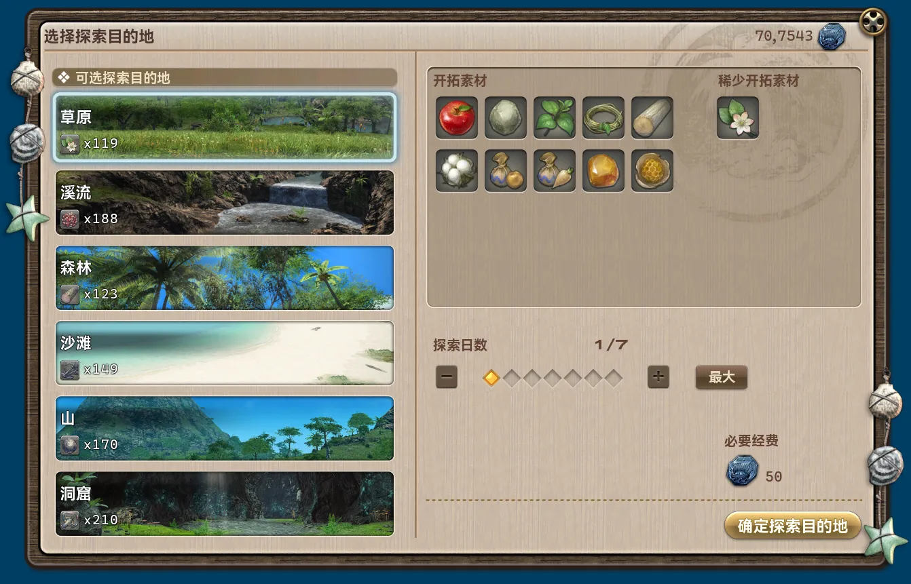
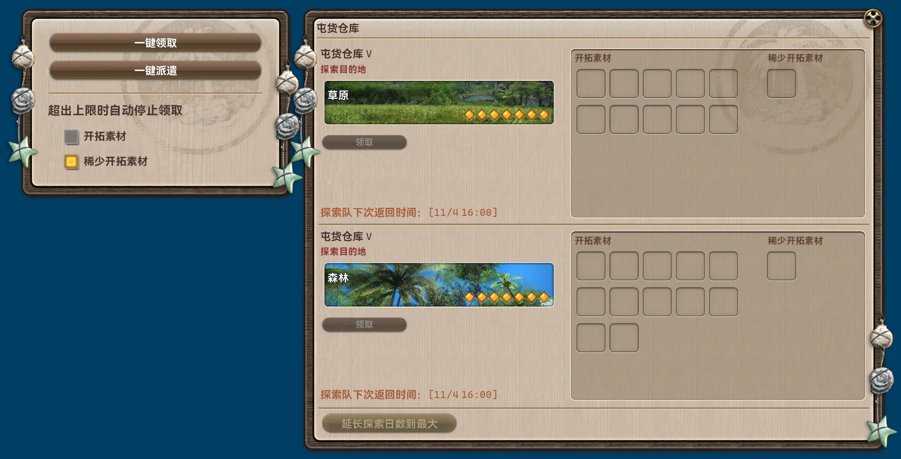
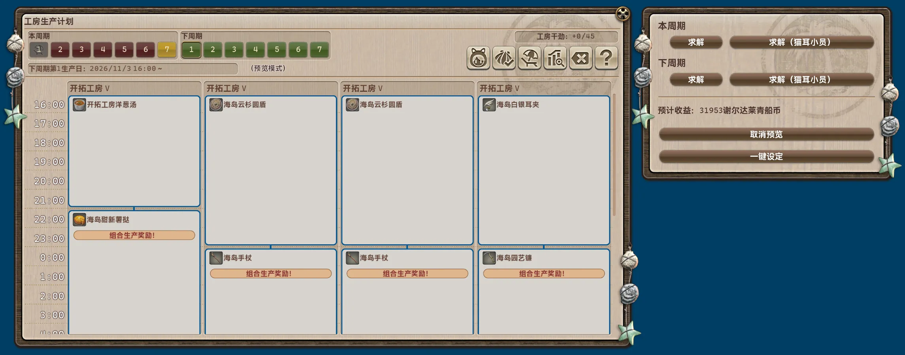
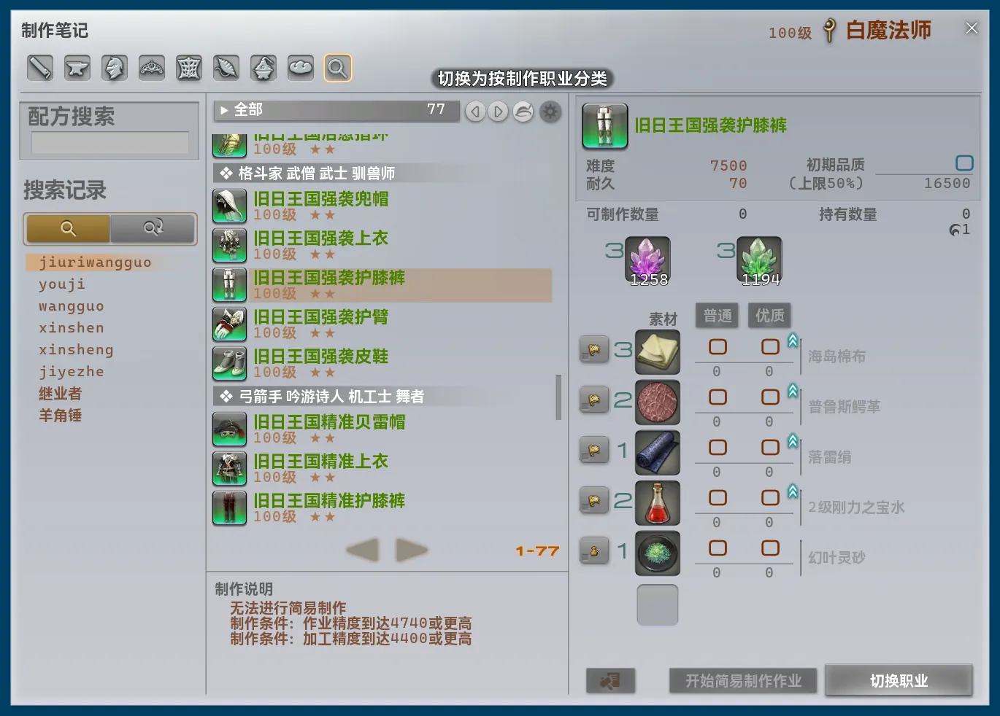

## 본체 변경 사항

- 편리한 이동 경로를 추가했습니다.
    - 콜루시아 섬 ↔ 인형들의 군사 기지
    - 콜루시아 섬 ↔ 기계 유적 갱도
    - 기계 유적 갱도 ↔ 복제된 공장 폐허
    - 홍옥해 ↔ 레이센 신사
    - 이름 없는 섬 → 저지 라노시아
    - 라비린토스 ↔ 올드 샬레이안
    - 가두리 계류기지 ↔ 레오파드의 방
- 메인 창의 상단 탐색 메뉴에서 "모듈"을 선택하면 오른쪽으로 다른 항목이 펼쳐집니다. 기존에 별도로 나란히 표시되던 "활성 기능 목록"과 새로 추가된 "오늘의 추천"이 포함됩니다.
    - "오늘의 추천"에는 추천 모듈로 지정된 모든 모듈이 표시됩니다.
- 별도의 글꼴 및 글꼴 크기 설정을 완전히 제거했습니다. 이제 Dalamud 의 글꼴 및 글꼴 크기 설정을 따릅니다.
- 오랫동안 잘못 적용되던 UI 배율 계산식을 수정했습니다. 글꼴 크기를 중복 계산하고 Dalamud 전역 배율을 함께 적용하여 실제 배율이 지나치게 커지던 문제였습니다.
- UI 배율 계산식 변경에 따라 트레이 위젯의 기본 크기를 48 에서 30 으로 줄였습니다. 업데이트 후 표시 상태에 맞게 다시 조정하는 것을 권장합니다.
- UI 배율 계산식 변경에 맞춰 다수의 UI 그리기 처리를 수정했습니다. 이전 버전의 외형을 최대한 유지했지만 일부 스타일이나 디자인은 달라질 수 있습니다.
- 명령어 자동 완성 화면에서 UI 배율을 고려하지 않아 남은 표시 공간을 잘못 계산하던 문제를 수정했습니다.
- 이전 UI 개편에서 누락된 "간략히 보기로 전환" 및 "자세히 보기로 전환" 기능을 복원했습니다.
- 모든 FontAwesome 아이콘을 고정 너비로 표시하여 시각적 일관성을 개선했습니다.
- 모듈 목록을 계속 스크롤할 때 카드 내부의 설명 또는 배지 영역이 스크롤 입력을 가로채 목록 스크롤이 중단되던 문제를 수정했습니다.
- 모듈 상세 화면에서 두 번째 탐색 메뉴까지 스크롤 영역에 포함되던 문제를 수정했습니다.
- "모듈 내부 이름 복사"를 눌러도 알림이 전송되지 않던 문제를 수정했습니다.
- 공통 지역 간 이동 처리에서 선택한 에테라이트로의 텔레포를 우선하지 않던 문제를 수정했습니다.
- 프레임률이 낮을 때 메인 스레드에서 실행해야 하는 작업의 진행이 지나치게 느려지던 문제를 수정했습니다.
- 메인 창에서 검색 중에는 상단 탐색 메뉴의 기존 선택 상태를 표시하지 않습니다.
- 비활성화된 모듈 카드를 조작하여 설정 화면에 들어갈 수 있던 문제를 수정했습니다.
- 공통 지역 간 이동 처리의 경로 계산을 대폭 간소화하고 최적화했습니다.
    - NPC 가 제공하는 이동 지점의 개방 조건 판정을 완전히 지원합니다.
    - 길이 부족하거나 아직 개방하지 않은 이동 지점은 자동으로 경로에서 제외합니다.

## 삭제된 모듈

### * 무인도 공방 생산 계획 자동 가져오기 [인터페이스]

기존에는 외부에서 작성한 생산 계획 가져오기만 지원했으며, 중국 서버에서 주로 사용하는 형식만 처리할 수 있었습니다. 새 모듈 `"공방 일정" UI 최적화`로 완전히 대체할 수 있어 삭제했습니다.

### 무인도 공방 휴무일 자유 설정 [시스템]

모든 기능을 새 모듈 `"공방 일정" UI 최적화`에 통합하여 삭제했습니다.

## 신규 모듈

### "재료 저장고" UI 최적화 [인터페이스]

*추천 모듈*

무인도 개척의 "재료 저장고" 화면을 개선합니다. 한 번의 클릭으로 개척 재료를 수령하고, 현재 보유량이 가장 적은 희귀 개척 재료에 맞춰 탐험대를 파견할 수 있습니다. 탐험 목적지 선택 화면에서는 각 목적지의 희귀 개척 재료와 현재 보유량을 직접 표시합니다.

### "공방 일정" UI 최적화 [인터페이스]

*추천 모듈*

무인도 개척의 "공방 일정" 화면을 개선합니다. 요구 사항에 맞는 생산 계획을 자동으로 계산하고 배정하며, 휴무일도 더 자유롭게 설정할 수 있습니다.

## 모듈 변경 사항

### 무인도 자동 채집 [스크립트]

- 설명을 수정했습니다.
- 설정 화면의 그리기 처리를 수정했습니다.
- 채집 지점 데이터 수집 중 자주 전송되던 Dalamud 알림을 제거했습니다.
- 설정 항목 "재고 상한 도달 시 채집을 중단하고 알림을 보냅니다."의 표시 문구를 "선택한 모든 재료가 보유 한도에 도달하면 중단하고 알림을 보냅니다."로 변경했습니다.
- "선택한 모든 재료가 보유 한도에 도달하면 중단하고 알림을 보냅니다."의 판정 방식을 아이템 수량 초과 오류 알림 감시에서 보유 수량 직접 확인으로 변경했습니다.
- "선택한 모든 재료가 보유 한도에 도달하면 중단하고 알림을 보냅니다."의 중단 조건을 어느 한 아이템이 한도에 도달했을 때에서 선택한 모든 아이템이 한도에 도달했을 때로 변경했습니다.
- 더 낮은 수준의 처리를 사용하는 방식으로 구현을 전면 재작성했습니다.
    - 채집 지점의 유형을 선택하는 대신 원하는 채집 재료를 직접 선택하도록 변경했습니다. 해당 재료의 채집 지점은 자동으로 선택합니다.
    - 설정 화면에 선택한 재료와 해당 채집 지점의 미리 보기를 추가했습니다. 채집 중에는 현재 채집하는 재료를 실시간으로 표시합니다.
    - 데이터 수집 과정을 재작성하고 대폭 간소화했습니다. 순회 지점을 96 곳에서 24 곳으로 줄여 데이터 수집 시간을 크게 단축했습니다. 일정 시간을 기다린 후 다음 지점으로 이동하던 방식 대신 주변 오브젝트가 실제로 갱신된 뒤 이동하도록 변경했습니다. 다양한 네트워크 환경에 대응하여 지점 누락이나 과도한 대기를 방지합니다.
    - 채집 과정을 재작성했습니다. 일정 시간을 기다린 후 다음 지점으로 이동하던 방식 대신 주변 오브젝트가 실제로 갱신된 뒤 이동하도록 변경하여 네트워크 환경에 따른 지점 누락이나 과도한 대기를 방지합니다. 환경 상태 확인도 보강했습니다. 한 지점에서 채집 시간이 초과되면 자동으로 "무인도 데존"을 사용하고 채집 재개를 시도합니다.
- 다수의 상태 정보와 오류 메시지를 추가했습니다.
- 채집을 시작하려면 플러그인 설정의 "환경 일관성 수정"을 반드시 활성화해야 합니다.
- 다수의 알림 유형과 내용을 수정했습니다.
- IPC 를 추가했습니다.
    - `DailyRoutines.Modules.AutoMJIGather.IsBusy`
        - 기능: 작업 중인지 확인합니다.
        - 반환 형식: `bool`.
    - `DailyRoutines.Modules.AutoMJIGather.SetItems`
        - 기능: 다음 채집 작업의 대상 아이템을 임시로 설정합니다.
        - 시그니처: `Task<bool> SetItems(Dictionary<uint, int>? items)`.
            - 반환값: 설정 성공 여부.
            - `items`의 키는 Item ID, 값은 목표 보유 수량입니다. 빈 사전을 전달하면 모듈 설정을 다시 사용합니다.
    - `DailyRoutines.Modules.AutoMJIGather.Start`
        - 기능: 채집을 시작합니다.
        - 시그니처: `Task<bool> Start()`.
            - 반환값: 채집 시작 여부.
    - `DailyRoutines.Modules.AutoMJIGather.Stop`
        - 기능: 채집을 중단합니다.
        - 시그니처: `Task<bool> Stop()`.
            - 반환값: 채집 중단 여부.

### 백그라운드 화면 렌더링 금지 [시스템]

- 설명을 수정했습니다.
- 구현을 전면 재작성했습니다. 렌더링 프레임 전송을 차단하던 방식에서 게임 내 3D 렌더링을 비활성화하는 방식으로 변경했습니다. 프레임 전송을 막지 않으므로 게임 렌더링 이벤트를 직접 후킹하는 플러그인과의 호환성이 향상됩니다. 기존 방식은 작동 중 GPU 사용량을 거의 없앨 수 있었지만, 새 방식은 UI 렌더링과 프레임 진행이 계속되므로 미미하나마 기존보다 GPU 자원을 더 사용합니다.
- 매 프레임 백그라운드 여부를 확인하는 대신 Windows 창 이벤트를 직접 후킹하도록 변경하여 반응성을 개선하고 처리 부하를 줄였습니다.

### "지도" 창의 에테라이트 표시 확장 [인터페이스]

- 설명을 수정했습니다.
- "* 파티 참가 중에는 UI 를 변경하지 않음" 설정을 추가했습니다. 기본적으로 활성화됩니다. 파티 참가 중에는 에테라이트 텔레포 처리를 변경하지 않고, 도시 내 에테라이트를 통한 텔레포를 활성화하지 않으며, 추가 목적지를 표시하지 않아 의도하지 않은 파티 텔레포 초대를 방지합니다.
- 임무 중에도 UI 를 변경하지 않습니다.
- 모든 편리한 이동 경로를 지도에 추가 목적지로 자동 표시합니다.
- "* 텔레포 확인 생략" 설정을 추가했습니다. 기본적으로 비활성화됩니다. 조작 시 표시되는 추가 확인 창을 생략하고 바로 텔레포합니다.

### 텔레포 UI 최적화 [인터페이스]

- 설명을 수정했습니다.
- 텔레포 알림 방식을 화면 위 표시에서 채팅 메시지로 변경했습니다.
- 텔레포 알림 내용을 수정했습니다.
- "이 위치로 텔레포트"를 눌러도 화면이 닫히지 않던 문제를 수정했습니다.
- 검색 처리를 모듈 검색과 같은 시스템으로 통일했습니다. 성능과 정확도가 향상되었으며 다양한 검색 기능도 지원합니다.

### 네트워크 지연 자동 표시 [시스템]

- 분류를 "인터페이스"에서 "시스템"으로 변경했습니다.
- 설명을 수정했습니다.
- 구현을 전면 재작성했습니다. 실제 외부 연결 경로를 통해 게임 서버에 Ping 을 보내던 방식에서 게임 자체가 기록한 TCP 통신 왕복 시간을 직접 읽는 방식으로 변경하여 정확도와 다양한 네트워크 환경 및 설정에 대한 호환성을 향상했습니다.
- 표시 문구의 사용자 지정 형식을 더 이상 지원하지 않습니다.
- 구현 방식 변경에 따라 패킷 손실률 표시를 제거하고 "* 재전송률"을 추가했습니다.
- 서버 정보 표시줄 항목을 눌러 팝업을 여는 처리와 포커스를 잃으면 자동으로 닫는 처리가 충돌하여 같은 항목을 조작해도 팝업을 닫을 수 없던 문제를 수정했습니다.

### 사용자 지정 지도 표식 [인터페이스]

- "사용자 지정 지도 표식 목록"에서 스크롤 막대가 자동으로 숨겨지지 않던 문제를 수정했습니다.

### 특수 렌더링 모드 [시스템]

- 설명을 수정했습니다.
- 여러 옵션의 이름을 변경했습니다.
- 설정 화면의 배치를 재작성했습니다.
- "* 타이틀 화면의 버전 정보와 조작 메뉴 숨기기" 모드를 추가했습니다.
- "* 화면을 단색으로 덮고 게임 UI 만 유지하기(이름표 제외)" 모드의 기본 색상을 변경했습니다.

### FPS 제한 설정 개선 [시스템]

- 서버 정보 표시줄 항목을 눌러 팝업을 여는 처리와 포커스를 잃으면 자동으로 닫는 처리가 충돌하여 같은 항목을 조작해도 팝업을 닫을 수 없던 문제를 수정했습니다.

### "제작 수첩" UI 최적화 [제작 및 채집]

- 설명을 수정했습니다.
- 설정 화면의 그리기 처리를 수정하여 각 옵션의 도움말을 바로 표시합니다.
- 다수의 UI 문구를 명확하게 다듬고 각 언어의 특성을 반영했습니다.
- 마지막으로 선택한 제작법을 기억하고 다음에 제작 수첩을 열 때 자동으로 선택합니다.
    - 제작 클래스는 클래스별로 선택한 제작법을 따로 기억합니다.
    - 채집 및 전투 클래스는 기억한 제작법을 공유합니다.
- 제작법 검색 기록을 영구 저장하여 게임을 다시 시작해도 유지합니다.
- 제작법 검색의 기반 처리를 모듈 검색과 같은 시스템으로 교체했습니다. 검색 속도가 크게 향상되었으며 유사 검색과 병음 검색 등의 기능을 지원합니다.
- 제작법 검색 입력란 오른쪽의 지우기 버튼이 입력 문구를 즉시 지우지 않던 문제를 수정했습니다.
- 검색 보기 전환 기능을 추가했습니다. "* 제작 클래스별" 분류(기존 방식) 또는 "* 장비 사용 클래스 및 잡별" 분류를 선택할 수 있습니다.
    - 예를 들어, 방어 역할용 "수호자" 장비는 같은 분류로 묶입니다.
    - 참고: "* 장비 사용 클래스 및 잡별" 보기에서는 주무기 및 보조무기와 도구를 "* 주무기 및 보조무기"로 별도 분류합니다. 착용 장비 이외의 아이템은 기존 제작 클래스별 분류를 유지합니다.

- "간이 제작 완료 시 알림" 설정을 제거했습니다. 이제 완료 알림을 항상 전송하며 알림 유형과 내용도 변경했습니다.
- "간이 제작 상한 해제" 설정을 제거했습니다. 이 기능은 항상 적용됩니다.
- "다른 직업 레시피 보기" 설정을 제거했습니다. 이 기능은 항상 적용됩니다.
- "재료 획득처 확인" 설정을 제거했습니다. 이 기능은 항상 적용됩니다.
- "검색어 지우기" 설정을 제거했습니다. 이 기능은 항상 적용됩니다.
- "직업 변경 버튼" 설정을 제거했습니다. 이 기능은 항상 적용됩니다.

*다시 안내합니다. 이 모듈은 다른 플러그인이 같은 위치에 요소를 추가한다는 이유로 호환성 지원이나 위치 변경을 요청하는 의견을 받지 않습니다. 사용할 기능을 직접 선택해 주시기 바랍니다.*

### 터보 클릭 [시스템]

- 컨트롤러의 왼쪽 트리거를 사용하는 조합 입력이 처리되지 않던 문제를 수정했습니다.
