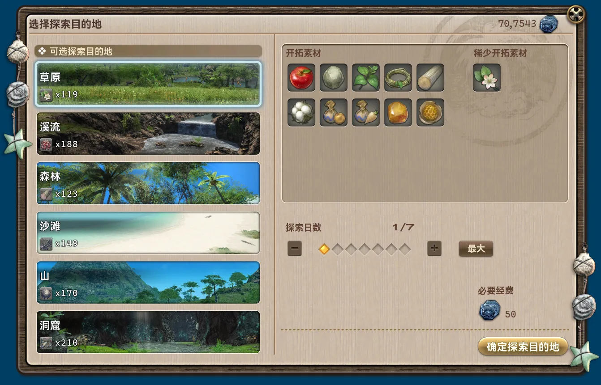
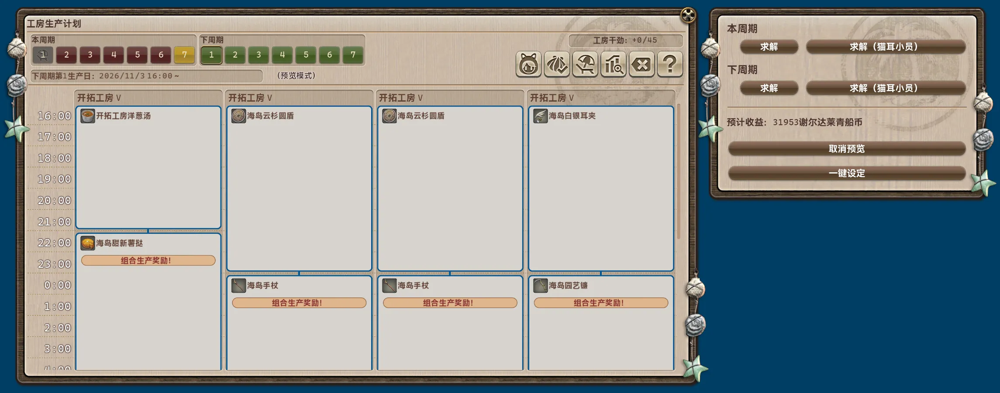
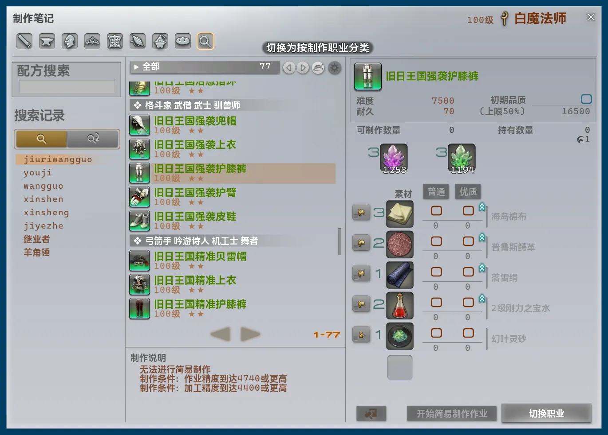

## 本体修改

- 新增了便捷传送路径。
    - 珂露西亚岛 ↔ 人偶军事基地
    - 珂露西亚岛 ↔ 机械遗迹坑道
    - 机械遗迹坑道 ↔ 复制工厂废墟
    - 红玉海 ↔ 醴泉神社
    - 无名岛 → 拉诺西亚低地
    - 迷津 ↔ 旧萨雷安
    - 帕洛克系留基地 ↔ 利奥法德的房间
- 主界面一级顶栏中现在选中“模块”会向右展开其他顶栏项，包含原独立并列的“已启用”项与新增的“推荐”项。
    - “推荐”项中会展示所有被标记为“推荐模块”的模块。
- 完全移除了独立的字体与字号设置，现在遵从 Dalamud 的字体字号设置。
- 修复了长期以来错误的界面缩放计算公式。原先的逻辑下错误计算了两次字体字号，并混用了 Dalamud 全局缩放，导致实际倍率异常偏大。
- 因界面缩放计算公式变更，故托盘悬浮窗的默认大小由 48 下调至 30。推荐更新后自行根据视觉效果再次调整。
- 因界面缩放计算公式修改，连带着修改了大量的界面绘制逻辑。原则上尽量与先前版本外观保持一致，但仍然会有部分样式或设计变动。
- 修复了指令补全界面未考虑界面缩放导致剩余可用空间计算错误的问题。
- 补全了上版本重构界面时遗漏的模块“紧凑视图”和“完整视图”切换功能。
- 现在所有 FontAwesome 图标均会定宽渲染，从而优化了观感。
- 修复了连续滚动模块列表时有可能滚动突然被模块卡片组件内部的描述区域或徽章区域抢夺滚动导致列表滚动中断的问题。
- 修复了模块详情页会将二级顶栏一并纳入可滚动范围的问题。
- 修复了“复制模块内部名称”菜单项点击后没有发送任何通知的问题。
- 调整了插件内共享跨区域移动逻辑未优先传送至选定的以太之光的问题。
- 修复帧率较低时相关必须运行在主线程上的任务推进过慢的问题。
- 现在主界面内搜索时不会显示原先的一级顶栏选中状态。
- 修复了可以交互未启用模块的模块卡片组件进入其配置界面的问题。
- 大幅简化并优化了插件内共享跨区域移动逻辑的路径计算逻辑。
    - 现在完整支持各非玩家对象传送点的解锁判断条件。
    - 现在会自动在金币不足或未解锁时排除部分传送点。

## 删除模块

### 自动无人岛工房生产计划 [界面]

该模块原本仅支持导入外部已有生产计划，且仅支持国服流行作业格式，可完全被新模块 `“工房生产计划”界面优化` 替代，故删除。

### 更加灵活的无人岛工房休息日设置 [系统]

相关功能完全融入新模块 `“工房生产计划”界面优化`，故删除。

## 新增模块

### “屯货仓库”界面优化 [界面]

*推荐模块*

优化开拓无人岛的“屯货仓库”界面。支持通过一键领取开拓素材，并根据当前持有数量最少的稀少开拓素材一键派遣探索队。“选择探索目的地”界面内支持直接在目的地上显示对应的稀少开拓素材与持有数量。

### “工房生产计划”界面优化 [界面]

*推荐模块*

优化开拓无人岛的“工房生产计划”界面。自动根据需求求解生产计划并安排，且支持更加灵活的休息日设置。

## 模块修改

### 自动无人岛采集 [脚本]

- 调整了描述
- 调整了配置界面绘制逻辑。
- 移除了数据采集过程中频繁发送的 Dalamud 通知。
- 配置项“达限时停止采集并发送通知”显示文本调整为“全部所选材料达到持有上限时停止并发送通知”。
- 配置项“全部所选材料达到持有上限时停止并发送通知”检测逻辑由监听物品数量溢出错误通知改为直接检测持有数量。
- 配置项“全部所选材料达到持有上限时停止并发送通知”的逻辑由“任一物品数量达到上限即停止”改为“全部所选物品数量达到上限才停止”。
- 完全重构了实现逻辑，采取了更加底层的实现方式。
    - 由原先的选择“采集点”类型调整为直接选择想要的“采集材料”，会自动选取对应的采集点位，更加直接。
    - 配置界面新增当前选取的采集材料与对应点位预览，并可在采集过程中实时显示当前正在采集的材料。
    - 重构并极大精简了数据采集流程。点位数量由 96 个精简为 24 个，极大降低了数据采集耗时；并以“周边对象实际更新再前往下一个点位”代替了原本的“等待固定时间后前往下一个点位”的逻辑，以应对各种不同的网络环境，避免遗漏点位或单点位等待时间过长。
    - 重构了采集流程。以“周边对象实际更新再前往下一个点位”代替了原本的“等待固定时间后前往下一个点位”的逻辑，以应对各种不同的网络环境，避免遗漏点位或单点位等待时间过长；引入了完善的环境检测逻辑；现在在单点位采集超时时会自动发动“海岛返回”并尝试继续开始采集。
- 补充了大量状态信息与错误提示信息。
- 现在强制要求启用插件配置项“修正环境不一致状态”后才允许开始。
- 大量调整了通知类型与内容。
- 新增了 IPC。
    - `DailyRoutines.Modules.AutoMJIGather.IsBusy`。
        - 含义：是否正在工作。
        - 返回值：`bool`。
    - `DailyRoutines.Modules.AutoMJIGather.SetItems`
        - 含义：临时设置下一次采集的物品。
        - 签名：`Task<bool> SetItems(Dictionary<uint, int>? items)`。
            - 返回值：是否设置成功。
            - `items` 字典键为 Item ID，值为想要到达的持有数量。传入空字典时恢复使用模块配置。
    - `DailyRoutines.Modules.AutoMJIGather.Start`
        - 含义：开始采集。
        - 签名：`Task<bool> Start()`
            - 返回值：是否开始了采集。
    - `DailyRoutines.Modules.AutoMJIGather.Stop`
        - 含义：停止采集。
        - 签名：`Task<bool> Stop()`
            - 返回值：是否停止了采集。

### 自动支持魔光键影中文输入 [金碟]

- 调整了标题与描述。
- 修复了部分文本的拼音未以大驼峰形式显示的问题。
- 修复了部分多音字标注的拼音不正确的问题。
- 现在支持注音与仓颉显示与输入。
    - 注音支持“注音符号”与“注音键位”两种输入模式。两种注音模式下均不需要输入声调。
    - 仓颉支持“三代仓颉”一种输入模式。
    
### 后台禁止渲染游戏画面 [系统]

- 调整了描述。
- 完全重构了实现逻辑，由阻止投递渲染帧调整为禁止游戏内三维图形渲染。相较于原实现方式，因为不阻止渲染，与一些直接挂钩游戏渲染事件的插件兼容性更佳；但旧实现方式激活时能够实现近乎于零的图形处理器性能消耗，新实现方式则因为只是因为界面仍在渲染、帧仍在推进，故会有微弱但比原来更高一些的图形处理器性能消耗。
- 将每帧判断是否位于后台的逻辑调整为直接挂钩 Windows 窗口事件，提高了及时性并降低了性能消耗。

### “地图”界面以太之光优化 [界面]

- 调整了描述。
- 新增配置项“组队状态下不修改界面”，组队状态下，不接管以太之光传送、不令城内以太之晶可交互传送、不添加任何额外传送目的地，以避免发送异常的小队传送邀请。默认启用。
- 现在在副本内同样也不会修改界面。
- 现在会自动将所有便捷传送路径自动在地图上添加为额外传送目的地。
- 新增配置项“传送无需二次确认”，移除交互时弹出的二次确认界面，直接传送。默认禁用。

### 更好的传送界面 [界面]

- 调整了描述。
- 传送时发送的通知类型由“浮动提示”改为“聊天消息”。
- 调整传送时发送的通知内容。
- 修复了点击“传送至此位置”后未关闭界面的问题。
- 搜索逻辑现在完全使用插件模块搜索所使用的相关系统，性能更高且更加精准，且支持各种搜索特性。

### 自动显示网络延迟 [系统]

- 分类由“界面”调整为“系统”。
- 调整了描述。
- 完全重构了实现方式，由自行尝试以真实出口 Ping 游戏服务器改为直接读取游戏自身记录的 TCP 网络请求往返时间，更加精准且对各种网络环境与设置的兼容性更好。
- 不再支持自定义显示文本格式。
- 因为实现方式变更，移除了界面内“丢包率”指标显示。新增了“重传率”指标。
- 修复了因服务器信息栏条目点击打开悬浮窗的逻辑与悬浮窗失焦自动关闭的逻辑互相冲突导致交互服务器信息栏无法关闭悬浮窗的问题。

### 自定义地图标记 [界面]

- 修复了“自定义地图标记一览”界面未自动隐藏滚动条的问题。

### 特殊渲染模式 [系统]

- 调整了描述。
- 批量调整了选项名称。
- 重构了配置界面布局。
- 新增模式“隐藏标题界面版本信息与操作菜单”。
- 调整了模式“以纯色覆盖画面，仅保留游戏界面（不包括姓名板）”默认使用的颜色。

### 更好的游戏帧数限制 [系统]

- 修复了因服务器信息栏条目点击打开悬浮窗的逻辑与悬浮窗失焦自动关闭的逻辑互相冲突导致交互服务器信息栏无法关闭悬浮窗的问题。

### “制作笔记”界面优化 [生产采集]

- 调整了描述。
- 调整了配置界面绘制逻辑，现在直接外显各选项帮助文本。
- 调整了大量界面文本内容，整体表述更加清晰，且支持了各语言自身的语言特性。
- 支持记忆上次所选的配方，并在下次打开“制作笔记”界面时自动选中。
    - 生产职业所选的配方分别记忆。
    - 采集职业与战斗职业所选的配方共享记忆。
- 支持持久保存配方搜索历史，避免每次重启游戏都被清空。
- 从底层接管了配方搜索逻辑，现在完全使用插件模块搜索所使用的相关系统，极大提高了搜索速度，且现在支持模糊搜索与拼音搜索等特性。
- 修复了配方搜索输入框右部清除搜索内容按钮没有及时清除输入文本的问题。
- 新增搜索视图切换功能，现在支持按照制作职业分类（原生）或装备适用职业分类。
    - 示例：所有“-御敌”类装备（适用于防护职业的）装备会自然划分在同一分类下。
    - 注：“按装备适用职业”视图下，主副手武器或工具单独归属于分类“主副手”。非可穿戴装备的其他物品依旧按照原始的制作职业分类划分。

- 删除了配置项“提醒简易制作完成”，现在始终发送通知提醒，且修改了通知类型与内容。
- 删除了配置项“突破简易制作上限”，现在始终生效。
- 删除了配置项“显示配方其他职业版本按钮”，现在始终生效。
- 删除了配置项“材料来源按钮”，现在始终生效。
- 删除了配置项“清除搜索内容按钮”，现在始终生效。
- 删除了配置项“切换职业按钮”，现在始终生效。

*再次声明：此模块不接受任何“其他插件在同样位置添加了其他元素，请考虑兼容/调整位置”类的反馈，请自行二择一。*

### 自动重复点击 [系统]

- 修复了未处理手柄左侧扳机组合键的问题。