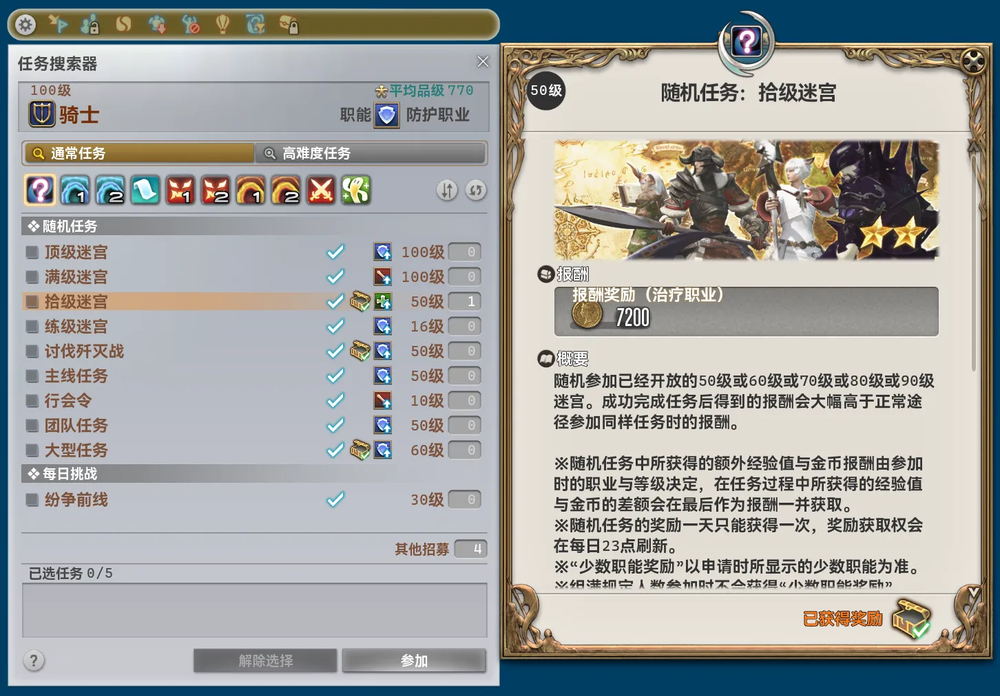
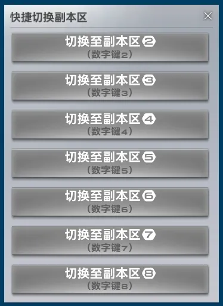

## Core Changes

- The main window's minimum size now follows UI scaling.
- The main window's default size now follows UI scaling.
- The module view in the main window now supports up to five columns instead of four.
- Fixed the notification for successfully importing a module configuration incorrectly reporting a successful export.
- Added a convenient travel route.
    - The Pillars ↔ Azys Lla
- The shared cross-zone travel logic now handles being inside an inn room, automatically leaving before calculating a route.
- All module classes now use `internal` accessibility instead of `public`. Using another module's types within a module now causes a compiler error. Update locally written modules as needed.
- Added integrity and tamper checks to all module assemblies.
- Rebuilt the module overlay system. Changes to internal names may require adjusting overlay sizes and positions again.
- Greatly reduced the size of bundled language and image resources.
- Added the “Crowdsourcing” settings tab. Some features and modules use data from community crowdsourcing platforms and also collect and anonymously upload the data those platforms need to contribute to their development. Disabling uploads makes some features and modules unavailable.
- On the “Auth” page, the status text for a successful server connection now appears in green instead of a multicolor gradient.
- Fixed some text on the “Auth” page rendering before the layout had stabilized.

## Removed Modules

### Better Duty Finder Settings [Recruitment]

Removed because all functionality has been integrated into the new `Better Duty Finder` module.

### Better Duty Finder Registration [Recruitment]

Removed because all functionality has been integrated into the new `Better Duty Finder` module.

## New Modules

### Better Duty Finder [Recruitment]

*Recommended module*

Improves the Duty Finder interface. Click the class/job display to open “Classes/Jobs”, or click the settings display to change Duty Finder settings. Reveals the names of prerequisite quests, adds a quick registration button to duty entries, and adds an icon to Duty Roulette entries indicating whether the daily reward has been claimed. Automatically clears the duty selection after completion.

### Better Time Widget In Server Info Bar [Addon]

*Recommended module*

Improves the time display in the Server Info bar. Synchronizes and corrects local time against server time in real time and increases display precision to seconds.

## Module Changes

### Brayflox's Longstop Helper [Duty]

- Updated the name and description.

### Striking Tree Helper [Duty]

- Updated the name and description.

### Hullbreaker Isle Helper [Duty]

- Updated the name and description.

### Pool Of Tribute Helper [Duty]

- Updated the name and description.

### Praetorium Helper [Duty]

- Updated the name and description.

### Sastasha Helper [Duty]

- Updated the name and description.
- Updated notification text and removed the “DR” prefix.

### Cuff Of Father Helper [Duty]

- Updated the name and description.

### Alphascape V3.0 Helper [Duty]

- Updated the name and description.

### Auto Leave Duty [Duty]

- Removed “Leave Immediately”; it is now always enabled. Increase the delay if this option previously needed to be disabled.
- Setting help text is now displayed directly.
- Renamed “Disable In High-end Raids” to “Disable In High-end Duties”.
- Renamed “Delay” to “Leave Delay”.
- Updated the display label for “Duty To Leave Immediately”.
- Renamed “Duty Blacklist” to “Duty To Stay”.
- Changed the default “Leave Delay” from 0 ms to 6,000 ms.
- Added help text for “Leave Delay”: the timer starts when the server sends the “Duty Complete” event, usually well before the character and arena enter their post-completion states.
- Updated notifications.

### Real-time Network Metrics [System]

- When a gaming accelerator or transparent network proxy prevents accurate TCP round-trip measurements, the module now uses the packet round-trip time recorded internally by the game. This value is heavily affected by the client's frame rate and is provided for reference only.

### Auto Spam Key [System]

- Fixed the cross hotbar becoming completely unresponsive when both controller triggers were held.

### Better Progress Bar [Combat]

- Fixed incorrect destinations appearing for some teleports when “Detailed Cast Info” was enabled.

### Better Party Finder Filter [Recruitment]

- Reduced the horizontal spacing between checkboxes and input fields for regular expression filters on the “Description” tab.
- Fixed the checkboxes for regular expression filters on the “Description” tab being unresponsive.
- Fixed some listings occasionally being filtered incorrectly when class/job data could not be retrieved.

### Notorious Monster Scanner [Script]

- Updated the description.
- Extensively revised interface text.
- Added comprehensive automatic tracking of hunt marks' alive/dead states, removing the heavy reliance on manual state changes or repeatedly iterating over nearby objects.
- Added the “Auto Broadcast” system. Automatically places map flags and relays hunt mark locations in route order. When a mark dies, it relays the next mark's location or the aetheryte at which to wait.
    - Supports scheduled starts.
    - Supports automatic route state tracking.
    - Added “Hunt-train Intro Message” and “Hunt-train Outro Message”, sent automatically when the relay starts and ends, with up to 15 lines each.
    - Supports automatic pathfinding, teleportation, and instance switching.
    - Sends notification reminders 30 seconds before the relay starts and after it ends.
- Removed “Font Scale”.
- All outgoing messages must be configured again due to extensive changes to the underlying system.
- Scanning now supports only A-rank hunt marks. The system has always been designed around A ranks, and common B-rank scanning scenarios do not fit that design.
- Removed “Duration Per Stop (millisecond)”, which had not had any effect for several versions.
- Extensively revised the types and content of all notifications.
- Completely rebuilt the scanner around a state machine instead of a simple queue, and rebuilt its interface.
    - Fixed scanning other instances being skipped when only one mark was found in an instance of an instanced zone.
    - Scan results can now be appended to an existing route. Renamed “Save” to “Overwrite” to reflect its actual behavior.
        - Appending a mark that already exists in the route replaces its existing data with the new data.
    - Fully supports the game's “Character Display Range” setting. Scan previews, scan routes, and teleport decisions now adapt by merging or skipping certain points.
    - Sends a notification if scanning is unexpectedly interrupted or some points cannot be reached.
    - If pathfinding to a point fails, automatically tries another coordinate within range.
    - “Zones To Be Scanned” now supports selecting all zones from an expansion at once.
    - Scans zones from nearest to farthest according to their actual distances, rather than zone IDs.
    - Increased the effective scan radius from 300 to 400.
    - Replaced point-to-point scanning with an algorithm based entirely on the areas a route may pass through, keeping travel distance as short as possible.
    - Sends a notification when scanning finishes.
- Fixed “Closest Aetheryte” sometimes appearing blank because a city aethernet shard was selected instead.
- Completely rebuilt the route selector. It now shows each route's name, number of zones, number of marks, and creation time, with rename, export, and delete buttons directly visible.
    - Moved route import into the route selector.
- Rebuilt the route contents table.
    - Deleting a mark now requires confirmation.
    - Replaced the up/down buttons before row numbers with drag-to-reorder row numbers.
    - Merged the zone and coordinates columns.
    - Supports specifying the nearest aetheryte for each mark and including it in exports, with special handling for some zones.
        - The Dravanian Hinterlands → Idyllshire
        - The Ruby Sea → Onokoro
        - The Tempest → The Ondo Cups
    - “Sort By Departure” now orders zones from nearest to farthest by actual distance instead of simply sorting by zone ID.
    - Removed the separate “Departure” button. Renamed the row number column header to “Departure”; clicking it opens the original departure selection interface.
    - Rebuilt the aetheryte selector for “Departure”. It now supports filtering by zone and only includes zones present in the route.
- Rebuilt the hunt train relay interface.
    - Removed the route import and export buttons.
    - Added “Broadcast Hunt-train Intro” and “Broadcast Hunt-train Outro” buttons.
    - Moved the alive/dead toggle from the bottom of each column to after the mark's name.
    - Location and nearest aetheryte information now appear on separate lines.
- Changed the command to open the hunt train relay from `/pdrmf` to `/pdr mf`.
- Added “Entity” navigation to hunt marks. Its new behavior setting supports “Location” and “Nearby”.
    - “Nearby” includes a “Distance Threshold” setting for horizontal distance, defaulting to 30. The vertical threshold is fixed at 20.
- Added “Echo” as an announcement channel.

### Better Macro Management [Addon]

- Fixed a crash when displaying line numbers in certain client languages.
- Reading a preset from the interface now also requires confirmation.

### Better Inn Access [General]

- Changed the category from “System” to “General”.
- Updated the description.
- Removed the online verification requirement.
- Completely rebuilt and greatly simplified the implementation. Entering or leaving an inn room now intercepts and handles confirmation dialogs before they appear, preventing them from flashing on screen.
- Selecting the nearest accessible inn now uses the plugin's shared cross-zone route calculations for smarter, more efficient decisions.

### Better Instance Switching [General]

- Changed the category from “System” to “General”.
- Updated the title and description.
- Extensively revised interface text.
- Extensively revised notification text and types.
- Completely rebuilt and greatly simplified the implementation.
- Fixed incorrectly using another module's localization resources.
- Removed “Hide the menu after interaction”; the menu now always closes.
- Removed “Auto mount after instance switching”. Mounting now follows the state before switching: switching while unmounted leaves the character unmounted, while switching while mounted automatically remounts afterward.
- Fixed teleporting to the nearest aetheryte selecting the one closest to the zone's center instead of the character.
- The `/pdr insc` command now performs additional validation of the instance argument and rejects nonexistent instances.
- Removed attempt-count notifications when repeatedly trying to enter the target instance.
- Completely rebuilt the quick instance switching interface as a native game interface, replacing the ImGui overlay.

- No longer opens an empty overlay before complete zone instance information has been retrieved.
- The Server Info bar entry now also appears in zones without instance switching, but the quick switching interface cannot be opened there.
- Buttons in the quick switching interface now appear disabled when instance switching is unavailable, matching the actual restriction on starting a switch.
- Switching instances with number keys now also supports the numeric keypad.
- The quick switching interface now directly indicates that number keys can be used.
- Fixed the quick switching interface not being properly centered because its window size was ignored.

### Better World Visit [System]

- Supports starting World Visit directly within each physical data center on the international servers.

### Better Intra-zone Loading [System]

- Updated the title and description.

### Unified Glamour Manager [Addon]

- Presets can now include gear and dyes not currently owned, allowing outfits to be planned in advance. Use “* Show Owned Gear Only” to restore the previous behavior.
- Added drafts for editing. Changes first apply to a temporary draft; “Save” replaces the original preset. “* Save As” creates a new preset from the draft, while “Cancel” discards the draft and restores the original contents. Drafts also support trying on and exporting.
    - Switching presets with an active draft requires confirmation: “* Save and Switch” or “* Discard Changes and Switch”.
- Selecting gear that occupies multiple slots now removes the gear previously assigned to those slots. Occupied empty slots also show which item occupies them.
- Importing, creating, saving, trying on, or applying a preset automatically removes conflicting or invalid gear entries and sends a notification. Gear occupying more slots takes priority.
- Added “* Fill Empty Slots with The Emperor's New Gear” to fill all empty gear slots except the main hand and off hand in one click.
- Rebuilt the try-on process. It now clears existing entries, inserts the entire preset at once, and refreshes the preview to prevent gear from a previous try-on being mixed in.
