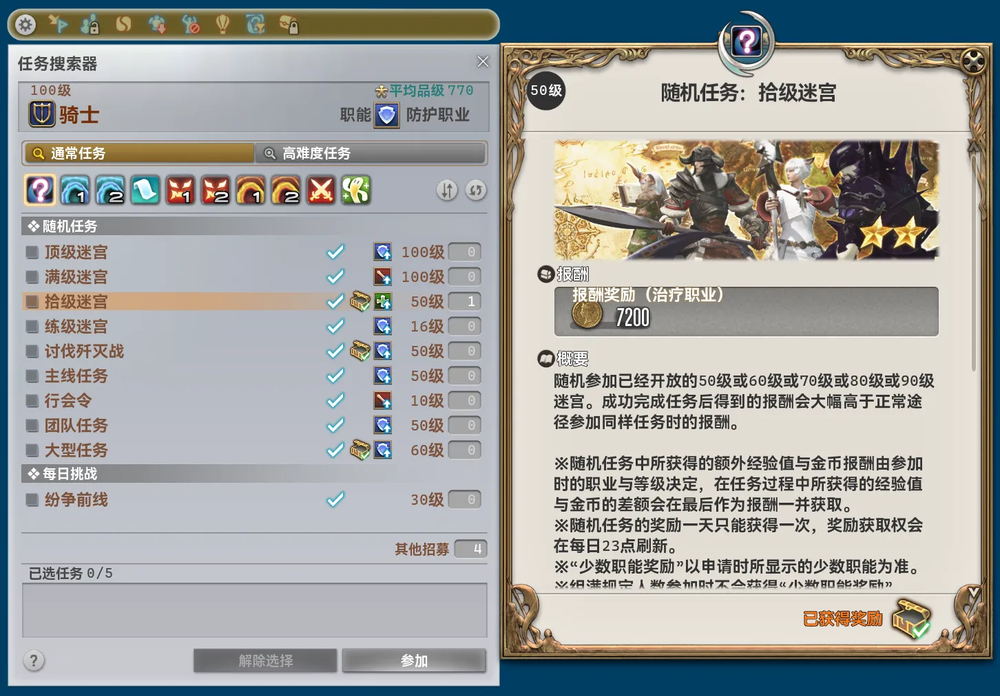
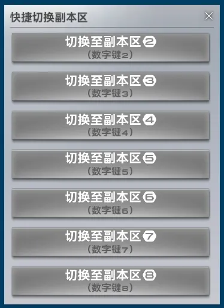

## 本体の変更

- メインウィンドウの最小サイズに UI スケールが反映されるようになりました。
- メインウィンドウの初期サイズに UI スケールが反映されるようになりました。
- メインウィンドウのモジュール表示を最大 4 列から最大 5 列に変更しました。
- モジュール設定のインポート成功通知が、エクスポート成功と誤って表示される問題を修正しました。
- 便利な移動ルートを追加しました。
    - イシュガルド：上層 ↔ アジス・ラー
- プラグイン共通のエリア間移動処理が宿屋の客室内に対応しました。客室内にいる場合は、自動で退出してからルートを計算します。
- すべてのモジュールクラスのアクセス修飾子を `public` から `internal` に変更しました。モジュール内で別のモジュールの型を使用すると、コンパイルエラーになります。必要に応じて自作のローカルモジュールを更新してください。
- すべてのモジュールのアセンブリに整合性チェックと改ざん検出を追加しました。
- モジュールのオーバーレイシステムを再構築しました。内部名の変更により、サイズと位置の再調整が必要になる場合があります。
- 同梱する言語リソースと画像リソースのファイルサイズを大幅に削減しました。
- 設定に「* クラウドソーシング」タブを追加しました。一部の機能やモジュールはプレイヤーコミュニティのクラウドソーシング基盤のデータを利用し、その基盤に必要なデータを収集して匿名でアップロードすることで運営と発展に貢献します。アップロードを無効にすると、一部の機能やモジュールを利用できなくなります。
- 「認証」ページで、サーバー接続成功時のステータステキストの色を多色グラデーションから緑色に変更しました。
- 「認証」ページの一部テキストが、レイアウトの確定前に描画される問題を修正しました。

## 削除したモジュール

### クエスト検索ツール設定の最適化 [募集]

すべての機能を新モジュール `* 「コンテンツファインダー」UI の最適化` に統合したため、削除しました。

### 簡易コンテンツファインダー申請 [募集]

すべての機能を新モジュール `* 「コンテンツファインダー」UI の最適化` に統合したため、削除しました。

## 新規モジュール

### * 「コンテンツファインダー」UI の最適化 [募集]

*おすすめモジュール*

コンテンツファインダーの UI を改善します。クラス・ジョブの表示をクリックすると「クラス／ジョブ」画面を開き、参加条件の表示をクリックするとコンテンツファインダーの設定を変更できます。前提クエスト名を直接表示し、各コンテンツに申請用のボタンを追加します。コンテンツルーレットには本日の報酬を獲得済みかどうかを示すアイコンを追加し、コンテンツクリア後は選択を自動で解除します。

### * 「サーバー情報」UI の時刻表示改善 [インターフェイス]

*おすすめモジュール*

サーバー情報の時刻表示を改善します。サーバー時刻に合わせてローカル時刻をリアルタイムで同期・補正し、秒単位で表示します。

## モジュールの変更

### * 奪還支援 ブレイフロクスの野営地アシスト [コンテンツ]

- 名前と説明を変更しました。

### * 真ラムウ討滅戦アシスト [コンテンツ]

- 名前と説明を変更しました。

### * 財宝伝説 ハルブレーカー・アイルアシスト [コンテンツ]

- 名前と説明を変更しました。

### * スサノオ討滅戦アシスト [コンテンツ]

- 名前と説明を変更しました。

### * 最終決戦 魔導城プラエトリウムアシスト [コンテンツ]

- 名前と説明を変更しました。

### * 天然要害 サスタシャ浸食洞アシスト [コンテンツ]

- 名前と説明を変更しました。
- 通知内容を変更し、「DR」の接頭辞を削除しました。

### * 機工城アレキサンダー：起動編2アシスト [コンテンツ]

- 名前と説明を変更しました。

### * 次元の狭間オメガ：アルファ編3アシスト [コンテンツ]

- 名前と説明を変更しました。

### コンテンツから自動退出する [コンテンツ]

- 「退出制限無視」を削除し、常に有効にしました。この設定を無効にする必要があった場合は、退出までの待機時間を長くしてください。
- 設定項目のヘルプテキストを直接表示するようにしました。
- 「高難度ダンジョンから自動的に退出しない」を「* 高難易度コンテンツから自動退出しない」に変更しました。
- 「遅延」を「* 退出遅延」に変更しました。
- 「ステージクリア後に即退出」を「* 即座に退出するコンテンツ」に変更しました。
- 「ブラックリストコンテンツ」を「* 自動退出しないコンテンツ」に変更しました。
- 「* 退出遅延」の初期値を 0 ミリ秒から 6,000 ミリ秒に変更しました。
- 「* 退出遅延」にヘルプテキストを追加しました。計測はサーバーからコンテンツクリアイベントを受信した時点で開始します。通常、キャラクターやフィールドがクリア後の状態になるよりもかなり早いタイミングです。
- 通知内容を変更しました。

### ネットワーク遅延の自動表示 [システム]

- ゲーム用通信アクセラレーターや透過型ネットワークプロキシの使用中に TCP の往復時間を正確に測定できない場合は、ゲーム内部で記録されたパケット往復時間を使用するようにしました。この値はクライアントのフレームレートに大きく左右されるため、参考値として表示します。

### ターボクリック機能 [システム]

- ゲームパッドの左右トリガーを同時に押すと、クロスホットバーをまったく操作できなくなる問題を修正しました。

### 「キャストバー」UIの最適化 [戦闘]

- 「詳細なキャスト情報を表示」を有効にすると、一部のテレポ先が誤って表示される問題を修正しました。

### パーティ募集フィルター画面の改善 [募集]

- 「募集文」タブの正規表現フィルターで、チェックボックスと入力欄の横方向の間隔を狭めました。
- 「募集文」タブの正規表現フィルターのチェックボックスを操作できない問題を修正しました。
- クラス・ジョブ情報を取得できない場合に、一部の募集が誤って除外されることがある問題を修正しました。

### リスキーモブを自動スキャン [スクリプト]

- 説明を変更しました。
- UI テキストを大幅に変更しました。
- リスキーモブの生存状態を自動管理する処理を追加しました。手動での状態切り替えや、周囲のオブジェクトの繰り返し検索に強く依存しなくなりました。
- 「* 自動中継」システムを追加しました。ルート順にマップフラグを設置し、リスキーモブの位置を中継します。モブが倒されると、次のモブの位置、または一時的な待機場所となるエーテライトの位置を自動で中継します。
    - 時刻を指定した開始に対応しました。
    - ルートの状態を自動管理できます。
    - 「* モブハントツアー開始メッセージ」と「* モブハントツアー終了メッセージ」を追加しました。自動中継の開始時と終了時に送信し、それぞれ最大 15 行まで設定できます。
    - 自動経路探索、テレポ、インスタンス切り替えに対応しました。
    - 自動中継の開始 30 秒前と終了後に通知します。
- 「フォントサイズ」を削除しました。
- 内部処理の大幅な変更に伴い、送信するメッセージをすべて再設定する必要があります。
- スキャン対象を A ランクのリスキーモブに限定しました。このシステムは当初から A ランク向けに設計されており、一般的な B ランクのスキャン用途は設計の目的に合わないためです。
- 数バージョン前から効果がなかった「単一地点の遅延 (ms)」を削除しました。
- すべての通知の種類と内容を大幅に変更しました。
- スキャナーを単純なキュー方式からステートマシン方式へ全面的に再構築し、関連 UI も作り直しました。
    - 複数のインスタンスがあるエリアで、あるインスタンス内のモブが 1 体しか見つからないと、ほかのインスタンスのスキャンが省略される問題を修正しました。
    - スキャン結果を既存ルートに追加できるようにしました。従来の「保存」ボタンを、実際の動作に合わせて「* 上書き」に変更しました。
        - 追加先のルートに同じモブが含まれる場合は、新しいデータで置き換えます。
    - ゲーム設定の「キャラクター表示範囲」に完全対応しました。スキャン状況のプレビュー、スキャンルート、テレポ先の判断が設定に合わせて一部の地点を統合または省略します。
    - スキャンが予期せず中断された場合や、一部の地点に到達できない場合に通知します。
    - 経路探索で到達できない地点では、範囲内の別の座標を選んで再度経路を探索します。
    - 「スキャン対象エリア」で、特定の拡張パッケージの全エリアを一括選択できるようにしました。
    - エリアをスキャンする順序を、エリア ID 順から実際の距離に基づく近い順へ変更しました。
    - スキャンの有効半径を 300 から 400 に拡大しました。
    - 地点を順番につなぐ方式から、通過できる範囲に基づいて移動距離を最短に保つ方式へ変更しました。
    - スキャン完了時に通知します。
- 都市内のエーテライト・ネットワークの転送地点を取得したために、「最寄りのエーテライト」が空欄になることがある問題を修正しました。
- ルート選択 UI を全面的に再構築しました。各ルートの名前、エリア数、モブ数、作成日時を表示し、名前変更、エクスポート、削除のボタンも直接表示します。
    - ルートのインポート機能をルート選択 UI 内に移動しました。
- ルート内容の表を再構築しました。
    - モブの削除に確認操作が必要になりました。
    - 行番号の前にあった上下ボタンを削除し、行番号のドラッグで並べ替えられるようにしました。
    - エリア列と座標列を統合しました。
    - 各モブの最寄りのエーテライトを指定し、ルートと一緒にエクスポートできるようにしました。一部のエリアには専用の処理を用意しました。
        - 低地ドラヴァニア → イディルシャイア
        - 紅玉海 → オノコロ島
        - テンペスト → オンドの潮溜まり
    - 「出発点に基づいて並べ替え」は、エリア ID による単純な並べ替えではなく、実際の距離に基づいて近いエリアから順に並べます。
    - 独立した「出発地」ボタンを削除しました。行番号の列見出しを「出発地」に変更し、クリックすると従来の出発地選択画面を開きます。
    - 「出発地」のエーテライト選択 UI を再構築しました。エリアで絞り込みでき、ルートに含まれるエリアのみを表示します。
- モブハントツアー中継 UI を再構築しました。
    - ルートのインポートとエクスポートのボタンを削除しました。
    - ツアー開始メッセージと終了メッセージを中継するボタンを追加しました。
    - 生存状態の切り替えボタンを各列の末尾からモブ名の直後へ移動しました。
    - 位置情報と最寄りのエーテライトを別々の行に表示するようにしました。
- モブハントツアー中継 UI を開くコマンドを `/pdrmf` から `/pdr mf` に変更しました。
- 「* リスキーモブへの移動」を追加しました。新しい動作設定で「* 正確な位置へ移動」または「* 付近へ移動」を選択できます。
    - 「* 付近へ移動」には水平方向の「* 距離しきい値」があり、初期値は 30 です。高さのしきい値は 20 固定で、変更できません。
- テキスト中継先に「Echo」を追加しました。

### 「マクロ」ウィンドウの拡張 [インターフェイス]

- 特定のクライアント言語で行番号を表示するとクラッシュする問題を修正しました。
- UI からプリセットを読み取る際も、確認操作が必要になりました。

### 宿屋へのクイック移動 [全般]

- カテゴリを「システム」から「全般」に変更しました。
- 説明を変更しました。
- オンライン認証を不要にしました。
- 実装を全面的に再構築し、大幅に簡素化しました。宿屋の客室への入退室時は、確認ダイアログを内部で直接処理し、一瞬だけ画面に表示されることもなくなりました。
- 最寄りの利用可能な宿屋を選ぶ処理に、プラグイン共通のエリア間移動ルート判定を導入し、判断の精度と効率を高めました。

### * インスタンスのクイック切り替え [全般]

- カテゴリを「システム」から「全般」に変更しました。
- タイトルと説明を変更しました。
- UI テキストを大幅に変更しました。
- 通知のテキストと種類を大幅に変更しました。
- 実装を全面的に再構築し、大幅に簡素化しました。
- 別のモジュールの言語リソースを誤って使用する問題を修正しました。
- 「メニュー使用後に自動で閉じる」を削除し、常に閉じるようにしました。
- 「インスタンス切り替え後、自動的にマウントを使用する」を削除しました。切り替え前に騎乗していなければ切り替え後も騎乗せず、騎乗していた場合は切り替え後に自動で再騎乗します。
- 最寄りのエーテライトへテレポする際、キャラクターではなくエリアの中心に最も近いエーテライトを選ぶ問題を修正しました。
- `/pdr insc` コマンドでインスタンス引数の検証を強化し、存在しないインスタンスを拒否するようにしました。
- 目的のインスタンスへの移動を繰り返す際の、試行回数の通知を削除しました。
- クイック切り替え UI を ImGui オーバーレイからゲーム標準形式の UI に全面的に作り直しました。

- エリアのインスタンス情報をすべて取得するまで、空のオーバーレイを開かなくなりました。
- インスタンスを切り替えられないエリアでもサーバー情報バーの項目を表示しますが、クイック切り替え UI は開けません。
- インスタンスを切り替えられない状態では、UI 内のボタンも無効表示になり、実際の切り替え可否と一致するようになりました。
- 数字キーによる切り替えがテンキーにも対応しました。
- クイック切り替え UI に、数字キーで切り替えられることを直接表示します。
- ウィンドウサイズを考慮していなかったため、クイック切り替え UI が画面中央に正しく配置されない問題を修正しました。

### クイック・ワールド間テレポ [システム]

- グローバル版の各物理データセンター内で、直接ワールド間テレポを開始できるようにしました。

### * エリア内移動の読み込み高速化 [システム]

- タイトルと説明を変更しました。

### ミラプリ一括管理 [インターフェイス]

- 未所持の装備やカララントをプリセットに設定し、事前にコーディネートを計画できるようにしました。「* 所持している装備のみ表示」で従来の動作に戻せます。
- 編集に下書きを導入しました。変更は一時的な下書きに反映され、「保存」で元のプリセットを置き換えます。「* 名前を付けて保存」で新しいプリセットを作成でき、「キャンセル」で下書きを破棄して元の内容に戻します。下書きも試着とエクスポートに対応します。
    - 下書きがある状態で別のプリセットに切り替える場合は、「* 保存して切り替え」または「* 変更を破棄して切り替え」の確認が必要です。
- 複数部位を占有する装備を選ぶと、該当部位の既存装備を取り除きます。占有された空き欄には、その部位を占有する装備名を表示します。
- プリセットのインポート、作成、保存、試着、適用時に、競合する装備や無効な装備を自動で取り除き、通知します。より多くの部位を占有する装備を優先して残します。
- 「* 空き部位をエンペラーズ・ニュー装備で埋める」ボタンを追加しました。メインアームとサブアームを除く空き部位を一括で埋められます。
- 試着処理を再構築しました。既存の試着項目を消去してからプリセット全体を一括で設定し、プレビューを更新することで、前回試着した装備の混入を防ぎます。
