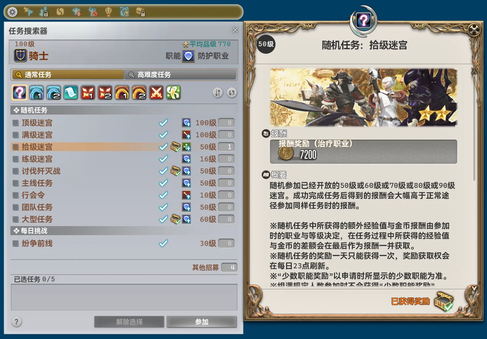
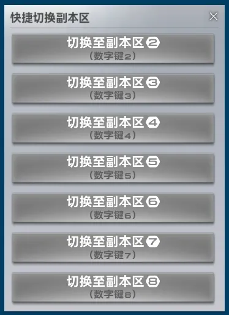

## 본체 변경 사항

- 메인 창의 최소 크기에 UI 배율이 반영됩니다.
- 메인 창의 기본 크기에 UI 배율이 반영됩니다.
- 메인 창의 모듈 보기를 최대 4열에서 최대 5열로 변경했습니다.
- 모듈 설정을 성공적으로 가져왔을 때 알림에 내보내기 성공으로 잘못 표시되던 문제를 수정했습니다.
- 편리한 이동 경로를 추가했습니다.
    - 이슈가르드 상층 ↔ 아지스 라
- 플러그인 공용 지역 간 이동 로직이 여관 객실 안에 있는 상황을 지원합니다. 객실 안에 있으면 자동으로 퇴장한 뒤 경로를 계산합니다.
- 모든 모듈 클래스의 접근 제한자를 `public`에서 `internal`로 변경했습니다. 모듈 안에서 다른 모듈의 형식을 사용하면 컴파일 오류가 발생합니다. 필요한 경우 직접 작성한 로컬 모듈을 수정해야 합니다.
- 모든 모듈 어셈블리에 무결성 검사와 변조 감지를 추가했습니다.
- 모듈 오버레이 시스템을 재구축했습니다. 내부 이름이 변경되어 오버레이의 크기와 위치를 다시 조정해야 할 수 있습니다.
- 함께 배포되는 언어 및 이미지 리소스 파일의 크기를 크게 줄였습니다.
- 설정에 "* 크라우드소싱" 탭을 추가했습니다. 일부 기능과 모듈은 플레이어 커뮤니티의 크라우드소싱 플랫폼 데이터를 사용하며, 플랫폼 운영과 발전에 기여하기 위해 필요한 데이터를 수집하여 익명으로 업로드합니다. 업로드를 비활성화하면 일부 기능과 모듈을 사용할 수 없습니다.
- "인증" 페이지에서 서버 연결 성공 시 상태 텍스트 색상을 여러 색의 그라데이션에서 녹색으로 변경했습니다.
- "인증" 페이지의 일부 텍스트가 레이아웃이 확정되기 전에 렌더링되던 문제를 수정했습니다.

## 삭제된 모듈

### 임무 찾기 도구 설정 최적화 [파티 모집]

모든 기능이 새 모듈 `* "임무 찾기" UI 최적화`에 통합되어 삭제했습니다.

### 간이 임무 찾기 신청 [파티 모집]

모든 기능이 새 모듈 `* "임무 찾기" UI 최적화`에 통합되어 삭제했습니다.

## 새 모듈

### * "임무 찾기" UI 최적화 [파티 모집]

*추천 모듈*

임무 찾기 UI를 개선합니다. 클래스 및 잡 표시를 클릭하면 "클래스/잡" 창을 열 수 있으며, 참가 조건 표시를 클릭하면 임무 찾기 설정을 변경할 수 있습니다. 숨겨진 선행 퀘스트 이름을 표시하고, 임무 목록에 빠른 참가 신청 버튼을 추가합니다. 무작위 임무 목록에는 오늘의 보상 획득 여부를 나타내는 아이콘을 추가하며, 임무를 완료하면 선택을 자동으로 해제합니다.

### * "서버 정보" UI 시간 표시 개선 [인터페이스]

*추천 모듈*

서버 정보의 시간 표시를 개선합니다. 서버 시간을 기준으로 로컬 시간을 실시간 동기화 및 보정하고, 초 단위까지 표시합니다.

## 모듈 변경 사항

### "브레이플록스의 야영지" 도우미 [콘텐츠]

- 이름과 설명을 변경했습니다.

### "진 라무 토벌전" 도우미 [콘텐츠]

- 이름과 설명을 변경했습니다.

### "난파선의 섬" 도우미 [콘텐츠]

- 이름과 설명을 변경했습니다.

### "스사노오 토벌전" 도우미 [콘텐츠]

- 이름과 설명을 변경했습니다.

### "마도성 프라이토리움" 도우미 [콘텐츠]

- 이름과 설명을 변경했습니다.

### "사스타샤 침식 동굴" 도우미 [콘텐츠]

- 이름과 설명을 변경했습니다.
- 알림 내용을 변경하고 "DR" 접두사를 제거했습니다.

### "기공성 알렉산더: 기동편 2" 도우미 [콘텐츠]

- 이름과 설명을 변경했습니다.

### "차원의 틈 오메가: 알파편 3" 도우미 [콘텐츠]

- 이름과 설명을 변경했습니다.

### 컨텐츠 자동 퇴장 [콘텐츠]

- "퇴장 제한 무시" 설정을 제거하고 항상 적용되도록 했습니다. 기존에 이 설정을 비활성화해야 했다면 퇴장 지연 시간을 늘려야 합니다.
- 설정 항목의 도움말을 직접 표시합니다.
- "고난도 컨텐츠에서는 자동 퇴장하지 않음"의 표시 문구를 조정했습니다.
- "지연"을 "종료 지연 (밀리초)"으로 변경했습니다.
- "임무 즉시 퇴장"을 "즉시 퇴장하는 임무"로 변경했습니다.
- "블랙리스트 컨텐츠"를 "자동퇴장하지 않는 임무"로 변경했습니다.
- "종료 지연 (밀리초)"의 기본값을 0밀리초에서 6,000밀리초로 변경했습니다.
- "종료 지연 (밀리초)"에 도움말을 추가했습니다. 서버에서 임무 완료 이벤트를 보낸 시점부터 시간을 측정하며, 일반적으로 캐릭터와 전장이 임무 완료 후 상태로 전환되기보다 훨씬 먼저 시작됩니다.
- 알림 내용을 변경했습니다.

### 네트워크 지연 자동 표시 [시스템]

- 게임용 네트워크 가속기나 투명 프록시 사용으로 정확한 TCP 왕복 시간을 측정할 수 없으면, 게임 내부에 기록된 패킷 왕복 시간을 사용합니다. 이 값은 클라이언트 프레임 속도의 영향을 크게 받으므로 참고용으로만 표시합니다.

### 터보 클릭 [시스템]

- 게임패드의 양쪽 트리거를 동시에 누르면 십자 단축바를 전혀 조작할 수 없던 문제를 수정했습니다.

### "시전바" UI 최적화 [전투]

- "캐스팅 정보 상세 표시"를 활성화하면 일부 텔레포 목적지가 잘못 표시되던 문제를 수정했습니다.

### 개선된 파티 찾기 필터 UI [파티 모집]

- "파티 모집 내용" 탭의 정규식 필터에서 확인란과 입력란 사이의 가로 간격을 줄였습니다.
- "파티 모집 내용" 탭의 정규식 필터 확인란을 조작할 수 없던 문제를 수정했습니다.
- 클래스 및 잡 데이터를 가져오지 못하면 일부 모집이 잘못 필터링되던 문제를 수정했습니다.

### 자동 마물 스캐너 [스크립트]

- 설명을 변경했습니다.
- UI 텍스트를 대폭 변경했습니다.
- 마물의 생존 상태를 자동으로 관리하는 로직을 추가하여, 수동 상태 변경이나 주변 개체의 반복 조회에 크게 의존하지 않도록 했습니다.
- "자동 전파" 시스템을 추가했습니다. 경로 순서대로 지도에 깃발을 표시하고 마물의 위치를 전파합니다. 마물이 처치되면 다음 마물 또는 잠시 대기해야 할 에테라이트의 위치를 자동으로 전파합니다.
    - 예약 시작을 지원합니다.
    - 경로 상태 자동 관리를 지원합니다.
    - "마물런 출발 메세지"와 "마물런 종료 메세지"를 추가했습니다. 자동 전파 시작과 종료 시 자동으로 보내며, 각각 최대 15줄까지 설정할 수 있습니다.
    - 자동 경로 탐색, 텔레포, 인스턴스 변경을 지원합니다.
    - 자동 전파 시작 30초 전과 종료 후에 알림을 보냅니다.
- "폰트 크기" 설정을 제거했습니다.
- 내부 구조가 크게 변경되어 전송용 메시지를 모두 다시 설정해야 합니다.
- 스캔 대상을 A급 마물로 제한했습니다. 이 시스템은 처음부터 A급 마물을 기준으로 설계되었으며, 일반적인 B급 마물 스캔 용도는 설계 목적에 맞지 않기 때문입니다.
- 여러 버전 전부터 실제 효과가 없었던 "단일 지점 지연 (ms)" 설정을 제거했습니다.
- 모든 알림의 유형과 내용을 대폭 변경했습니다.
- 스캐너를 단순 대기열 방식에서 상태 머신 방식으로 전면 재구축하고 관련 UI도 새로 만들었습니다.
    - 여러 인스턴스가 있는 지역에서 한 인스턴스에 마물이 한 마리만 발견되면 다른 인스턴스의 스캔을 건너뛰던 문제를 수정했습니다.
    - 스캔 결과를 기존 경로에 추가할 수 있습니다. 기존 "저장" 버튼은 실제 동작에 맞게 "덮어쓰기"로 변경했습니다.
        - 추가할 경로에 같은 마물이 있으면 기존 데이터를 새 데이터로 덮어씁니다.
    - 게임의 "캐릭터 표시 범위" 설정을 완전히 지원합니다. 스캔 상태 미리보기, 스캔 경로, 텔레포 판단 시 설정에 맞게 일부 지점을 통합하거나 건너뜁니다.
    - 스캔이 예기치 않게 중단되거나 일부 지점에 도달할 수 없으면 알림을 보냅니다.
    - 경로 탐색으로 도달할 수 없는 지점에서는 범위 안의 다른 좌표로 변경하여 다시 경로를 탐색합니다.
    - "스캔 대상 지역"에서 특정 확장팩의 모든 지역을 한 번에 선택할 수 있습니다.
    - 지역 ID 대신 지역 간 실제 거리를 고려하여 가까운 지역부터 차례로 스캔합니다.
    - 유효 스캔 반경을 300에서 400으로 늘렸습니다.
    - 지점을 순서대로 연결하는 방식 대신 통과 가능한 구역을 기준으로 이동 거리를 최소화하는 알고리즘을 사용합니다.
    - 스캔을 완료하면 알림을 보냅니다.
- 도시 내 에테라이트망의 전송 지점을 가져오는 바람에 "가장 가까운 에테라이트"가 빈칸으로 표시되던 문제를 수정했습니다.
- 경로 선택 UI를 전면 재구축했습니다. 각 경로의 이름, 지역 수, 마물 수, 생성 시간을 표시하며 이름 변경, 내보내기, 삭제 버튼을 직접 표시합니다.
    - 경로 가져오기 기능을 경로 선택 UI 안으로 옮겼습니다.
- 경로 내용 표를 재구축했습니다.
    - 마물을 삭제할 때 추가 확인이 필요합니다.
    - 번호 앞의 위아래 이동 버튼을 제거하고 번호를 끌어서 순서를 변경하도록 했습니다.
    - 지역 열과 좌표 열을 통합했습니다.
    - 각 마물의 가장 가까운 에테라이트를 지정하고 경로와 함께 내보낼 수 있습니다. 일부 지역에는 별도 처리를 적용했습니다.
        - 저지 드라바니아 → 이딜샤이어
        - 홍옥해 → 오노코로 섬
        - 템페스트 → 온도 바다웅덩이
    - "출발지 기준 정렬"은 지역 ID로 단순 정렬하는 대신 실제 거리를 고려하여 가까운 지역부터 정렬합니다.
    - 별도의 "출발지" 버튼을 제거했습니다. 번호 열의 제목을 "출발지"로 바꾸었으며, 클릭하면 기존 출발지 선택 창이 열립니다.
    - "출발지"의 에테라이트 선택 UI를 재구축했습니다. 지역별 필터링을 지원하고 경로에 포함된 지역만 표시합니다.
- 마물런 전파 UI를 재구축했습니다.
    - 경로 가져오기와 내보내기 버튼을 제거했습니다.
    - "마물런 출발 메세지 전파"와 "마물런 종료 메세지 전파" 버튼을 추가했습니다.
    - "생존 상태 전환" 버튼을 각 열의 맨 아래에서 마물 이름 뒤로 옮겼습니다.
    - 위치와 가장 가까운 에테라이트 정보를 각각 별도 줄에 표시합니다.
- 마물런 전파 UI를 여는 명령어를 `/pdrmf`에서 `/pdr mf`로 변경했습니다.
- "정예 마물 경로 탐색"을 지원합니다. 새 동작 설정에서 "정확한 위치로 경로 찾기" 또는 "인근 경로 찾기"를 선택할 수 있습니다.
    - "인근 경로 찾기"의 "임계값과의 거리"는 수평 거리이며 기본값은 30입니다. 높이 임계값은 20으로 고정되며 변경할 수 없습니다.
- 텍스트 전파 채널에 "혼잣말"을 추가했습니다.

### 사용자 매크로 UI 최적화 [인터페이스]

- 특정 클라이언트 언어에서 줄 번호를 표시하면 충돌하던 문제를 수정했습니다.
- UI에서 프리셋을 읽을 때도 추가 확인이 필요합니다.

### 여관 빠른 입장/퇴장 [일반]

- 분류를 "시스템"에서 "일반"으로 변경했습니다.
- 설명을 변경했습니다.
- 온라인 인증 요구를 제거했습니다.
- 구현을 전면 재구축하고 크게 간소화했습니다. 여관 객실에 입장하거나 퇴장할 때 확인 대화상자를 내부에서 직접 가로채 처리하므로 화면에 잠깐 나타나는 현상이 없어졌습니다.
- 가장 가까운 이용 가능 여관을 선택할 때 플러그인 공용 지역 간 이동 경로 판단을 사용하여 더 정확하고 효율적으로 선택합니다.

### * 빠른 인스턴스 변경 [일반]

- 분류를 "시스템"에서 "일반"으로 변경했습니다.
- 제목과 설명을 변경했습니다.
- UI 텍스트를 대폭 변경했습니다.
- 알림 텍스트와 유형을 대폭 변경했습니다.
- 구현을 전면 재구축하고 크게 간소화했습니다.
- 다른 모듈의 현지화 리소스를 잘못 사용하던 문제를 수정했습니다.
- "메뉴 사용 후 자동으로 메뉴를 닫습니다." 설정을 제거하고 항상 닫도록 했습니다.
- "던전 구역 전환 후 자동으로 탈것을 사용합니다." 설정을 제거했습니다. 변경 전에 탈것에 타고 있지 않았다면 변경 후에도 타지 않으며, 타고 있었다면 변경 후 자동으로 다시 탑니다.
- 가장 가까운 에테라이트로 텔레포할 때 캐릭터가 아닌 지역 중심에 가장 가까운 에테라이트를 선택하던 문제를 수정했습니다.
- `/pdr insc` 명령어가 입력한 인스턴스 인수를 추가로 검증하고 존재하지 않는 인스턴스를 거부합니다.
- 목표 인스턴스로 이동을 반복 시도할 때 시도 횟수를 알리던 알림을 제거했습니다.
- 빠른 인스턴스 변경 UI를 ImGui 오버레이에서 게임 기본 형식의 UI로 전면 재구축했습니다.

- 지역의 전체 인스턴스 정보를 가져오기 전에 빈 오버레이를 열지 않습니다.
- 인스턴스를 변경할 수 없는 지역에서도 서버 정보 표시줄 항목을 표시하지만 빠른 변경 UI는 열 수 없습니다.
- 인스턴스를 변경할 수 없는 상태에서는 UI의 버튼도 비활성화되어 실제 변경 가능 여부와 일치합니다.
- 숫자 키로 인스턴스를 변경할 때 숫자 키패드도 사용할 수 있습니다.
- 빠른 변경 UI에 숫자 키로 변경할 수 있다는 안내를 직접 표시합니다.
- 창 크기를 고려하지 않아 빠른 변경 UI가 화면 중앙에 정확히 표시되지 않던 문제를 수정했습니다.

### 빠른 서버 텔레포트 명령어 [시스템]

- 글로벌 서버의 각 물리 데이터센터 내에서 다른 월드 방문을 직접 시작할 수 있습니다.

### * 지역 내 이동 로딩 개선 [시스템]

- 제목과 설명을 변경했습니다.

### 통합 투영 관리 [인터페이스]

- 아직 보유하지 않은 장비와 염료를 프리셋에 설정하여 미리 의상을 계획할 수 있습니다. "* 보유한 장비만 표시"를 선택하면 이전 버전처럼 사용할 수 있습니다.
- 편집에 초안 기능을 도입했습니다. 변경 사항은 임시 초안에 먼저 적용되며, "저장"을 누르면 기존 프리셋을 교체합니다. "* 다른 이름으로 저장"으로 새 프리셋을 만들 수 있고, "취소"하면 초안을 버리고 원래 내용으로 돌아갑니다. 초안도 입어 보기와 내보내기를 지원합니다.
    - 초안이 있는 상태에서 다른 프리셋으로 변경하려면 "* 저장 후 전환" 또는 "* 변경 사항을 버리고 전환"을 확인해야 합니다.
- 여러 부위를 차지하는 장비를 선택하면 해당 부위에 설정되어 있던 장비를 제거합니다. 점유된 빈 슬롯에는 어떤 장비가 해당 부위를 차지하는지도 표시합니다.
- 프리셋을 가져오거나 생성, 저장, 입어 보기, 적용할 때 충돌하거나 유효하지 않은 장비 항목을 자동으로 제거하고 알림을 보냅니다. 더 많은 부위를 차지하는 장비를 우선 유지합니다.
- "* 빈 부위를 임금님 장비로 채우기" 버튼을 추가했습니다. 주무기와 보조무기를 제외한 빈 장비 부위를 한 번에 채울 수 있습니다.
- 입어 보기 로직을 재구축했습니다. 기존 항목을 비운 뒤 프리셋 전체를 한 번에 설정하고 미리보기를 갱신하여, 이전에 입어 본 장비가 섞이지 않도록 했습니다.
