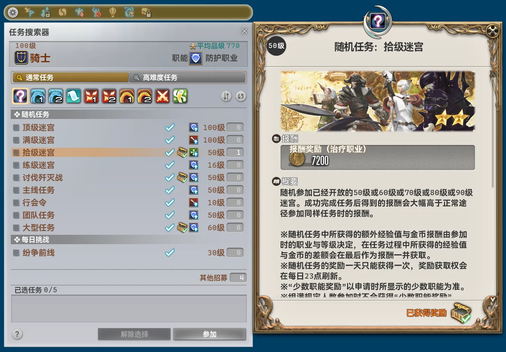
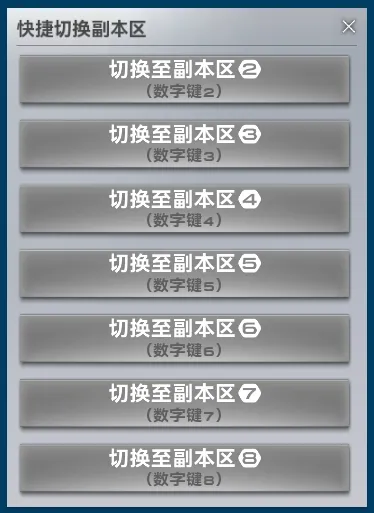

## 本体修改

- 主界面最小尺寸限制现在会遵循界面缩放。
- 主界面默认尺寸现在会遵循界面缩放。
- 主界面模块视图由至多4列调整为至多5列。
- 修复了为模块成功导入配置时发送的通知错误显示为成功导出的问题。
- 新增了便捷传送路径。
    - 伊修加德砥柱层 ↔ 魔大陆阿济兹拉
- 插件内共享跨区域移动逻辑现在支持处理位于旅馆内的情况，位于旅馆时将先自动退出再算路。
- 所有模块类可访问性均由 `public` 调整为 `internal`，且在模块中使用其他模块的类型会被编译器直接报错。如有需要，请更新自己编写使用的本地模块写法。
- 为所有模块的程序集都加入了完整性与防篡改检测。
- 重构了模块悬浮窗系统，因内部名称变更，可能需要重新调整悬浮窗尺寸与位置。
- 极大压缩了随包附带的语言和图片资源文件尺寸。
- 新增配置分页“众包“。部分功能或模块会使用玩家社区建立的众包平台的数据，因而也会收集并匿名上传平台所需的众包数据以回馈与共建。如果禁用上传，将不可使用部分功能和模块。
- “验证”页下，成功服务器时的状态文本颜色由彩色渐变改为绿色。
- 修复了“验证”页中部分文本会在布局未稳定前渲染的问题。

## 移除模块

### 任务搜索器设置优化 [招募]

因相关功能完全融入新模块 `“任务搜索器”界面优化`，故删除。

### 快捷任务搜索器匹配副本 [招募]

因相关功能完全融入新模块 `“任务搜索器”界面优化`，故删除。

## 新增模块

### “任务搜索器”界面优化 [招募]

*推荐模块*

优化“任务搜索器”界面。点击职业显示组件可直接打开“职业&特职”界面；条件显示组件可直接点击设置任务搜索器条件；外显隐藏的前置任务名称；任务列表项新增快捷申请参加按钮；随机任务列表项新增指示是否已获得本日任务奖励的图标；完成任务后自动取消任务选择。

### “基本情报”界面时间优化 [界面]

*推荐模块*

优化“基本情报”界面内的时间显示，根据服务器时间实时同步校正本地时间，并把显示精度提高到秒级。

## 模块修改

### 休养胜地布雷福洛克斯野营地助手 [副本]

- 调整了名称与描述。

### 拉姆歼灭战助手 [副本]

- 调整了名称与描述。

### 财宝传说破舰岛助手 [副本]

- 调整了名称与描述。

### 须佐之男歼灭战助手 [副本]

- 调整了名称与描述。

### 最终决战天幕魔导城助手 [副本]

- 调整了名称与描述。

### 天然要害沙斯塔夏溶洞助手 [副本]

- 调整了名称与描述。
- 调整了通知内容，且现在不再显示“DR”前缀。

### 启动之章2助手 [副本]

- 调整了名称与描述。

### 阿尔法幻境3助手 [副本]

- 调整了名称与描述。

### 指导者任务记录上传助手 [副本]

- 调整了名称与描述。
- 调整了通知内容与类型。
- 移除了配置项“发送聊天消息”，现在始终发送。
- 修复了修改配置项“服务器地址”后没有自动设定登录状态为“未登录”的问题。

### 自动退出副本 [副本]

- 移除了配置项“强制退本”，现在始终生效。如原先有禁用该选项的需要，请自行调高延迟。
- 现在配置项的帮助文本将会直接外显。
- 配置项“不自动退出现版本高难副本”显示文本调整为“不自动退出高难度任务”。
- 配置项“延迟”显示文本调整为“退出延迟”。
- 配置项“即刻退出副本”显示文本调整为“立刻退出的副本”。
- 配置项“黑名单副本”显示文本调整为“不自动退出的副本”。
- 配置项“退出延迟”的默认值由0毫秒调整为6000毫秒。
- 为配置项“退出延迟”新增了帮助文本：由服务器下发“任务完成”事件时开始计时，一般远早于角色和场地被调整至任务完成后的状态。
- 调整了通知内容。

### 自动显示网络延迟 [系统]

- 现在在使用使用游戏加速器或透明网络代理时，因无法测量准确的 TCP 往返时间，会直接使用游戏内部记录的数据包往返时间。该时间受客户端帧率影响极大，仅供参考。

### 自动重复点击 [系统]

- 修复了同时按下手柄左右扳机时，完全无法操控十字热键栏的问题。

### “咏唱栏”界面优化 [战斗]

- 修复了“显示详细咏唱信息”配置项启用后部分传送目的地显示错误的问题。

### 更好的招募过滤界面 [招募]

- 降低了“招募描述”分页内“正则过滤规则”的勾选框与输入框的水平间距。
- 修复了无法操控“招募描述”分页内“正则过滤规则”的勾选框的问题。
- 修复了有时候会因为无法获取职业数据导致部分招募被错误过滤的问题。

### 自动扫描恶名精英 [脚本]

- 调整了描述。
- 大幅调整了界面文本。
- 加入了完整的恶名精英存活状态自动维护逻辑，不再强依赖手动切换存活状态或反复遍历周边对象。
- 新增“自动播报”系统。按路线顺序自动标记地图，并播报恶名精英所在位置。单个恶名精英死亡后自动播报下一个恶名精英或需要暂时等待的以太之光的位置信息。
    - 支持定时启动。
    - 支持自动维护路线状态。
    - 新增“狩猎车开始消息”和“狩猎车结束消息”用于自动播报开始与结束时自动发送，最多支持15行。
    - 支持自动寻路、传送与切换副本区。
    - 自动播报开始前半分钟与结束后均会发送通知提醒。
- 移除了配置项“字体缩放”。
- 由于底层大改，所有用于发送的消息现在全部需要重新配置。
- 因系统从过去到现在始终围绕着“A 级恶名精英”设计，常见需要扫描“B 级恶名精英”的场景也与设计完全不符，故现在仅支持扫描“A 级恶名精英”。
- 因自多个版本前就已无任何实际效果，故移除了“单点位延迟”配置项。
- 大幅调整了所有通知的类型与内容。
- 从底层完全重构了扫描器实现方式，由简单队列改为使用状态机。同时完全重构了相关界面。
    - 修复了在多分线区域内，在某一分线内若仅找到一只恶名精英，则会直接跳过扫描其他分线的问题。
    - 现在支持将扫描结果“追加”到某一路线中，原“保存”按钮显示文本调整为“覆盖”，更符合其实际逻辑。
        - 若被“追加”的路线中包含相同的恶名精英，会直接使用新的数据覆盖原有数据。
    - 完整适配了游戏设置“角色显示范围”，现在扫描状态预览、扫描路线与传送决策都会根据其设置自适应合并某些点位或跳过某些点位。
    - 现在在扫描过程被意外打断或某些点位无法实在无法抵达时，会发送通知提醒。
    - 现在在部分点位无法寻路到达时，会自动调整至范围内其他坐标再次发起寻路。
    - “待扫描区域”支持直接选中某一版本对应的全部区域。
    - 扫描不同区域时限制会考虑区域间实际距离，由近及远依次前往扫描，而非根据区域 ID。
    - 扫描有效半径由300提高至400。
    - 扫描算法由不再使用逐点连接前往改为完全基于可能经过的区域，并会让经过距离维持最短。
    - 扫描完成后，将会发送通知提醒。
- 修复了“最近的以太之光”可能因取到城内以太之晶导致显示为空的问题。
- 完全重构了路线选择组件。现在支持显示每条路线的名称、区域数量、恶名精英数量与创建时间。并外显了重命名、导出与删除按钮。
    - 路线“导入”功能收归路线选择组件内。
- 重构了路线内容表格。
    - 删除恶名精英现在需要二次确认。
    - 移除了序号文本前的上下切换按钮，改为拖拽序号文本即可重排。
    - 合并了“区域”列和“坐标”列。
    - 现在支持指定各个恶名精英最近的以太之光，可跟随导出内容一并导出，同时内置了部分区域的特殊处理。
        - 龙堡内陆低地 → 田园郡。
        - 红玉海 → 自凝岛
        - 黑风海 → 鳍人潮池
    - “根据出发点排序”功能现在在排序区域时会考虑区域间实际距离，由近及远依次前往，而非根据区域 ID 简单排序。
    - 移除了单独的“指定出发点”按钮，调整“序号”列表头显示文本为“指定出发点”，点击即可打开原出发点指定界面。
    - 重构了“指定出发点”以太之光选择组件，现在支持按照区域筛选，且只会包含路线中涉及的区域。
- 重构了狩猎行车器界面。
    - 移除了界面内的“导入”和“导出”路线按钮。
    - 新增“播报狩猎车开始消息”和“播报狩猎车结束消息”按钮。
    - “切换存活状态”按钮由每列底部调整位置至恶名精英名称之后。
    - “位置”信息与“最近的以太之光”信息现在单独成行，不再同行。
- 打开狩猎行车器的指令由 `/pdrmf` 调整为 `/pdr mf`。
- 现在支持“寻路至恶名精英”，根据新增配置“寻路至恶名精英”行为支持“寻路至精准位置”或“寻路至附近”。
    - “寻路至附近”包含配置项“距离阈值”，为水平距离，默认为30。高度阈值不可配置，为20。
- 文本播报频道新增“默语”频道。

### “用户宏指令”界面优化 [界面]

- 修复了行号显示在特定客户端语言下会崩溃的问题。
- 现在从界面读取预设也需要二次确认。

### 快捷进出旅馆 [一般]

- 分类由“系统”调整为“一般”。
- 调整了描述。
- 移除了在线验证要求。
- 完全重构并大幅精简了实现逻辑，现在进出旅馆都不会再一闪而过任何确认对话框，而是在底层就直接拦截并处理。
- 选择最近可达旅馆的逻辑接入了插件共享跨区域移动路径判断，判断更加智能且高效。

### 快捷副本区切换 [一般]

- 分类由“系统”调整为“一般”。
- 调整了标题与描述。
- 大幅重构了界面文本。
- 大幅重构了通知文本和类型。
- 完全重构并大幅精简了实现逻辑。
- 修复了错误使用其他模块本地化资源的问题。
- 移除了配置项“使用菜单后自动关闭菜单”，现在始终关闭。
- 移除了配置项“切换副本区后自动使用坐骑”，现在视切换前情况而定，即：若切换前未在骑乘坐骑，则切换后也不会自动骑乘坐骑；反之，切换前正在骑乘坐骑的话，切换后则会自动重新骑乘上坐骑。
- 修复了传送至最近的以太之光时实际选择的是距离区域中心最近而非离自身最近的以太之光的问题。
- 现在 `/pdr insc` 指令会进一步检查输入的副本区参数有效性，会拒绝不存在副本区。
- 移除了反复尝试前往目标副本区时发送的尝试次数通知提醒。
- 快捷切换副本区界面由 ImGui 悬浮窗完全重构为游戏原生界面。

- 现在在未获取区域副本区完整信息前，不会再打开并展示空悬浮窗。
- 现在在无法切换副本区的区域也会正常显示服务器信息栏条目，但无法打开快捷切换副本区界面。
- 现在在无法切换副本区状态下，快捷切换副本区界面内的按钮会显示为禁用状态，与实际的拒绝开始切换副本区逻辑保持一致。
- 快捷切换副本区界面内使用数字键切换副本区的功能现在额外支持使用小键盘数字键。
- 快捷切换副本区界面内现在会直接提示可以使用数字键来快速切换。
- 修复了快捷切换副本区界面打开时因未考虑窗口尺寸导致未实际居中屏幕的问题。

### 快捷跨界传送 [系统]

- 支持国际服各物理数据中心内直接跨界传送。

### 更快的区域内移动加载 [系统]

- 调整了标题和描述。

### 统一投影管理器 [界面]

- 支持为预设编辑入当前尚未拥有的装备与染色，以提前设计搭配。也可以筛选“仅显示已拥有装备”以恢复过往版本行为。
- 为编辑操作引入了草稿机制。编辑操作会先作用于临时草稿，点击“保存”后再更新替换原预设。支持将草稿“另存为”新预设。“取消”则会丢弃草稿，恢复原有内容。草稿同样支持试穿与导出。
    - 存在草稿时，若切换至其他预设则会要求二次确认“保存并切换”或“放弃修改并切换”。
- 选择占用了多个部分的装备时，现在会移除对应部位原本的装备。而被占用的空栏，也会具体显示其是由哪件装备占用。
- 导入、创建、保存、试穿和应用预设时，会自动移除冲突或无效的装备条目，移除时也会发送通知提醒。移除机制会优先保留占用部位较多的装备。
- 新增 `使用“皇帝的新装备”填充空部位` 按钮，以一键填充除主副手外其他装备部位。
- 重构了试穿机制，现在会清空其中已有的试穿条目，一次性写入整套预设，再刷新预览，避免混入上次试穿的装备。