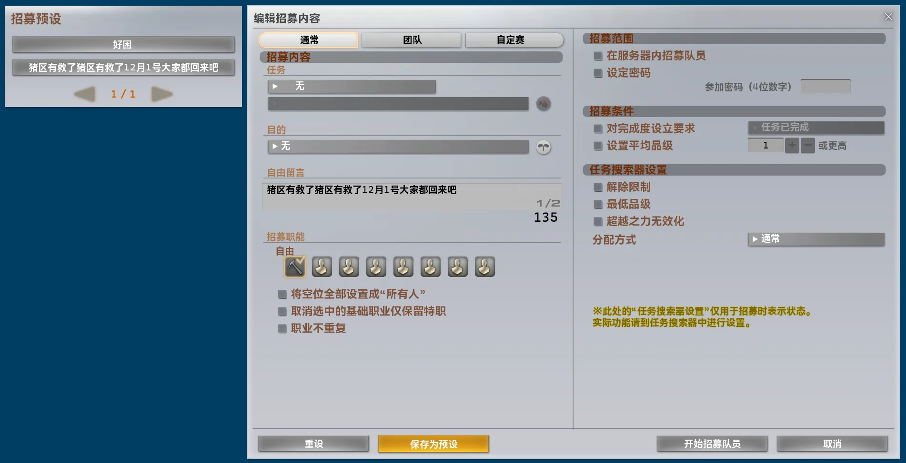

## Core Changes

- Fixed an issue where empty text was searched every time the main window was opened.
- Apart from most IPC remaining the same, the two are effectively separate plugins in many respects. To facilitate further development, the original "vnavmesh" plugin is no longer supported. Only the "vnavmesh CN" plugin from the same repository as this plugin is supported; it can also be used on other clients.
- Fixed an issue where the teleportation cost of some aetherytes or aethernet shards was incorrectly displayed as the maximum value of a 32-bit unsigned integer in rare cases.
- The shared mount logic now attempts to obtain a more appropriate ground surface through the "vnavmesh CN" plugin when it is enabled.
- The shared return-to-ground logic now attempts to obtain a more appropriate ground surface through the "vnavmesh CN" plugin when it is enabled.
- Fixed an issue where some custom context menus still allowed interaction with the interface they were opened from.
- Completely rebuilt the child node and nested resource management mechanism of the dependency library used to build native interfaces, improving stability.

## New Modules

### Better Duty Gauge [Addon]

Rebuilt the toast display mechanism. When the next toast appears, the previous toast now fades out quickly, preventing a large backlog from greatly extending the time required to finish displaying.

## Module Changes

- Added a "Prerequisite Plugin" section to module information, allowing modules to specify other required plugins.
    - Unlike the optional "Prerequisite Module", a module is prevented from loading when its "Prerequisite Plugin" is not enabled.

### Better Isleworks Agenda [Addon]

- Fixed an issue where production plans could not be scheduled properly when fewer than four workshops were unlocked, caused by FFXIVClientStructs marking an incorrect workshop structure.
- Scheduling production plans now clears existing plans day by day instead of one by one.
- Scheduling production plans now assigns plans day by day instead of one by one.
- Solving and scheduling production plans now iterate only over the dates in the target period instead of all dates.
- Fixed an issue where task messages displayed "Solving production plan..." while scheduling production plans.

### Notorious Monster Scanner [Script]

- Added "vnavmesh CN" as a prerequisite plugin and removed the separate prerequisite plugin description.
- The following aetherytes are no longer used for teleportation during scanning.
    - Tamamizu (The Ruby Sea)
    - The Macarenses Angle (The Tempest)
    - Bestways Burrow (Mare Lamentorum)
    - Tertium (Garlemald)
    - Base Omicron (Ultima Thule)
    - Worlar's Echo (Urqopacha)
- Added the following rules for automatically selecting the nearest aetheryte to a notorious monster.
    - Mare Lamentorum → Sinus Lacrimarum
    - Urqopacha → Wachunpelo
- Fixed an issue where, with "Auto Broadcast Mode" enabled, clicking the "Auto Navigate After Broadcast", "Broadcast Location" and "Broadcast Aetheryte" buttons started automatic teleportation or navigation.
- "Monster Location Message" and "Aetheryte Standby Message" now support multi-line input, up to 15 lines.
- The interval between sending each line of all multi-line messages has been reduced from 1 second to 500 milliseconds.
- With automatic broadcasting enabled, monster location messages for notorious monsters in The Dravanian Hinterlands are now broadcast once each in Idyllshire and The Dravanian Hinterlands. If a zone without any aetherytes is introduced in the future, messages will likewise be broadcast once in the aetheryte zone and once in the zone where the notorious monster is located.
- The display text of the "Broadcast Standby Message If Leaving Zone" option under "Auto Broadcast Mode" has been adjusted.
- With automatic broadcasting enabled, if the "Broadcast Standby Message If Leaving Zone" option is not checked, the "Monster Location Message" is broadcast once more after arriving in the target zone or instanced area.
- Added the "Broadcast Delay After Entering New Zone" option under "Auto Broadcast Mode". After switching zones or instanced areas, the "Monster Location Message" is broadcast after the specified interval. The default is 5000 milliseconds.
- Optimized the scan route planning algorithm to address the issue where a single scan point on one side was easily missed, requiring a return from the opposite side to scan the missed point in the worst case.
- In the "Hunt-train Mini Helper", the start time setting row is now automatically hidden while automatic broadcasting is in progress.
- The height of the destination selected for scanning has been changed from the maximum height of scan points in the zone plus 100 to dynamic detection of passable space.
- The height threshold for "Entity" has been lowered from 20 to 15.
- Added a "Share Spawn Data" button under the "Scan" tab that opens the corresponding spawn data repository webpage.
- The waiting time after arriving near a scan point has been reduced from 1.5 seconds to 250 milliseconds.
- The configuration interface and the "Hunt-train Mini Helper" interface no longer share route selection, and both interfaces now persistently remember the selected route.

### Better Teleportation [Addon]

- Because earlier versions greatly changed the data structures representing aethernet shards or city aetherytes, and this module's adaptation was incomplete, both interface interaction and internal data storage conflicted extensively. The module has now been completely rebuilt and fixed.
    - When the module is loaded, it attempts to migrate existing data automatically. If migration fails, the data is discarded, so please check again.
- Rebuilt the interface color scheme, which now adapts to different interface styles.

### Nearby Player Counter & Radar [General]

- Adjusted the description.
- Added the "Trace Lines To Everyone Nearby" option under the "Players Nearby" tab in the overlay. Disabled by default.

### Auto Gather In Diadem [Script]

- Adjusted the description.
- Significantly adjusted the interface text.
- Significantly adjusted the notification text and types.
- Added "vnavmesh CN" as a prerequisite plugin and removed the separate prerequisite plugin description.
- Removed the conflicting "Instantly Dismount" module.
- Changed the "Auto Discard Items", "Game Interaction Optimization" and "Auto Repair" prerequisite modules to combo modules.
- Completely rebuilt the implementation from a hybrid state machine and task queue to a pure state machine. Because it is now a pure state machine, it naturally supports starting from any state.
- Removed the logout-based detection logic that prevented the gathering interface from freezing, which was added in a previous version to handle incorrect gathering by botanists. The "Instant Logout Or Exit" and "Auto Login" prerequisite modules were also removed.
- Greatly optimized the path calculation and navigation logic, introducing complete multi-segment navigation and automatic calculation of alternative points when navigation fails. The teleportation or duty-exit detection logic added in a previous version due to poor path calculation has also been removed.
- The character no longer attempts to land early while using a wind current.
- Fixed an issue where the "Blacklist Weathers" setting sometimes did not take effect in "Clouded Node" mode.
- Fixed an issue where the validity check for gathering points was too strict and depended on inaccurate map markers.
- The character now waits until it has descended below the maximum jump height before dismounting.
- Completely rebuilt the item inspection process using a lower-level approach, greatly improving inspection speed.
- Completely rebuilt the gathering data retrieval logic using a lower-level data source and no longer parsing the interface.
- All tooltip texts now appear below the original interface elements.
- Changed the configuration interface layout to tabs.
- The display text of the "Blacklist Weathers" option has been adjusted to "Special Weather To Be Ignored".
- Removed the "Items to be gathered" option. Added the "Materials To Be Prioritized" option as a replacement, which requires reconfiguration. Multiple items can be selected for priority gathering. When none of the prioritized items are present at a gathering point, grade 4 reconstruction materials are gathered according to the original default rules.
- The display text of the "Aetheromatic Auger Blacklist" option has been adjusted.
- It is now possible to leave "Item To Be Exchanged For" unset and to "Clear" configured items.
- Added a new "Skybuilders' Scrips" overflow check before item inspection. When the cap is about to be reached, if "Item To Be Exchanged For" is configured, the items are exchanged first and then inspection resumes; if not configured, item inspection is skipped and a notification is sent.

### Better Market Board [Addon]

- Removed the mechanism that requested the data of the last viewed item once on every initialization.

### Warp Panel [Addon]

- Adjusted the description.
- Significantly adjusted the interface and notification text.
- Added "vnavmesh CN" as a prerequisite plugin.
- Coordinates are now corrected through the "vnavmesh CN" plugin at various marker positions in the same way as during actual teleportation.
- Fixed an issue where, when the character was already within the range of a quest marker, it was still redirected first to the marker center and then to the target quest object.
- The display text of "Blacklist Icons" has been adjusted to "Blacklisted Icons".

### Auto Sightseeing Log [Script]

- Added "vnavmesh CN" as a prerequisite plugin and removed the separate prerequisite plugin description.

### Auto Complete Hunting Log [Script]

- Added "vnavmesh CN" as a prerequisite plugin and removed the separate prerequisite plugin description.

### Better Party Finder Filter [Addon]

- Adjusted the description.
- The attached interface now opens on the upper right side, on the same side as the "Filter" button.

### Recruitment Criteria Preset [Recruitment]

- Added a preview image.
- The "Save As Preset" button has been moved from the top of the attached interface to next to the "Reset" button at the top of the "Edit Recruitment Criteria" interface. Its display text has been adjusted.

- Presets now support comments. Use "Edit Preset" in the preset context menu to set one.

### Better Classes/Jobs [Addon]

- Adjusted the name and description.
- Completely rebuilt the implementation using lower-level logic, removing all hardcoded interface nodes and job mappings. New jobs added to the game in the future will be supported immediately without waiting for a module update.
- All job components, including those in the PvP "Character" interface, now show the same highlight effect on hover as crafting jobs.
- If a job has multiple saved gear sets, the job component tooltip now shows which gear set will be switched to after clicking.
- If a job has multiple saved gear sets, the job component context menu can now be opened by right-clicking, where "Assign Default Gear Set To Job" can be used to choose the gear set to use instead of always switching to the first one.
    - To keep interaction consistent, only left-clicking a job component switches jobs now. Right-clicking either opens the context menu or does nothing.
- Hovering over a job component now correctly displays the job's experience or desynthesis skill information at the bottom of the interface.
- When an unlocked job has no saved gear set, hovering over the job component now displays the warning "The gear set {jobName} was not found."

### Unified Glamour Manager [Addon]

- Added a "Live Try On" checkbox to the glamour plate editing interface, which synchronizes the current plate edits to the "Try On" window in real time.

### Better Duty Finder [Recruitment]

- Fixed an issue where non-random duties could also display the daily reward obtained icon.

### Auto Gardenwork [Addon]

- Adjusted the name and description.
- Rebuilt the item selection component.
