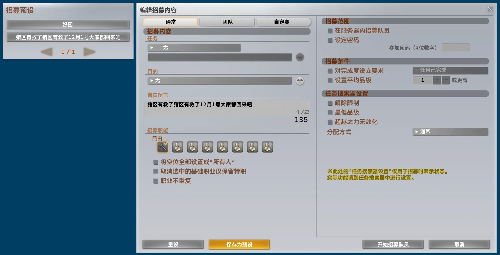

## 本体の変更

- メインウィンドウを開くたびに空のテキストを検索してしまう問題を修正しました。
- ほとんどの IPC が同一であることを除けば、様々な面で実質的に別のプラグインとなっているため、よりよい開発のために、オリジナルの「vnavmesh」プラグインのサポートを終了し、本プラグインと同じリポジトリにある「vnavmesh CN」プラグインのみをサポートします（他のクライアントでも使用できます）。
- 一部のエーテライトや都市内エーテライトのテレポ費用が、まれに 32 ビット符号なし整数の最大値として誤表示される問題を修正しました。
- プラグイン共通のマウント乗車処理は、「vnavmesh CN」が有効な場合、それを介してより適切な地面を取得しようとします。
- プラグイン共通の地面への帰還処理は、「vnavmesh CN」が有効な場合、それを介してより適切な地面を取得しようとします。
- 一部のカスタム右クリックメニューを開いている間、元のインターフェースを操作できてしまう問題を修正しました。
- ネイティブ UI の作成に使用する依存ライブラリの子ノードとネストされたリソースの管理機構を全面的に再構築し、安定性を向上させました。

## 追加モジュール

### * より高速なポップアップ通知 [インターフェイス]

ポップアップ通知の表示機構を再構築しました。次の通知が表示されるときに前の通知をすばやくフェードアウトさせることで、大量に滞留して表示完了までの時間が大幅に延びる問題を防ぎます。

## モジュールの変更

- モジュール情報に「前提プラグイン」セクションを追加し、モジュールが必要とする他のプラグインを指定できるようにしました。
    - 任意で有効化する「前提モジュール」とは異なり、「前提プラグイン」が有効でない場合はモジュールの読み込みを禁止します。

### * 「工房生産計画」UI 最適化 [インターフェイス]

- FFXIVClientStructs が誤った工房構造をマークしていたため、4 つの工房をすべて解放していない場合に生産計画を正常に組めない問題を修正しました。
- 生産計画の編成で、既存の生産計画を 1 件ずつ削除する方式から、日ごとに削除する方式に変更しました。
- 生産計画の編成で、生産計画を 1 件ずつ割り当てる方式から、日ごとに割り当てる方式に変更しました。
- 生産計画の求解と編成は、すべての日付を走査するのではなく、対象期間の日付のみを走査するようになりました。
- 生産計画の編成中にタスクメッセージが「生産計画を求解しています……」と表示される問題を修正しました。

### リスキーモブを自動スキャン [スクリプト]

- 「vnavmesh CN」を前提プラグインとして追加し、個別の前提プラグイン説明を削除しました。
- スキャン中、以下のエーテライトへテレポしなくなりました。
    - 碧のタマミズ（紅玉海）
    - マカレンサス広場（テンペスト）
    - ベストウェイ・バロー（嘆きの海）
    - テルティウム駅（ガレマルド）
    - オミクロンベース（ウルティマ・トゥーレ）
    - ウォーラーの残響（オルコ・パチャ）
- リスキーモブに最も近いエーテライトを自動選択するための以下のルールを追加しました。
    - 嘆きの海 → 涙の入江
    - オルコ・パチャ → ワチュン・ペロ
- 「* 自動ブロードキャスト動作」が有効な状態で、「* ブロードキャスト後に自動テレポ・ナビゲート・インスタンスエリア切り替え」「位置情報をアナウンスする」「エーテライトを経由する」ボタンをクリックすると、自動テレポやナビゲーションが開始される問題を修正しました。
- 「* リスキーモブ位置メッセージ」と「* エーテライト集合メッセージ」は複数行入力に対応し、最大 15 行まで入力できるようになりました。
- すべての複数行メッセージの 1 行あたりの送信間隔を 1 秒から 500 ミリ秒に短縮しました。
- 自動ブロードキャストが有効な場合、低地ドラヴァニアにいるリスキーモブの位置メッセージを、イディルシャイアと低地ドラヴァニアでそれぞれ 1 回ずつブロードキャストするようになりました。今後、区域内にエーテライトが存在しない設計が追加された場合も、エーテライトのある区域とリスキーモブのいる区域でそれぞれ 1 回ずつ自動的にブロードキャストします。
- 「* 自動ブロードキャスト動作」の設定項目「* 最も近いエーテライト情報を優先して通知する」の表示テキストを「* エーテライト集合メッセージを優先して通知する」に修正しました。
- 自動ブロードキャストが有効で、設定項目「* エーテライト集合メッセージを優先して通知する」がチェックされていない場合、目標区域またはインスタンスエリアに到着した後に「* リスキーモブ位置メッセージ」をもう一度ブロードキャストします。
- 「* 自動ブロードキャスト動作」に設定項目「* 区域切り替え時のブロードキャスト遅延（ミリ秒）」を追加しました。区域またはインスタンスエリアを切り替えた後、指定した時間だけ待ってから「* リスキーモブ位置メッセージ」をブロードキャストします。既定値は 5000 ミリ秒です。
- スキャン経路の計画アルゴリズムを最適化し、片側の単一スキャンポイントを見落としやすく、最悪の場合に対側から見落としたポイントへ戻って再スキャンする必要がある問題に対処しました。
- 「モブハンティング指揮オーバーレイ」内で、自動ブロードキャスト中は開始時刻の設定行を自動的に非表示にするようになりました。
- スキャンで選択する目的地の高さを、区域内のスキャンポイントの最大高さ + 100 から、通行可能空間の動的検出に変更しました。
- 「* リスキーモブへのナビゲーション」の高さしきい値を 20 から 15 に引き下げました。
- 「スキャン」タブに「* スポーンデータを提供」ボタンを追加し、クリックすると対応するスポーンデータ保管リポジトリの Web ページを開けるようにしました。
- スキャンポイント付近に到着した後の待機時間を 1.5 秒から 250 ミリ秒に短縮しました。
- 設定画面と「モブハンティング指揮オーバーレイ」画面は経路選択を共有しなくなり、両方の画面で選択した経路が永続的に記憶されるようになりました。

### テレポUI最適化 [インターフェイス]

- 以前のバージョンで内部エーテライトや都市内エーテライトを表すデータ構造が大きく変更された一方、本モジュールの対応が不完全だったため、UI の操作と内部データ保存の両方で広範囲に競合が発生していました。今回、全面的に再構築して修正しました。
    - モジュールの読み込み時に既存データの自動移行を試みますが、自動移行できない場合は破棄されます。再度確認してください。
- UI の配色を再構築し、異なる UI スタイルに適応できるようになりました。

### 周囲のプレイヤーの数を自動で表示する [全般]

- 説明を調整しました。
- オーバーレイ内の「周辺プレイヤー」タブに設定項目「* 周囲の全プレイヤーへ線を描画する」を追加しました。既定では無効です。

### ディアデム諸島自動採集 [スクリプト]

- 説明を調整しました。
- UI テキストを大幅に調整しました。
- 通知テキストと種類を大幅に調整しました。
- 「vnavmesh CN」を前提プラグインとして追加し、個別の前提プラグイン説明を削除しました。
- 競合モジュール「即マウントから降りる」を削除しました。
- 前提モジュール「アイテムの自動廃棄/売却」「インタラクションロジックの最適化」「自動修理」を連携可能モジュールに変更しました。
- 実装方式を全面的に再構築し、ステートマシンとタスクキューのハイブリッド方式から純粋なステートマシンに変更しました。純粋なステートマシンになったことで、任意の状態から開始することも自然にサポートします。
- 以前のバージョンで園芸工の誤った採集方法に対処するために追加した、ログアウトによる採集 UI のフリーズ検出ロジックを削除しました。あわせて、前提モジュール「即ログアウト・ゲーム終了」と「自動ログイン」も削除しました。
- 経路計算とナビゲーションのロジックを大幅に最適化し、完全な複数区間ナビゲーションと、ナビゲーション失敗時に代替ポイントを自動計算する機能を導入しました。あわせて、以前のバージョンで経路計算の精度が低かったために追加した、テレポやコンテンツ退出によるフリーズ防止ロジックも削除しました。
- 風の渦を使用する際、早めに着地しようとしなくなりました。
- 「幻素材採集」モードで「* 対象外とする天候」設定がときどき反映されない問題を修正しました。
- 採集ポイントの有効性判定が厳しすぎて、不正確なマップマーカーに依存してしまう問題を修正しました。
- ジャンプの最大高度以内までキャラクターが下降するのを待ってからマウントから降りるようになりました。
- アイテム検査処理を全面的に再構築し、より低レベルな方式を使用することで検査速度を大幅に向上させました。
- 採集データの取得ロジックを全面的に再構築し、より低レベルなデータソースを使用して UI を解析しなくなりました。
- すべてのツールチップテキストを元の UI 要素より下に表示するようにしました。
- 設定画面のレイアウトをタブ形式に変更しました。
- 設定項目「* 対象外とする天候」の表示テキストを「* 無視する特殊天候」に調整しました。
- 設定項目「採集予定アイテム名」を削除しました。代わりに設定項目「* 優先的に採集するアイテム」を追加しました。再設定が必要です。優先して採集したい複数のアイテムを選択でき、採集ポイントに優先アイテムが 1 つも存在しない場合は、元の既定ルールに従って第 4 期再建用アイテムを採集します。
- 設定項目「エーテルオーガーブラックリスト」の表示テキストを「* 「エーテルオーガー」を使用しない対象」に調整しました。
- 「* 交換するアイテム」を設定しなくてもよくなり、設定済みのアイテムを「クリア」できるようになりました。
- アイテム検査の前に、新しい「蒼天街振興券」の上限超過検出を追加しました。上限に近づいたとき、「* 交換するアイテム」が設定されていれば先に交換してから検査に戻り、設定されていなければアイテム検査を行わずにそのまま続行し、通知を送信します。

### どこでもマーケットボード [インターフェイス]

- 初期化のたびに前回最後に閲覧したアイテムのデータを 1 回要求する機構を削除しました。

### クイック転送パネル [インターフェイス]

- 説明を調整しました。
- UI と通知テキストの内容を大幅に調整しました。
- 「vnavmesh CN」を前提プラグインとして追加しました。
- 各種マーカー位置に、実際のテレポ時に「vnavmesh CN」プラグインを呼び出して座標を補正する処理を生成するようになりました。
- すでにクエストマーカーの範囲内にいる場合でも、先にキャラクターをマーカー中心へリダイレクトし、その後で目標のクエストオブジェクトへリダイレクトしてしまう問題を修正しました。
- 「ブラックリストアイコン」の表示テキストを「* 表示しないアイコン」に調整しました。

### 探検手帳を自動完了する [スクリプト]

- 「vnavmesh CN」を前提プラグインとして追加し、個別の前提プラグイン説明を削除しました。

### 討伐手帳自動化 [スクリプト]

- 「vnavmesh CN」を前提プラグインとして追加し、個別の前提プラグイン説明を削除しました。

### パーティ募集フィルター画面の改善 [インターフェイス]

- 説明を調整しました。
- 付属画面は右上側で開くようになり、「絞り込み」ボタンと同じ側に表示されます。

### PT募集内容編集の情報を自動保存 [募集]

- プレビュー画像を追加しました。
- 「* プリセットとして保存」ボタンの位置を、付属画面の上部から「パーティ募集内容の編集」画面の上部にある「リセット」ボタンの隣に変更しました。表示テキストも調整しました。

- プリセットにコメントを設定できるようになりました。プリセットの右クリックメニューにある「* プリセットを編集」から設定できます。

### * 「クラス＆ジョブ」UI 最適化 [インターフェイス]

- 名前と説明を調整しました。
- 実装方式を全面的に再構築し、より低レベルな実装ロジックを採用して、ハードコードされた UI ノードとジョブ対応データをすべて削除しました。今後ゲームに新しいジョブが追加されても、モジュールの更新を待たずにそのまま対応できます。
- プレイヤー対戦の「キャラクター」画面を含むすべてのジョブコンポーネントが、ホバー時に製作職と同じハイライト効果を表示するようになりました。
- 1 つのジョブに複数のギアセットが保存されている場合、ジョブコンポーネントのツールチップに、クリック後に切り替わるギアセットを表示するようになりました。
- 1 つのジョブに複数のギアセットが保存されている場合、ジョブコンポーネントを右クリックしてメニューを開き、「* ジョブ切り替え時に使用するギアセットを設定」から使用するギアセットを選択できるようになりました。常に最初のセットに切り替わるわけではありません。
    - 操作ロジックの一貫性を保つため、ジョブの切り替えはジョブコンポーネントの左クリックでのみ行えます。右クリックは右クリックメニューを開くか、何も反応しません。
- ジョブコンポーネントにホバーすると、UI 下部にジョブの経験値または分解スキル情報が正常に表示されるようになりました。
- 解放済みのジョブにギアセットが 1 つも保存されていない場合、ジョブコンポーネントにホバーすると「* {jobName} に関連するギアセットが保存されていません。」という警告が表示されます。

### ミラプリ一括管理 [インターフェイス]

- ミラージュプレート編集画面に「* リアルタイム試着」チェックボックスを追加しました。現在のミラージュプレートの編集内容が「試着」画面にリアルタイムで同期されます。

### * 「コンテンツ検索ツール」UI 最適化 [募集]

- ランダムでないコンテンツでも、デイリーボーナス取得済みアイコンが表示されることがある問題を修正しました。

### * 庭園の自動管理 [インターフェイス]

- 名前と説明を調整しました。
- アイテム選択コンポーネントを再構築しました。
