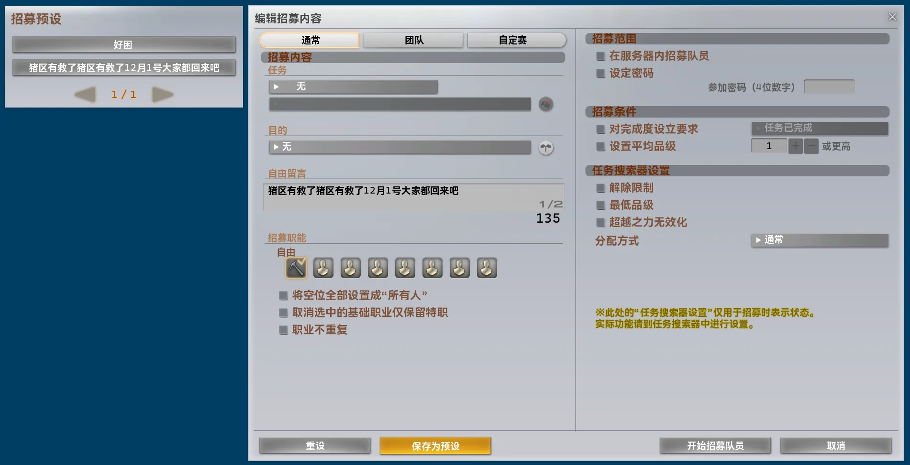

## 본체 변경 사항

- 메인 창을 열 때마다 빈 텍스트를 검색하던 문제를 수정했습니다.
- 대부분의 IPC가 동일한 것을 제외하면 여러 측면에서 사실상 두 개의 플러그인이므로, 더 나은 개발을 위해 기존 "vnavmesh" 플러그인 지원을 중단하고 이 플러그인과 같은 저장소에 있는 "vnavmesh CN" 플러그인만 지원합니다(다른 클라이언트에서도 사용할 수 있습니다).
- 일부 에테라이트 또는 도시 내 에테라이트의 텔레포 비용이 드물게 32비트 부호 없는 정수의 최댓값으로 잘못 표시되던 문제를 수정했습니다.
- 플러그인 공용 탈것 탑승 로직은 "vnavmesh CN"이 활성화된 경우 이를 통해 더 적절한 지면을 얻으려고 시도합니다.
- 플러그인 공용 지면 귀환 로직은 "vnavmesh CN"이 활성화된 경우 이를 통해 더 적절한 지면을 얻으려고 시도합니다.
- 일부 사용자 지정 우클릭 메뉴를 열어 둔 상태에서도 원래 인터페이스와 상호작용할 수 있던 문제를 수정했습니다.
- 네이티브 UI 제작에 사용하는 종속 라이브러리의 자식 노드 및 중첩 리소스 관리 메커니즘을 전면 재구축하여 안정성을 높였습니다.

## 신규 모듈

### * 더 빠른 팝업 알림 [인터페이스]

팝업 알림 표시 메커니즘을 재구축했습니다. 다음 알림이 표시될 때 이전 알림이 빠르게 사라지도록 하여, 알림이 대량으로 쌓여 표시 완료까지 걸리는 시간이 크게 늘어나는 문제를 방지합니다.

## 모듈 변경 사항

- 모듈 정보에 "의존성 플러그인" 섹션을 추가하여 모듈이 필요한 다른 플러그인을 지정할 수 있게 했습니다.
    - 선택적으로 활성화하는 "전제 모듈"과 달리 "의존성 플러그인"이 활성화되어 있지 않으면 모듈 로드를 금지합니다.

### "공방 일정" UI 최적화 [인터페이스]

- FFXIVClientStructs가 잘못된 공방 구조를 표시하여 공방 4개를 모두 해제하지 않은 경우 생산 계획을 정상적으로 편성할 수 없던 문제를 수정했습니다.
- 생산 계획 편성 시 기존 생산 계획을 하나씩 삭제하는 방식에서 일별로 삭제하는 방식으로 변경했습니다.
- 생산 계획 편성 시 생산 계획을 하나씩 배정하는 방식에서 일별로 배정하는 방식으로 변경했습니다.
- 생산 계획 해법 산출과 편성은 이제 모든 날짜를 순회하지 않고 목표 기간의 날짜만 순회합니다.
- 생산 계획 편성 과정에서 작업 메시지가 "생산 계획을 산출하는 중..."으로 표시되던 문제를 수정했습니다.

### 자동 마물 스캐너 [스크립트]

- "vnavmesh CN"을 의존성 플러그인으로 추가하고 개별 의존성 플러그인 설명을 삭제했습니다.
- 스캔 중 더 이상 다음 에테라이트로 텔레포하지 않습니다.
    - 푸른 물구슬(홍옥해)
    - 마카렌세스 광장(템페스트)
    - 베스트웨이 피난처(비탄의 바다)
    - 테르티움 역(갈레말드)
    - 오미크론 기지(울티마 툴레)
    - 워라의 잔향(오르코 파차)
- 정예 마물에게 가장 가까운 에테라이트를 자동 선택하는 다음 규칙을 추가했습니다.
    - 비탄의 바다 → 눈물의 만
    - 오르코 파차 → 와춘 펠로
- "자동 전파 행위"가 활성화된 상태에서 "전파 후 자동 텔레포, 경로 찾기 또는 인스턴스 구역 전환", "위치 알림", "에테라이트 경유" 버튼을 클릭하면 자동 텔레포 또는 경로 탐색이 시작되던 문제를 수정했습니다.
- "정예마물 위치 메세지"와 "에테라이트 집합 메세지"는 여러 줄 입력을 지원하며 최대 15줄까지 입력할 수 있습니다.
- 모든 여러 줄 메시지의 줄당 전송 간격을 1초에서 500밀리초로 단축했습니다.
- 자동 전파가 활성화된 경우 저지 드라바니아에 있는 정예 마물의 위치 메시지를 이딜샤이어와 저지 드라바니아에서 각각 한 번씩 전파합니다. 향후 구역 내에 에테라이트가 없는 설계가 추가되면 에테라이트가 있는 구역과 정예 마물이 있는 구역에서도 각각 한 번씩 자동으로 전파합니다.
- "자동 전파 행위" 아래 설정 항목 "가까운 "에테라이트" 정보를 우선 전파하기"의 표시 텍스트를 조정했습니다.
- 자동 전파가 활성화된 상태에서 설정 항목 "가까운 "에테라이트" 정보를 우선 전파하기"가 선택되어 있지 않으면 목표 구역 또는 인스턴스 구역에 도착한 후 "정예마물 위치 메세지"를 한 번 더 전파합니다.
- "자동 전파 행위" 아래 설정 항목 "지역 전환 전파 지연 시간 (밀리초)"을 추가했습니다. 구역 또는 인스턴스 구역을 전환한 후 지정한 시간만큼 기다렸다가 "정예마물 위치 메세지"를 전파합니다. 기본값은 5000밀리초입니다.
- 스캔 경로 계획 알고리즘을 최적화하여 한쪽의 단일 스캔 지점을 놓치기 쉬워 최악의 경우 반대쪽에서 누락된 지점으로 다시 돌아가 스캔해야 하는 문제를 처리했습니다.
- "마물 사냥 오버레이"에서 현재 자동 전파 중이면 시작 시간 설정 행을 자동으로 숨깁니다.
- 스캔에서 선택한 목적지 높이를 구역 내 스캔 지점 최대 높이 + 100에서 통행 가능 공간 동적 감지로 변경했습니다.
- "정예 마물 경로 탐색"의 높이 임계값을 20에서 15로 낮췄습니다.
- "스캔" 탭 아래에 "* 스폰 데이터 공유" 버튼을 추가했습니다. 클릭하면 해당 스폰 데이터 저장소 웹 페이지로 이동합니다.
- 스캔 지점 근처에 도착한 후 대기 시간을 1.5초에서 250밀리초로 단축했습니다.
- 설정 인터페이스와 "마물 사냥 오버레이" 인터페이스는 더 이상 경로 선택을 공유하지 않으며, 두 인터페이스 모두 선택한 경로를 영구적으로 기억합니다.

### 텔레포 UI 최적화 [인터페이스]

- 이전 버전에서 내부 에테라이트 또는 도시 내 에테라이트를 나타내는 데이터 구조가 크게 변경되었으나 이 모듈의 대응이 완전하지 않아 인터페이스 상호작용과 내부 데이터 저장 모두에서 광범위한 충돌이 발생했습니다. 이제 전면 재구축하여 수정했습니다.
    - 모듈을 로드할 때 기존 데이터 자동 마이그레이션을 시도하지만, 자동 마이그레이션이 불가능하면 데이터가 폐기되므로 다시 확인해 주십시오.
- 인터페이스 색상 구성을 재구축하여 다양한 인터페이스 스타일에 적응할 수 있게 했습니다.

### 주변 플레이어 자동 표시 [일반]

- 설명을 조정했습니다.
- 오버레이 내 "주변 플레이어" 탭 아래에 설정 항목 "* 주변 모든 플레이어에게 연결선 그리기"를 추가했습니다. 기본적으로 비활성화되어 있습니다.

### 디아뎀 제도 자동 채집 [스크립트]

- 설명을 조정했습니다.
- 인터페이스 텍스트를 대폭 조정했습니다.
- 알림 텍스트와 유형을 대폭 조정했습니다.
- "vnavmesh CN"을 의존성 플러그인으로 추가하고 개별 의존성 플러그인 설명을 삭제했습니다.
- 충돌 모듈 "즉시 탈것 하차"를 삭제했습니다.
- 전제 모듈 "아이템 자동 폐기/판매", "상호작용 방식 최적화", "자동 수리"를 연동 모듈로 변경했습니다.
- 구현 방식을 전면 재구축하여 상태 머신과 작업 큐의 혼합 방식에서 순수 상태 머신으로 변경했습니다. 순수 상태 머신이 되었으므로 임의의 상태에서 시작하는 것도 자연스럽게 지원합니다.
- 이전 버전에서 원예공의 잘못된 채집 방식을 처리하기 위해 추가한 로그아웃 기반 채집 인터페이스 멈춤 감지 로직을 삭제했습니다. 아울러 전제 모듈 "즉시 로그아웃 / 종료"와 "자동 로그인"도 삭제했습니다.
- 경로 계산과 경로 탐색 로직을 대폭 최적화하여 완전한 다구간 경로 탐색과 경로 탐색 실패 시 대체 지점을 자동 계산하는 기능을 도입했습니다. 아울러 이전 버전에서 경로 계산 성능이 좋지 않아 추가한 순간이동 또는 콘텐츠 퇴장 멈춤 방지 로직도 삭제했습니다.
- 바람 소용돌이를 사용할 때 더 이상 조기에 착지하려고 시도하지 않습니다.
- "환상 재료 채집" 모드에서 "* 대상 제외 날씨" 설정이 때때로 적용되지 않던 문제를 수정했습니다.
- 채집 지점 유효성 판단이 지나치게 엄격하여 부정확한 지도 마커에 의존하던 문제를 수정했습니다.
- 이제 점프 최대 높이 이내로 캐릭터가 하강할 때까지 기다린 후 탈것에서 내립니다.
- 아이템 검사 흐름을 전면 재구축하여 더 저수준의 방식을 사용함으로써 검사 속도를 크게 향상시켰습니다.
- 채집 데이터 획득 로직을 전면 재구축하여 더 저수준의 데이터 소스를 사용하고 더 이상 인터페이스를 파싱하지 않습니다.
- 모든 툴팁 텍스트가 원래 인터페이스 요소 아래에 표시되도록 했습니다.
- 설정 인터페이스 레이아웃을 탭 방식으로 변경했습니다.
- 설정 항목 "대상 제외 날씨"의 표시 텍스트를 "* 무시할 특수 날씨"로 조정했습니다.
- 설정 항목 "채집 예정 아이템명"을 삭제했습니다. 대신 설정 항목 "* 우선 채집할 아이템"을 추가했습니다. 다시 설정해야 합니다. 우선 채집할 아이템을 여러 개 선택할 수 있으며, 채집 지점에 우선 아이템이 하나도 없으면 기존 기본 규칙에 따라 4차 재건용 아이템을 채집합니다.
- 설정 항목 "에테르 착암기 블랙리스트"의 표시 텍스트를 "* '에테르 착암기'를 사용하지 않을 대상"으로 조정했습니다.
- 이제 "* 교환할 아이템"을 설정하지 않아도 되며, 설정한 아이템을 "지우기"로 삭제할 수 있습니다.
- 아이템 검사 전에 새로운 "창천 거리 진흥권" 초과 감지를 추가했습니다. 상한에 가까워지면 "* 교환할 아이템"이 설정된 경우 먼저 교환한 뒤 검사로 돌아가고, 설정되지 않은 경우 아이템 검사를 하지 않고 계속 진행하며 알림을 보냅니다.

### 어디서든 장터 게시판 [인터페이스]

- 초기화할 때마다 마지막으로 조회한 아이템 데이터를 한 번 요청하는 메커니즘을 삭제했습니다.

### 빠른 전송 패널 [인터페이스]

- 설명을 조정했습니다.
- 인터페이스와 알림 텍스트 내용을 대폭 조정했습니다.
- "vnavmesh CN"을 의존성 플러그인으로 추가했습니다.
- 이제 각종 마커 위치에 실제 텔레포 시 "vnavmesh CN" 플러그인을 호출하여 좌표를 보정하는 처리가 생성됩니다.
- 이미 퀘스트 마커 범위 안에 있을 때도 먼저 캐릭터를 마커 중심으로 재지정한 뒤 목표 퀘스트 오브젝트로 재지정하던 문제를 수정했습니다.
- "블랙리스트 아이콘"의 표시 텍스트를 "* 표시하지 않을 아이콘"으로 조정했습니다.

### 탐험 수첩 자동 완료 [스크립트]

- "vnavmesh CN"을 의존성 플러그인으로 추가하고 개별 의존성 플러그인 설명을 삭제했습니다.

### 토벌 수첩 자동화 [스크립트]

- "vnavmesh CN"을 의존성 플러그인으로 추가하고 개별 의존성 플러그인 설명을 삭제했습니다.

### 개선된 파티 찾기 필터 UI [인터페이스]

- 설명을 조정했습니다.
- 부착 인터페이스가 이제 오른쪽 위에서 열리며 "필터" 버튼과 같은 쪽에 표시됩니다.

### 파티 모집 내용 자동 저장 [파티 모집]

- 미리보기 이미지를 추가했습니다.
- "* 프리셋으로 저장" 버튼 위치를 부착 인터페이스 상단에서 "파티 모집 내용 편집" 인터페이스 상단의 "리셋" 버튼 옆으로 변경했습니다. 표시 텍스트도 조정했습니다.

- 프리셋에 메모를 설정할 수 있습니다. 프리셋 우클릭 메뉴의 "* 프리셋 편집"에서 설정할 수 있습니다.

### * "클래스＆잡" UI 최적화 [인터페이스]

- 이름과 설명을 조정했습니다.
- 구현 방식을 전면 재구축하여 더 저수준의 구현 로직을 채택하고 하드코딩된 인터페이스 노드와 직업 대응 데이터를 모두 제거했습니다. 향후 게임에 새 직업이 추가되면 모듈 업데이트를 기다리지 않고 바로 대응할 수 있습니다.
- 플레이어 대전의 "캐릭터" 인터페이스를 포함한 모든 직업 구성 요소가 이제 마우스를 올리면 제작 직업과 같은 하이라이트 효과를 표시합니다.
- 한 직업에 여러 장비 세트가 저장되어 있으면 직업 구성 요소 툴팁에 클릭 후 전환될 장비 세트를 표시합니다.
- 한 직업에 여러 장비 세트가 저장되어 있으면 이제 직업 구성 요소를 우클릭하여 메뉴를 열고 "* 직업 전환 시 사용할 장비 세트 설정"에서 사용할 장비 세트를 선택할 수 있습니다. 항상 첫 번째 세트로만 전환되지는 않습니다.
    - 상호작용 로직의 일관성을 유지하기 위해 이제 직업 구성 요소를 왼쪽 클릭해야만 직업이 전환됩니다. 우클릭은 우클릭 메뉴를 열거나 아무 반응도 하지 않습니다.
- 직업 구성 요소에 마우스를 올리면 이제 인터페이스 하단에 직업의 경험치 또는 분해 기술 정보가 정상적으로 표시됩니다.
- 해금한 직업에 저장된 장비 세트가 없으면 직업 구성 요소에 마우스를 올렸을 때 "* {jobName} 관련 장비 세트가 저장되어 있지 않습니다."라는 경고가 표시됩니다.

### 통합 투영 관리 [인터페이스]

- 투영 세트 편집 인터페이스에 "* 실시간 입어 보기" 체크박스를 추가했습니다. 현재 투영 세트 편집 내용이 "입어 보기" 인터페이스에 실시간으로 동기화됩니다.

### "임무 찾기" UI 최적화 [파티 모집]

- 무작위가 아닌 임무에서도 일일 보상 획득 아이콘이 표시될 수 있던 문제를 수정했습니다.

### * 정원 자동 관리 [인터페이스]

- 이름과 설명을 조정했습니다.
- 아이템 선택 구성 요소를 재구축했습니다.
