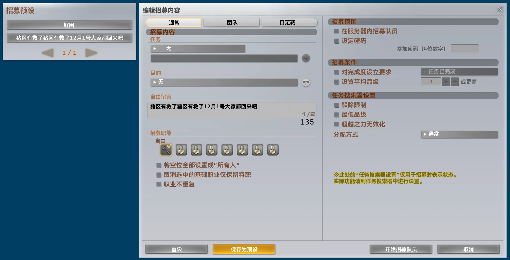

## 本体修改

- 修复了每次打开主界面都会搜索空文本的问题。
- 因除大部分 IPC 保持相同外从各种层面上已实质上是两个插件，为了更好开发，不再支持原版“vnavmesh”插件，仅支持与本插件同一仓库下的“vnavmesh CN”插件（也支持在其他客户端使用）。
- 修复了少数情况下部分以太之光或城内以太之晶的传送花费错误显示为32位无符号整数最大值的问题。
- 插件内共享下坐骑逻辑会在启用了插件“vnavmesh CN”后尝试通过其获取更加合理的地面。
- 插件内共享回到地面逻辑会在启用了插件“vnavmesh CN”后尝试通过其获取更加合理的地面。
- 修复了部分自定义右键菜单打开时仍能交互来源界面的问题。
- 完全重构了用以制作原生界面的依赖库的子节点与嵌套资源管理机制，提升了稳定性。

## 新增模块

### 更快的浮动提示 [界面]

重构浮动提示显示机制，下一条浮动提示显示时自动快速渐隐前一条，避免大量堆积而极大拉长显示完成用时。

## 模块修改

- 模块信息新增了“前置插件”部分，用以让模块可以指定所需要的其他插件。
    - 与可选启用的“前置模块”不同，若未启用“前置插件”，则会禁止加载模块。

### “工房生产计划”界面优化 [界面]

- 修复了因 FFXIVClientStructs 标记了错误的工房结构，导致未完整解锁四个工房时无法正常安排生产计划的问题。
- 安排生产计划中由逐个清除原有生产计划改为逐日清除。
- 安排生产计划中由逐个安排生产计划改为逐日安排。
- 求解与安排生产计划现在仅会遍历目标周期的日期，不再完整遍历所有日期。
- 修复了安排生产计划过程中任务消息会显示为“正在求解生产计划……”的问题。

### 自动扫描恶名精英 [脚本]

- 新增了前置插件“vnavmesh CN”，移除了单独的前置插件说明。
- 现在在扫描过程中不再会传送至下列以太之光。
    - 碧玉水（红玉海）
    - 马克连萨斯广场（黑风海）
    - 最佳威兔洞（叹息海）
    - 第三站（加雷马）
    - 奥密克戎基地（天外天垓）
    - 沃拉的回响（奥阔帕恰山）
- 为恶名精英自动选定最近的以太之光新增了下列规则。
    - 叹息海 → 泪湾
    - 奥阔帕恰山 → 瓦丘恩佩洛
- 修复了若启用了“自动播报行为”下配置项“播报后自动传送、寻路或切换”“播报位置信息”与“播报以太之光”按钮点击后会开始自动传送或寻路的问题。
- “恶名精英位置消息”与“以太之光集合消息”支持输入多行，最多15行。
- 所有多行消息每一行的发送间隔由1秒下调至500毫秒。
- 自动播报下，现在会在田园郡与龙堡内陆低地各播报一次的位于龙堡内陆低地的恶名精英位置消息。若今后也出现了区域内无任何以太之光的设计，则也会自动在以太之光区域和恶名精英所在区域分别播报一次。
- “自动播报行为”下配置项“优先播报最近的以太之光信息”显示文本修正为“优先播报‘以太之光集合消息’”。
- 自动播报下，若未勾选配置项“优先播报‘以太之光集合消息’”，则会在到达目标区域或副本区后，再播报一次“恶名精英位置消息”。
- 新增“自动播报行为”下配置项“区域切换播报延迟”，切换区域或副本区后，等待指定的时间间隔，再播报“恶名精英位置消息”。默认为5000毫秒。
- 优化了扫描路径规划算法，处理了容易遗漏单侧单个扫描点位致使最坏情况下需要从对侧再次折返扫描该遗漏点位的问题。
- “狩猎行车器”内，若当前已在自动播报，则会自动隐藏开始时间设置行。
- 扫描选定的目的地高度由区域内扫描点最大高度加100改为动态检测可通行空间。
- “寻路至恶名精英”的高度阈值从20下调至15。
- “扫描”分页下新增“贡献点位数据”按钮，点击即可跳转到相应的点位数据存储仓库网页。
- 到达扫描点附近后的等待时间由1.5秒下调至250毫秒。
- 配置界面与“狩猎行车器”界面不再共享路线选择，且现在两个界面都会持久保存记忆路线选择结果。

### 更好的传送界面 [界面]

- 因更早版本表示内部以太之光或城内以太之晶的数据结构大改，而本模块适配不齐全，致使界面交互与内部数据存储均大范围冲突，现已完全重构与修复。
    - 加载模块时会尝试自动迁移原有数据，但若无法自动迁移则会丢弃，请二次检查。
- 重构了界面配色，现在可以适配不同的界面样式。

### 自动显示周边玩家数量 [一般]

- 调整了描述。
- 新增悬浮窗内“周边玩家”分页下配置项“绘制至全部玩家的连接线”。默认禁用。

### 自动云冠群岛采集 [脚本]

- 调整了描述。
- 大幅调整了界面文本。
- 大幅调整了通知文本与类型。
- 新增了前置插件“vnavmesh CN”，移除了单独的前置插件说明。
- 移除了冲突模块“即刻下坐骑”。
- 前置模块“自动丢弃物品”、“游戏原生交互优化”和“自动修理”调整为可搭配模块。
- 完全重构了实现方式，由状态机与任务队列混合模式改为纯状态机。因现在为纯状态机，所以也自然支持从任意状态下开始。
- 移除了因先前版本为处理园艺工错误采集方式而加入的登出游戏防采集界面卡死检测逻辑。同时移除了前置模块“即刻登出”和“自动登录”。
- 大幅优化了算路与寻路逻辑，引入了完备的多段寻路与寻路失败时自动计算备选点功能。同时移除了因先前版本算路效果不佳而加入的瞬移或退出副本防卡死逻辑。
- 现在在使用风涡时不再会尝试提前落地。
- 修复了“梦幻采集”模式下“黑名单天气”设置有时候不生效的问题。
- 修复了对于采集点有效性判断过于严格致使依赖于不准确的地图标记的问题。
- 现在会等待人物下降到跳跃最大高度以内之后再下坐骑。
- 完全重构了道具检验流程，现在使用更加底层的方式，极大提升了检验速度。
- 完全重构了采集数据获取逻辑，现在使用更加底层的数据来源，不再解析界面。
- 外显了所有悬浮提示文本在原界面元素之下。
- 配置界面布局改为分页。
- 配置项“黑名单天气”显示文本调整为“要忽略的特殊天气”。
- 移除了配置项“待采集物品名称”。新增了配置项“优先采集的物品”以替代，需要重新配置。可自行选择想要优先采集的多种物品，当采集点内不存在任一优先采集的物品时，则会按照原本的默认规则采集第四期重建用物品。
- 配置项“以太钻孔机目标黑名单”显示文本调整为“不会对其使用‘以太钻孔机’的目标”
- 现在可以不设定任何“要交换的物品”，并可“清除”已设定的物品。
- 为道具检验前置了新的“天穹街振兴票”溢出检测。即将达到上限时，若配置了“要交换的物品”，则会先交换再回来检验；若未配置，则不会检验道具，而是直接继续，并发送通知提醒。

### 更好的市场布告板 [界面]

- 移除了每次初始化都会尝试请求一次上次最后查看物品数据的机制。

### 快捷传送面板 [界面]

- 调整了描述。
- 大幅调整了界面与通知文本内容。
- 新增前置插件“vnavmesh CN”。
- 现在会在各类标记位置生成与实际传送时调用“vnavmesh CN”插件修正坐标。
- 修复了判定当前已经在任务标记范围内时仍然会先重定向人物至标记中心再重定向至目标任务物体的问题。
- “黑名单图标”显示文本调整为“不显示的图标”。

### 自动完成探索笔记 [脚本]

- 新增了前置插件“vnavmesh CN”，移除了单独的前置插件说明。

### 自动讨伐笔记 [脚本]

- 新增了前置插件“vnavmesh CN”，移除了单独的前置插件说明。

### 更好的招募过滤界面 [界面]

- 调整了描述。
- 附着界面现在会在右上侧开启，与“筛选”按钮保持在同一侧。

### 自动保存招募编辑信息 [招募]

- 新增了预览图。
- “保存当前设置为预设”按钮位置由附着界面顶部调整为“编辑招募内容”界面顶部“重设”按钮旁。显示文本调整为“保存为预设”。

- 支持为预设设置备注，可在预设的右键菜单内“编辑预设”，设定预设后

### “职业&特职”界面优化 [界面]

- 调整了名称与描述。
- 完全重构了实现方式，采取更加底层的实现逻辑，去除了所有硬编码的界面节点与职业对应数据，将来游戏新增新职业时即可直接适配无需等待模块更新。
- 现在包括玩家对战的“角色”界面在内的所有职业组件在悬浮时都会有和制作职业一样的高亮效果。
- 若一个职业保存有多个套装，职业组件悬浮提示文本则会显示点击后将会切换至的套装。
- 若一个职业保存有多个套装，现在可以通过右键职业组件打开菜单，在其中选择“设置切换职业时使用的套装”设置想要使用的套装，而非永远只能切换至首个。
    - 因需要保持交互逻辑一致，现在仅能左键职业组件切换职业，右键职业组件要么打开右键菜单，要么无反应。
- 现在悬浮职业组件时可以界面底部正常显示职业的经验或分解技能信息。
- 已解锁的职业未保存任一套装时，悬浮职业组件会显示“没有保存<职业名称>相关的套装。”警告。

### 统一投影管理器 [界面]

- 编辑投影模板界面新增“实时试穿”勾选框，将会实时同步当前投影模板编辑内容至“试穿室”界面中。

### “任务搜索器”界面优化 [招募]

- 修复了非随机任务也可能会显示已获取每日奖励图标的问题。

### 自动管理园圃 [界面]

- 调整了名称与描述。
- 重构了物品选择组件。